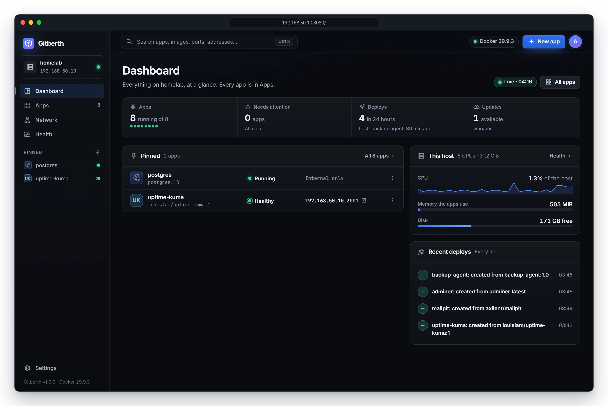

# Gitberth

Deploy your apps from GitHub and run every container on your home server from one web page.



Gitberth is a single container that runs in a Proxmox LXC next to the apps it manages. Paste a GitHub URL, public or private, and it works out how to build the project, builds a Docker image, runs it with your ports, variables and volumes, and deploys every new commit. Images from Docker Hub or any registry, images already on the host, and `docker run` commands or Compose services you paste become apps the same way. So does every container already on the host, whoever started it.

Gitberth is free for personal use. Businesses need a license; see [License](#license).

## What it does

- **Builds from GitHub.** Node.js, Python, Go, .NET, Rust, Ruby, PHP, Java, static sites, or the repo's own Dockerfile, found by looking at the repo. Each push deploys within about 30 seconds, and a deploy that fails its checks leaves the running version in place. [How Gitberth builds your project](docs/reference/build-detection.md)
- **Every container is an app.** The same page, settings and history for an app you deployed, a database you pulled and a container someone started by hand. [Manage apps](docs/guides/manage-apps.md)
- **Shows a change before it makes it.** Each change to a running app says what changes, what's kept and whether the app restarts, before you confirm it. [How deploys work](docs/concepts/how-deploys-work.md)
- **Keeps images up to date.** Checks registries for newer images, then tells you or updates in a window you choose. An update that fails puts the old container back. [Image updates](docs/guides/updates.md)
- **Makes networking visible.** Ports are reachable from your LAN by default, each one can be LAN, host only or internal, a container can have its own LAN address, and the Network page shows who holds every port. [Networking](docs/guides/networking.md)
- **Public domains** through a Cloudflare Tunnel, and **CPU and memory charts** for every container. [Domains](docs/guides/domains.md) · [Health and monitoring](docs/guides/health-and-monitoring.md)

## Install

On a Proxmox host running PVE 9.1 or later (8.4.16 or later on 8.x), create an **unprivileged** Debian 13 LXC with 4 vCPU, 8 GB RAM, a 64 GB disk and a static IP, then run `pct set <id> --features nesting=1,keyctl=1` on the host. Inside the LXC:

```bash
apt update && apt install -y curl
curl -fsSL https://get.docker.com | sh
mkdir -p /opt/gitberth && cd /opt/gitberth
curl -fsSLO https://raw.githubusercontent.com/johnhowelljr/Gitberth/main/docker-compose.yml
curl -fsSL https://raw.githubusercontent.com/johnhowelljr/Gitberth/main/.env.example -o .env
nano .env            # admin password, this machine's LAN address, time zone
docker compose up -d
```

Open `http://<lxc-ip>:8080` and sign in as `admin`. The image, `ghcr.io/johnhowelljr/gitberth`, is ready-made for Intel/AMD and ARM machines. The [installation guide](docs/getting-started/install.md) covers each step, updating, and building from source.

## Documentation

Start with [the documentation's index](docs/README.md), or go straight to:

- [Install Gitberth](docs/getting-started/install.md) and [first steps](docs/getting-started/first-steps.md)
- Add an app: [from GitHub](docs/guides/deploy-from-github.md), [a registry image](docs/guides/run-a-registry-image.md), [a local image](docs/guides/use-a-local-image.md), [a pasted docker run or Compose service](docs/guides/paste-docker-run-or-compose.md)
- [Troubleshooting](docs/guides/troubleshooting.md) and the [FAQ](docs/faq.md)

## Development

- `dotnet test tests/Gitberth.Tests` runs the unit tests. GitHub Actions runs them on every push and pull request. Publishing a release such as `v1.2.0` on GitHub then builds `ghcr.io/johnhowelljr/gitberth:1.2.0`, `:1.2` and `:latest`; a push to `main` builds `:edge`.
- `tests/samples` holds the smallest project of every kind Gitberth builds; `tests/samples/check-remote.ps1` builds and starts them all on a Docker host.
- `tests/Gitberth.UiTests` drives a running Gitberth in a browser. They're skipped unless `GITBERTH_UI_URL` and `GITBERTH_UI_PASSWORD` are set.
- `dotnet run --project src/Gitberth` runs Gitberth locally, with data in `src/Gitberth/App_Data`. Deploys also need the docker CLI and git on your PATH.

## License

Gitberth is source-available, not open source. It's licensed under the [PolyForm Noncommercial License 1.0.0](LICENSE.md):

- **Free:** personal use with no commercial purpose, like your own home server, hobby projects or learning. Charities, schools, public research organizations and government can use it free too.
- **Needs a license:** any use by or for a business, a one-person business included, such as running it at work or hosting apps for clients. Write to business@objectstate.com.
- **Forks and modified versions** come under the same terms. They may be used only for the same free purposes, and every copy has to keep the license and its `Required Notice:` lines.

Contributions are welcome; see [CONTRIBUTING.md](CONTRIBUTING.md) for the terms.
