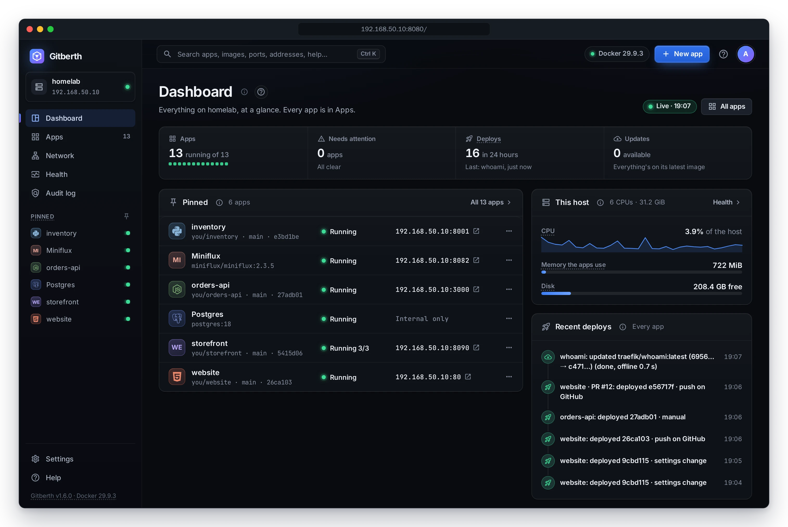

# Gitberth

Deploy your apps from GitHub and run every container on your home server from one web page.



Gitberth is a single container that runs in a Proxmox LXC next to the apps it manages. Paste a GitHub URL, public or private, and it works out how to build the project, builds a Docker image, runs it with your ports, variables and volumes, and deploys every new commit. Images from Docker Hub or any registry, images already on the host, and `docker run` commands or Compose files you paste become apps the same way. So does every container already on the host, whoever started it.

Gitberth is free for personal use. Businesses need a license; see [License](#license).

## What it does

- **Builds from GitHub or GitLab.** Node.js, Python, Go, .NET, Rust, Ruby, PHP, Java, static sites, or the repo's own Dockerfile, found by looking at the repo: a GitHub repo, or a project on gitlab.com or your own GitLab, groups and subgroups too. Each push deploys within about 30 seconds, and a deploy that fails its checks leaves the running version in place. [How Gitberth builds your project](docs/reference/build-detection.md) · [GitLab](docs/guides/gitlab-integration.md)
- **Compose apps.** A repo with a `compose.yaml` (a web app, a worker, Redis) deploys as one app with all its services, with previews and rollbacks like any Git app; a pasted Compose file becomes one app the same way. [Compose apps](docs/guides/compose-apps.md)
- **One-click app templates.** A gallery of popular self-hosted apps (Uptime Kuma, Vaultwarden, n8n, Gitea, Paperless-ngx, Nextcloud and more): pick one, and Gitberth sets it up with its database, generated secrets and domain, then deploys it. [App templates](docs/guides/templates.md)
- **Previews of every pull request.** Each pull request, and each branch if you like, runs next to production with its own address and its own data, with variables for production or for previews, and **Promote** puts a preview's commit into production. [Preview deployments](docs/guides/previews.md)
- **Talks to GitHub, GitLab and you.** Each deploy marks its commit on GitHub or GitLab, a pull request's (or merge request's) preview comments its address, a push deploys at once through a webhook, and a failed deploy or a crash sends a message by email, Discord, Slack, ntfy or webhook. [GitHub integration](docs/guides/github-integration.md) · [GitLab](docs/guides/gitlab-integration.md) · [Notifications](docs/guides/notifications.md)
- **Deploy hooks.** A secret URL per app that deploys it when a CMS, a scheduled job or CI calls it, as on Vercel. [Deploy hooks](docs/guides/deploy-hooks.md)
- **Databases from the app page.** Add a Postgres database or a Redis to any app in a click: Gitberth makes it and its login, and puts the connection string in the app's `DATABASE_URL`. Each preview gets its own, empty or a copy of production's, dropped when it goes. [Databases](docs/guides/databases.md)
- **Every container is an app.** The same page, settings and history for an app you deployed, a database you pulled and a container someone started by hand. [Manage apps](docs/guides/manage-apps.md)
- **An audit log of every change.** Who changed what, from where and how it ended, from a setting to a deploy to a sign-in, and Docker changes made outside Gitberth too, in a tamper-evident file that needs no database server. [Audit log](docs/guides/audit-log.md)
- **AI agents run it too.** An MCP server lets Claude Code, Claude Desktop, VS Code or Cursor list your apps, read their logs, deploy, roll back and change settings, and scripts get the same tools over HTTP. Each agent has a token of its own (read only, operate, or admin), and everything it does is in the audit log under its name. [AI agents and the API](docs/guides/ai-agents.md)
- **Shows a change before it makes it.** Each change to a running app says what changes, what's kept and whether the app restarts, before you confirm it. [How deploys work](docs/concepts/how-deploys-work.md)
- **Keeps images up to date.** Checks registries for newer images, then tells you or updates in a window you choose. An update that fails puts the old container back. [Image updates](docs/guides/updates.md)
- **Makes networking visible.** Ports are reachable from your LAN by default, each one can be LAN, host only or internal, a container can have its own LAN address, and the Network page shows who holds every port. [Networking](docs/guides/networking.md)
- **Public domains** through a Cloudflare Tunnel (see [below](#putting-apps-on-the-internet)), and **CPU and memory charts** for every container. [Domains](docs/guides/domains.md) · [Health and monitoring](docs/guides/health-and-monitoring.md)
- **Uptime checks, a status page and a down page.** Each app is checked from outside the way a visitor reaches it, so a broken tunnel, DNS record or certificate sends a message; a public status page shows 90 days of uptime; and a stopped or held-back app's domain shows a clean "temporarily unavailable" page instead of Cloudflare's error. [Uptime checks, the status page and the down page](docs/guides/uptime-and-status-page.md)

## Putting apps on the internet

Gitberth is built for your LAN. When an app should be reachable from the internet, give it a domain through a **Cloudflare Tunnel** instead of forwarding ports on your router. It's the way Gitberth is designed to publish apps, and the safest one for a home connection:

- **No open ports.** cloudflared, running on the host, connects out to Cloudflare. Nothing on your network accepts connections from the internet, and your home IP address isn't in your DNS records.
- **HTTPS without the work.** Cloudflare serves and renews a certificate for every domain.
- **Cloudflare stands in front.** Its DDoS protection, firewall rules and rate limits apply before a request ever reaches your server.
- **Works on any home connection,** including behind carrier-grade NAT and with an IP address that changes, with no dynamic DNS.
- **A sign-in in front of any app** with Cloudflare Access, for things meant only for you, such as admin pages and dashboards.
- **Gitberth does the wiring.** Add a domain on an app's page and Gitberth creates the tunnel route and the DNS record. Deploys move the domain to the new version without downtime where they can, and removing the domain cleans both up.

Keep Gitberth's own page on your LAN. It controls Docker on the host, so if you want to reach it from outside, put Cloudflare Access in front of it first. [Domains](docs/guides/domains.md) · [Putting a domain in front of Gitberth](docs/concepts/security.md#putting-a-domain-in-front-of-gitberth)

## Install

On a Proxmox host running PVE 9.1 or later (8.4.16 or later on 8.x), create an **unprivileged** Debian 13 LXC with 4 vCPU, 8 GB RAM, a 64 GB disk and a static IP, then run `pct set <id> --features nesting=1,keyctl=1` on the host. Inside the LXC, as root:

```bash
apt update && apt install -y curl
curl -fsSL https://raw.githubusercontent.com/johnhowelljr/Gitberth/main/install.sh | sh
```

The installer sets up Docker if it's missing, checks that the machine can run containers, starts Gitberth, waits until it answers, and prints its address with the username `admin` and a password it made up. If anything's in the way, it says what and how to fix it. Run it again at any time to update Gitberth; your settings and data stay.

The image, `ghcr.io/johnhowelljr/gitberth`, is ready-made for Intel/AMD and ARM machines. The [installation guide](docs/getting-started/install.md) covers the installer's settings, installing by hand, and building from source.

## Documentation

Start with [the documentation's index](docs/README.md), or go straight to:

- [Install Gitberth](docs/getting-started/install.md) and [first steps](docs/getting-started/first-steps.md)
- Add an app: [from GitHub or GitLab](docs/guides/deploy-from-github.md), [a registry image](docs/guides/run-a-registry-image.md), [a local image](docs/guides/use-a-local-image.md), [a pasted docker run or Compose file](docs/guides/paste-docker-run-or-compose.md), [a template](docs/guides/templates.md)
- [Troubleshooting](docs/guides/troubleshooting.md) and the [FAQ](docs/faq.md)

## Development

- `dotnet test tests/Gitberth.Tests` runs the unit tests. GitHub Actions runs them on every push and pull request, with a secret scan of the whole history ([gitleaks](https://github.com/gitleaks/gitleaks); the made-up values the tests use are listed in `.gitleaks.toml`): nothing is released while it finds one. A release such as `v1.2.0`, published on GitHub or made by pushing its tag, then builds `ghcr.io/johnhowelljr/gitberth:1.2.0`, `:1.2` and `:latest`; a push to `main` builds `:edge`.
- `tests/samples` holds the smallest project of every kind Gitberth builds; `tests/samples/check-remote.ps1` builds and starts them all on a Docker host.
- `tests/Gitberth.UiTests` drives a running Gitberth in a browser. They're skipped unless `GITBERTH_UI_URL` and `GITBERTH_UI_PASSWORD` are set.
- `dotnet run --project src/Gitberth` runs Gitberth locally, with data in `src/Gitberth/App_Data`. Deploys also need the docker CLI and git on your PATH.

## License

Gitberth is source-available, not open source. It's licensed under the [PolyForm Noncommercial License 1.0.0](LICENSE.md):

- **Free:** personal use with no commercial purpose, like your own home server, hobby projects or learning. Charities, schools, public research organizations and government can use it free too.
- **Needs a license:** any use by or for a business, a one-person business included, such as running it at work or hosting apps for clients. Write to business@objectstate.com.
- **Forks and modified versions** come under the same terms. They may be used only for the same free purposes, and every copy has to keep the license and its `Required Notice:` lines.

Contributions are welcome; see [CONTRIBUTING.md](CONTRIBUTING.md) for the terms.
