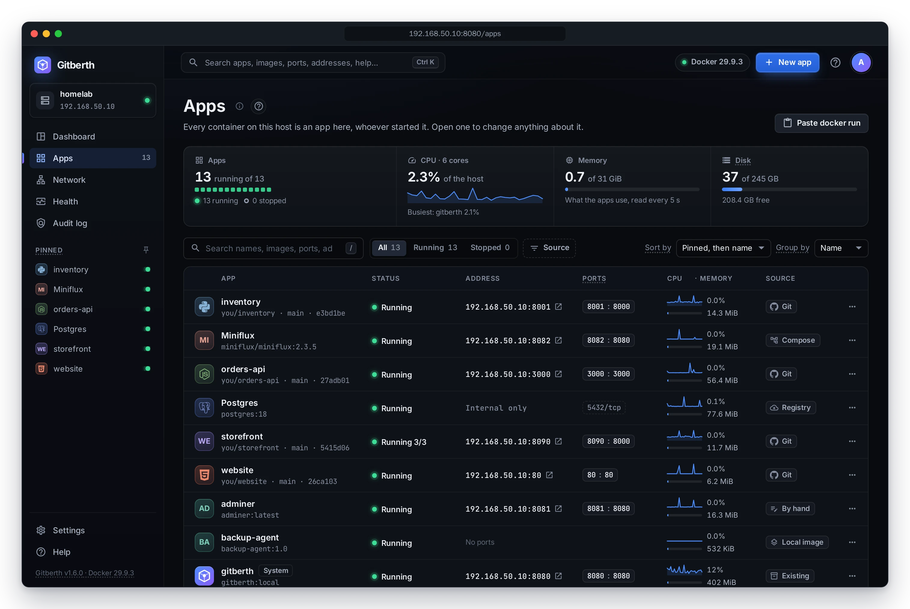

# Gitberth documentation

Gitberth runs apps in Docker on your home server and gives every container on the host one place to be managed: a web page where you add apps, change their settings, watch them run and keep them up to date. Apps come from a GitHub repo or a GitLab project (built for you and redeployed on every push, with Compose when it has a Compose file), a registry image, an image already on the host, a `docker run` command or Compose file you paste, or a template.

These pages are built into Gitberth too: click **?** in its top bar, or **Help** at the foot of its sidebar (see
[Get help in Gitberth](getting-started/first-steps.md#get-help-in-gitberth)). Their examples and screenshots come from a
demo server, `homelab` at `192.168.50.10`; yours show your own host's name and addresses.

## Get started

| | |
|---|---|
| [Install Gitberth](getting-started/install.md) | Create the LXC on Proxmox, install Docker, start Gitberth and sign in. |
| [First steps](getting-started/first-steps.md) | A tour of the pages, getting help inside Gitberth, connecting GitHub, and your first app. |

## Add an app

| | |
|---|---|
| [Add an app](guides/add-an-app.md) | The New app page: its five sources and the three steps every app goes through. |
| [Deploy from GitHub or GitLab](guides/deploy-from-github.md) | Paste a repo URL; Gitberth works out how to build it and redeploys on every push. |
| [Run a registry image](guides/run-a-registry-image.md) | Docker Hub, ghcr.io or your own registry. |
| [Use a local image](guides/use-a-local-image.md) | An image already on the host, with no pull. |
| [Paste a docker run or Compose file](guides/paste-docker-run-or-compose.md) | Bring an existing command, service or whole Compose file across as it is. |
| [Compose apps](guides/compose-apps.md) | A repo's `compose.yaml`, or a pasted one, deployed as one app with all its services. |
| [App templates](guides/templates.md) | Popular self-hosted apps (Uptime Kuma, Vaultwarden, n8n, Nextcloud…) installed in one click with their database, secrets and domain. |

## Run your apps

| | |
|---|---|
| [Manage apps](guides/manage-apps.md) | The Apps list, an app's page, starting and stopping, changing settings, removing. |
| [Environment variables](guides/environment-variables.md) | Variables and secrets, and the ones Gitberth adds. |
| [Deploys and rollbacks](guides/deploys-and-rollbacks.md) | Automatic deploys from Git, the deploy log, and going back to an earlier build. |
| [Preview deployments](guides/previews.md) | A preview of every pull request or branch, variables for production or previews, and Promote. |
| [Databases](guides/databases.md) | A Postgres database or a Redis of an app's own, its connection string set for it, and each preview's own. |
| [Image updates](guides/updates.md) | Checking for newer images, update policies, what happens when an update fails, and rolling one back. |
| [Scheduled jobs and restarts](guides/scheduled-jobs-and-restarts.md) | Commands on a schedule, and restarts on a timer. |
| [Deploy hooks](guides/deploy-hooks.md) | Secret URLs that deploy an app when a CMS, a scheduled job or CI calls them. |

## Networks and domains

| | |
|---|---|
| [Networking](guides/networking.md) | Ports, who can reach them, own LAN addresses and the Network page. |
| [Domains](guides/domains.md) | Public domains through a Cloudflare Tunnel, and protecting them with a sign-in. |

## Watch your apps

| | |
|---|---|
| [Health and monitoring](guides/health-and-monitoring.md) | The Health page, CPU and memory charts, and health checks. |
| [Uptime checks, the status page and the down page](guides/uptime-and-status-page.md) | Each app checked from outside, a public status page, and a clean page while an app can't be served. |
| [Notifications](guides/notifications.md) | A message by email, Discord, Slack, ntfy or webhook when a deploy fails, an app crashes or goes down. |
| [Audit log](guides/audit-log.md) | Every change, who made it, from where and how it ended, Docker changes made outside Gitberth too; search, export and check it. |

## Connect other tools

| | |
|---|---|
| [GitHub integration](guides/github-integration.md) | Deploys reported on commits and pull requests, and deploys that start the moment you push. |
| [GitLab](guides/gitlab-integration.md) | Deploy from gitlab.com or your own GitLab: merge request previews, CI/CD variables, statuses, a comment on each merge request, and instant deploys. |
| [AI agents and the API](guides/ai-agents.md) | Let Claude Code, VS Code, Cursor, Claude Desktop or a script see and run your apps over MCP or HTTP, each with a token of its own. |

## Look after Gitberth

| | |
|---|---|
| [Backups and restore](guides/backups-and-restore.md) | What to back up, and moving Gitberth to a new machine. |
| [Updating Gitberth](guides/updating-gitberth.md) | Getting a new version, pinning one, and going back. |
| [Troubleshooting](guides/troubleshooting.md) | What a message means and what to do about it. |
| [FAQ](faq.md) | Short answers to common questions. |

## Reference

| | |
|---|---|
| [How Gitberth builds your project](reference/build-detection.md) | Every project type it recognises, and how each is built. |
| [Railpack builds](reference/railpack.md) | Railway's builder, for the projects Gitberth doesn't know and the apps set to it. |
| [App settings](reference/app-settings.md) | Every field on an app's Settings, Environment and Network tabs. |
| [Gitberth settings](reference/gitberth-settings.md) | The Settings page, section by section. |
| [Tools for AI agents and the HTTP API](reference/api.md) | Every tool an agent or script can call, the access it needs, and its arguments. |
| [Configuration](reference/configuration.md) | Gitberth's own environment variables, volume and port. |

## Concepts

| | |
|---|---|
| [Architecture](concepts/architecture.md) | The pieces and how they fit together. |
| [How deploys work](concepts/how-deploys-work.md) | What happens, step by step, during a deploy, an update and a settings change. |
| [Security](concepts/security.md) | Sign-in, secrets, the Docker socket, and putting Gitberth behind a domain. |
