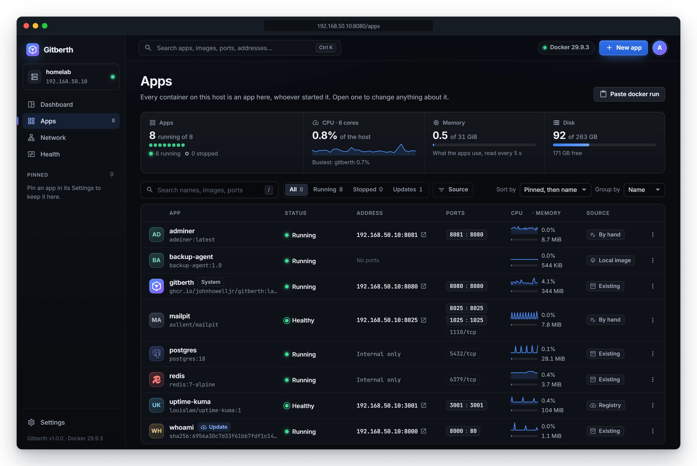

# Gitberth documentation

Gitberth runs apps in Docker on your home server and gives every container on the host one place to be managed: a web page where you add apps, change their settings, watch them run and keep them up to date. Apps come from a GitHub repo (built for you and redeployed on every push), a registry image, an image already on the host, or a `docker run` command or Compose service you paste.

## Get started

| | |
|---|---|
| [Install Gitberth](getting-started/install.md) | Create the LXC on Proxmox, install Docker, start Gitberth and sign in. |
| [First steps](getting-started/first-steps.md) | A tour of the pages, connecting GitHub, and your first app. |

## Add an app

| | |
|---|---|
| [Deploy from GitHub](guides/deploy-from-github.md) | Paste a repo URL; Gitberth works out how to build it and redeploys on every push. |
| [Run a registry image](guides/run-a-registry-image.md) | Docker Hub, ghcr.io or your own registry. |
| [Use a local image](guides/use-a-local-image.md) | An image already on the host, with no pull. |
| [Paste a docker run or Compose service](guides/paste-docker-run-or-compose.md) | Bring an existing command or service across as it is. |

## Run your apps

| | |
|---|---|
| [Manage apps](guides/manage-apps.md) | The Apps list, an app's page, starting and stopping, changing settings, removing. |
| [Environment variables](guides/environment-variables.md) | Variables and secrets, and the ones Gitberth adds. |
| [Deploys and rollbacks](guides/deploys-and-rollbacks.md) | Automatic deploys from Git, the deploy log, and going back to an earlier build. |
| [Image updates](guides/updates.md) | Checking for newer images, update policies, what happens when an update fails, and rolling one back. |
| [Scheduled jobs and restarts](guides/scheduled-jobs-and-restarts.md) | Commands on a schedule, and restarts on a timer. |
| [Networking](guides/networking.md) | Ports, who can reach them, own LAN addresses and the Network page. |
| [Domains](guides/domains.md) | Public domains through a Cloudflare Tunnel. |
| [Health and monitoring](guides/health-and-monitoring.md) | The Health page, CPU and memory charts, and health checks. |

## Look after Gitberth

| | |
|---|---|
| [Backups and restore](guides/backups-and-restore.md) | What to back up, and moving Gitberth to a new machine. |
| [Updating Gitberth](guides/updating-gitberth.md) | Getting a new version, pinning one, and going back. |
| [Troubleshooting](guides/troubleshooting.md) | What a message means and what to do about it. |
| [FAQ](faq.md) | Short answers to common questions. |

## Reference

| | |
|---|---|
| [How Gitberth builds your project](reference/build-detection.md) | Every project type it recognises, and how each is built. |
| [App settings](reference/app-settings.md) | Every field on an app's Settings, Environment and Network tabs. |
| [Gitberth settings](reference/gitberth-settings.md) | The Settings page, section by section. |
| [Configuration](reference/configuration.md) | Gitberth's own environment variables, volume and port. |

## Concepts

| | |
|---|---|
| [Architecture](concepts/architecture.md) | The pieces and how they fit together. |
| [How deploys work](concepts/how-deploys-work.md) | What happens, step by step, during a deploy, an update and a settings change. |
| [Security](concepts/security.md) | Sign-in, secrets, the Docker socket, and putting Gitberth behind a domain. |
