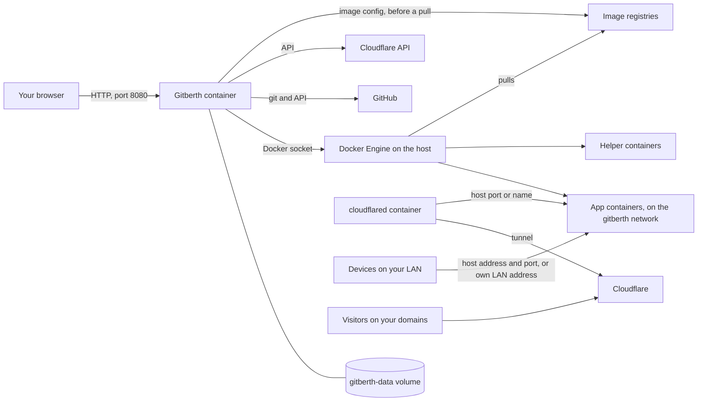

# Architecture

Gitberth is one container that runs next to the apps it manages, on the same Docker host. It has no database server, queue or reverse proxy of its own: it keeps its data in SQLite files in one volume, and does everything else through the host's Docker engine. This page shows the pieces and how they connect.

## The pieces

- **Gitberth container.** An ASP.NET Core app with a Blazor Server UI. The page in your browser keeps a live connection to it, so pages update as things change. It signs you in with a cookie and runs its background work in the same process.
- **The `gitberth-data` volume.** `gitberth.db` (settings, apps, history and encrypted secrets), the encryption keys, deploy logs, and `stats.db` for the Health charts. See [Configuration](../reference/configuration.md#the-data-volume).
- **Docker Engine.** Gitberth reaches it through the mounted socket, two ways: the docker CLI (with BuildKit through buildx) for builds and for starting a Git app's containers, and the Engine API for everything it reads (containers, images, networks, stats, events) and for pulls, registry sign-ins and recreating containers.
- **GitHub.** `git ls-remote` to watch branches, a shallow `git clone` to build, and GitHub's API to check the token and read and write a repo's variables.
- **Image registries.** Docker pulls images and Gitberth asks registries for the newest digest of a tag, through the engine, with the sign-ins saved in **Settings › Registries**. For a new app whose image isn't on the host yet, Gitberth reads the image's manifest and configuration straight from its registry, without pulling it, so **New app** can show its ports, volumes and health check.
- **Cloudflare.** Only when domains are on: Gitberth edits the tunnel's routes and the DNS records through Cloudflare's API. cloudflared, a container on the host, carries the visitors; Gitberth isn't in their path.
- **Helper containers.** Short-lived containers on Gitberth's own image that read the host's network: which ports are listening, the default route and the host's addresses, and whether addresses on the LAN answer. They run read-only, with no capabilities and 32 MiB of memory.
- **App containers.** Every container on the host is an app, whoever started it. Those Gitberth makes are on the shared `gitberth` network, where they reach each other by name.

## Background work

Besides answering the UI, Gitberth runs these in its own process:

| Task | What it does |
|---|---|
| Repo watcher | Runs one `git ls-remote` per repo, every 30 seconds by default, and queues a deploy when a branch moves. Retries a failed build a bounded number of times. |
| Deploy queue | Runs one deploy at a time per app; a newer request replaces one that's still waiting. One image build runs at a time across all apps. |
| Update watcher | Checks images for a newer digest, every 6 hours by default (apps set to **When I ask** are left out), and runs automatic updates in their window. |
| Domain removal retry | Every 15 minutes, while domains are on, tries again to take out of Cloudflare the routes and DNS records of domains whose removal failed, and, when Cloudflare couldn't take the change or Cloudflare Access failed for a moment, to finish protecting a domain, taking its protection off, or removing a removed domain's Access application. An Access application Cloudflare refused to remove is tried once more after **Check again** in Settings › Domains › Protection finds Access working. |
| Stats collector | Reads every running container's CPU, memory and network every 5 seconds, and keeps 6 hours. |
| Event watcher | Follows Docker's events (starts, stops, crashes, health changes) for the Health charts and each app's **Activity**. |
| Network keeper | Joins containers again to the networks Gitberth keeps them on when something else recreates them. |
| App sync | Notices when a container is recreated outside Gitberth, and reads its settings again. |
| Job and restart schedulers | Run Git apps' scheduled jobs from `vercel.json`, and scheduled restarts of any container. |
| Startup tasks | After a restart: mark interrupted deploys as failed, finish or undo container changes that were cut short, start apps whose containers are missing, and remove leftover temporary containers. |

## How an app is reached

- **From your LAN:** at the host's address and a host port, through Docker's own port bindings, or at the container's own LAN address on `gitberth-lan`. See [Networking](../guides/networking.md).
- **From other containers:** by name on a shared Docker network, like `postgres:5432`.
- **From the internet:** through Cloudflare and cloudflared, to the app's web port. See [Domains](../guides/domains.md).

Gitberth itself is never in the path of an app's traffic, so apps keep answering while Gitberth restarts or updates.

## What Gitberth isn't

- **Not a cluster manager.** One Gitberth manages one Docker host.
- **Not a reverse proxy.** It doesn't terminate TLS itself; domains get HTTPS from Cloudflare.
- **Not in charge of Compose.** It shows and manages Compose containers, but gives a change that needs a recreate as lines for the Compose file, rather than fighting Compose.

## Related

- [How deploys and changes work](how-deploys-work.md)
- [Security](security.md)
- [Configuration](../reference/configuration.md)
