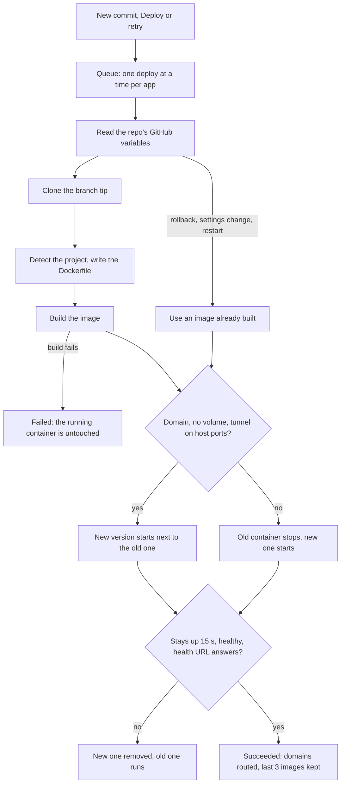
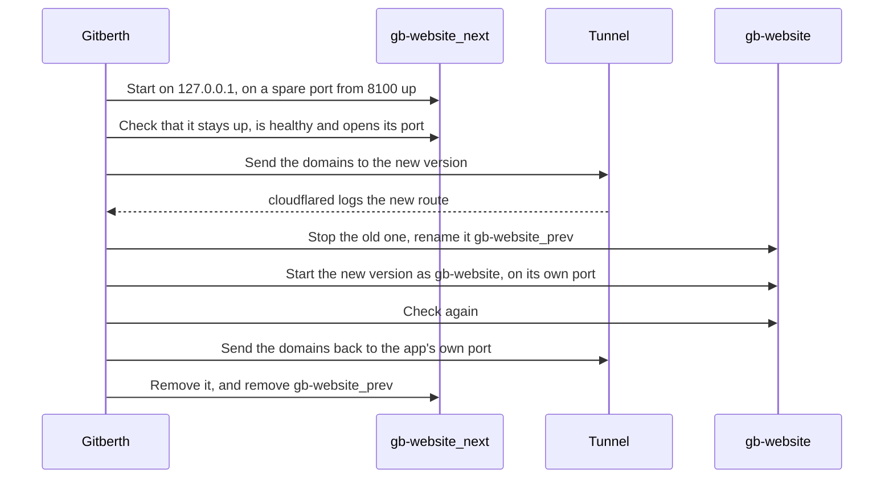
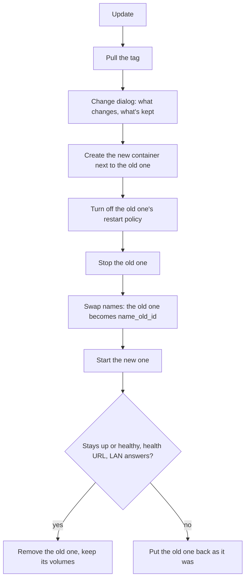

# How deploys and changes work

Gitberth changes a running app in three ways: a Git deploy builds a new image from the repo and swaps the container, an image update pulls a newer image and recreates the container on it, and a settings change does whichever is least disruptive, from nothing at all to a recreate. Each one checks the new container before it takes over, and puts the old one back when the check fails. This page walks through each, step by step.

## A Git deploy

A deploy starts when Gitberth sees a new commit on the app's branch (**New commit**), when you click **Deploy** (**Manual**), when a failed build is tried again (**Automatic retry**), and for an app's **First deploy**. The deploy's page shows these on its tag, and its state as it goes: **Queued**, **Cloning**, **Building**, **Starting**, then **Succeeded**, **Failed**, **Rolled back** or **Cancelled**.

1. **Queue.** Each app has its own queue and runs one deploy at a time. A deploy queued while another waits replaces it; the one replaced says **Superseded by a newer deploy**.
2. **Variables.** Gitberth reads the repo's GitHub Actions variables, and the app's own values in Gitberth win over them. If GitHub can't be reached, it uses an encrypted copy of the last successful read, and the log says so. `PORT`, `HOST`, `HOSTNAME`, `ASPNETCORE_URLS` and `ASPNETCORE_HTTP_PORTS` from GitHub are ignored, because Gitberth sets where the app listens.
3. **Clone.** A shallow clone of the branch's newest commit, into a work folder in Gitberth's volume. The log names the commit and its author.
4. **Dockerfile.** Your custom Dockerfile when the app has one, else the repo's own Dockerfile, else one Gitberth writes for what it detected (see [How Gitberth builds](../reference/build-detection.md)). It's written outside the clone, so your repo is never changed. When the app now listens on another port than before, its container port moves with it, unless you set that port yourself. `vercel.json` cron jobs are read here too.
5. **Build.** `docker build` with BuildKit, one build at a time across all apps. The build runs on the host's network with every container on `gitberth` added by name, so a build step can reach `postgres:5432`. In a Dockerfile Gitberth writes, secret values go in as BuildKit secrets, so they're never written into the image's history, and other values as build arguments; a Dockerfile in your repo gets build arguments for the `ARG`s it declares. The image is `gitberth/<app>:<commit>`. A build that fails ends the deploy here, and the running container isn't touched.
6. **Swap.** If the app has a domain and can swap without downtime, the new version starts next to the old one (see [Deploys without downtime](#deploys-without-downtime)). Otherwise the old container stops and is renamed `gb-<app>_prev`, and the new one starts as `gb-<app>`. An app that was stopped while the deploy waited isn't started again.
7. **Checks.** The new container has to stay up for 15 seconds: no exit, no restart, not out of memory. A container with a Docker health check has to report healthy, within 60 seconds after that. Then, if the app has a health URL, it has to answer below 400 within 60 seconds.
8. **Done.** Gitberth records the new image and commit, makes the app's domains point at the running container, and keeps the images of the last 3 successful deploys for rollbacks.

When the checks fail, Gitberth writes the new container's last output into the log, removes it, and starts the previous container again: the deploy ends **Rolled back** with **Rolled back to the previous container.**

**Rollbacks, settings changes and scheduled restarts** of a Git app are deploys without a build: they skip the clone and build, and start from an image that's already on the host, with the same swap and checks. A rollback goes to the image of the deploy you picked, and is offered only while that image is still on the host. **Start** of a Git app whose container is gone is one too when its last image is still on the host; when it isn't, **Start** runs a full deploy of the branch.

## Deploys without downtime

For an app with a domain, the new version starts next to the old one, and the domain's visitors move to it before the old one stops.

- The temporary container publishes only the web port, on `127.0.0.1`, where the tunnel reaches it and the LAN doesn't. Other apps only reach it by the app's name once it has passed its checks.
- A new version that fails its checks never interrupts the running one: the log says **The new version didn't pass its checks, so the current one kept running throughout.**
- Gitberth waits up to 20 seconds for cloudflared to log that it runs the changed route. If the tunnel can't be changed, the deploy carries on the usual way.
- People who open the app by its host port, rather than its domain, still see a few seconds' gap.

It's used when domains are on, the app has a domain and is running, cloudflared runs on the host's network, the web port is published (LAN or Host only) and isn't moving with this deploy, and a spare host port is free. **An app with a volume always swaps the usual way**, because two copies writing the same files at once isn't safe. When it can't be used, the log says why, starting with **The swap takes a few seconds of downtime:**.

## An image update

An app that runs an image updates through the change engine, the same one that recreates any container for a change.

1. **Pull.** Gitberth pulls the tag the app follows, before anything else. If the tag moves again during the pull, or the app already runs that image, it stops there and says so.
2. **Review.** The change dialog shows what changes, what's kept and the impact. Nothing changes until you click **Update**.
3. **Recreate.** The steps below, under [The change engine](#the-change-engine), with the new image.
4. **Afterwards.** The image the app ran before stays on the host, for **Roll back**; the one before that is removed once no container uses it and no other app keeps it for its own **Roll back**. The **Updates** card reads the app's status again.

An automatic update runs the same steps without the dialog, in the window set in **Settings › Updates**. See [Image updates](../guides/updates.md).

**A rollback** of an image update takes the same path back: nothing is pulled, the change dialog shows the plan, and the change engine recreates the container on the image the app ran before its last update, with the same checks. Once it's done, there's nothing left to roll back to, and an app set to **Automatically** goes back to **Tell me**. See [Roll back an update](../guides/updates.md#roll-back-an-update).

## A settings change on any other app

For an app that isn't built from Git, each setting applies in the least disruptive way it can. The change dialog tags the lines that don't recreate the container with **Gitberth** or **no restart**:

| How it applies | Settings | What happens |
|---|---|---|
| Gitberth's own data (**Gitberth**) | Name, pinned, **Gather stats**, health URL, update choice, the web port marker | Saved at once. Nothing in Docker changes. |
| In place (**no restart**) | Restart policy, memory, CPU and process limits | Docker changes them in place (`docker update`). When nothing else changes, the button is **Apply, no restart**. |
| Network | Joining or leaving a network, an own LAN address | Instant; nothing restarts. |
| Recreate | Everything else: image, command, environment, ports, volumes, health check, labels, logging and the advanced settings | The change engine recreates the container. |
| Compose | Anything that needs a recreate, on a container Docker Compose manages | Gitberth gives the lines for the Compose file and the command to run, and changes nothing itself. |
| No container | Any setting, while the app has no container | Saved, and used when the container is created. |

### The change engine

When a container has to be recreated, for a setting, a port or an update:

1. **Preflight.** Gitberth checks the change, that the temporary names are free, and that new host ports are free (it binds them for a moment to be sure).
2. **Create.** The new container is created next to the old one, without a restart policy yet. A setting Docker refuses fails here, while nothing has stopped.
3. **Disarm.** The old container's restart policy goes to "no", so nothing starts it next to the new one.
4. **Stop.** The old one stops, with its own stop signal and timeout: 60 seconds for a database without one of its own, Docker's 10 seconds for anything else.
5. **Swap names.** The old one becomes `<name>_old_<id>`, and the new one takes the name.
6. **Start and check.** The new one starts and has to stay up for 15 seconds, or report healthy when it has a health check, publish every port, answer its health URL if it has one, and answer at its LAN address (checked from the host) if the old one answered there.
7. **Finish.** It gets its restart policy, and the old container is removed, never with its volumes.

If a step fails, each one has its undo: the old container comes back as it was, with its name and restart policy, and the dialog says **Not applied: … runs as before**. A stopped container is recreated stopped, and its original is kept until the new one's first start passes the same checks.

Gitberth writes each step down as it goes. If Gitberth restarts in the middle of a change, it finishes or undoes it when it starts again; when it can't tell which, the app's page asks you with **A change is waiting for you**.

**What stays and what changes.** The new container keeps the old one's name, image (unless the change is the image), command, environment, volumes (anonymous ones too), networks with its names and fixed IPs, restart policy, limits, health check and hostname. Its container ID, start time, restart count and log so far change. Files it wrote outside its volumes are lost, and the dialog names them.

## A settings change on a Git app

A Git app's settings are saved in Gitberth first, then made live:

- **Restart policy, memory and CPU** change at once, without a restart.
- **Most other settings** (environment, ports, volumes, health check) apply with a deploy without a build, through the same swap and checks as a deploy. **Save for next deploy** keeps them for later instead, and the app shows **Saved, not live yet** with **Apply now**.
- **Settings that change the build** (branch, folder, build settings, build-time variables) need a new build: **Rebuild and deploy**.

## Related

- [Deploys and rollbacks](../guides/deploys-and-rollbacks.md)
- [Image updates](../guides/updates.md)
- [Networking](../guides/networking.md)
- [Architecture](architecture.md)
