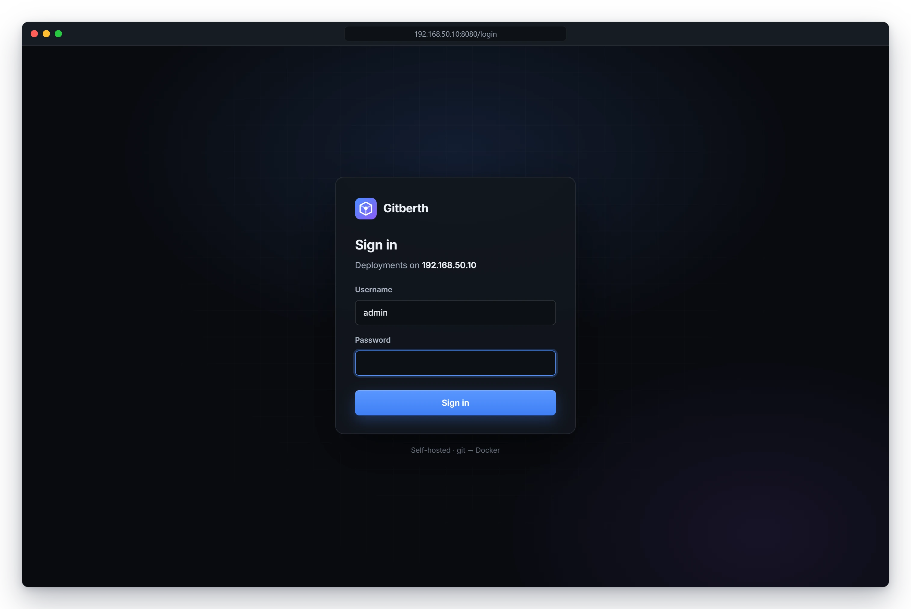

# Security

Gitberth drives the Docker engine on the host, so whoever signs in to Gitberth can do anything Docker can on that machine. This page describes how sign-in works, how Gitberth stores the secrets you give it, what access it has to the host, and what to do before you put its page on a domain.

## Sign-in and the lockout

- **One account.** The user name is `admin`. There are no other users or roles.
- **The first password** comes from `GITBERTH_ADMIN_PASSWORD` in `.env`, read on the first start only. If it's empty, Gitberth generates a 20-character password and prints it once in its log (`docker compose logs gitberth`).
- **Changing it.** In **Settings › Admin password**, with the current password, and a new one of at least 10 characters. Changing it signs every other browser out (see Sessions below).
- **How it's stored.** As a salted PBKDF2-SHA256 hash, with 210,000 iterations, in Gitberth's database. The password itself isn't kept.
- **Sessions.** Signing in sets an HTTP-only cookie, `gitberth.auth`, that lasts 14 days from your last visit. **Sign out** is in the account menu (**A**) at the top right. Each sign-in is tied to the password it was made with, so changing the password signs every other browser out: on its next request, and within a minute for a page that's left open. The browser you changed it in stays signed in, and says **Password changed. Every other browser is signed out.**
- **The lockout.** After 5 failed sign-ins within 15 minutes from the same address, that address gets **Too many failed attempts. Try again in a few minutes.** until 15 minutes after the first failure, even with the right password. The count is kept in memory, so restarting Gitberth clears it. Gitberth counts by the address a request reaches it from: through Cloudflare Tunnel, every visitor arrives from cloudflared's side, so they share one count.

Gitberth serves its page over plain HTTP on port 8080. Through a domain, Cloudflare serves it over HTTPS.

If you lose the password, see [Forgot the admin password](../guides/troubleshooting.md#forgot-the-admin-password).

## How secrets are stored

Gitberth encrypts these at rest in its database, with ASP.NET Core Data Protection:

- the GitHub token and the Cloudflare API token;
- registry passwords and tokens;
- every environment variable value set in Gitberth, secret or not;
- the copy it keeps of each repo's GitHub variables, used when GitHub can't be reached during a deploy;
- the saved settings of apps from images, which Gitberth uses to create a missing container again.

The keys are in `/data/keys`, in the same volume as the database. Anyone with a copy of the volume can read the secrets, so keep backups private. Keep the keys with the database: without them, Gitberth can't read the secrets, and tokens, passwords and variable values have to be entered again. **Settings › Registries** marks a sign-in whose password it can't read with **needs its password again: enter it below**.

**Where secrets go:**

- **On screen and in logs**, values are masked (`••••`) when they're marked **Secret**, when their name looks secret (like `DATABASE_PASSWORD` or `TUNNEL_TOKEN`), or when they're a URL with a password in it. The same goes for secret-looking options in a command, like `--token`. Build logs mask the app's secret values too.
- **To a container**, environment values are passed in the process environment, never on `docker`'s command line. Once a container runs, its environment is part of its settings in Docker, as with any container: anyone who can use Docker on the host can read it with `docker inspect`.
- **To a build**, secret values go in as BuildKit secrets in a Dockerfile Gitberth writes, so they're never written into the image's history.
- **To git**, the GitHub token goes through git's configuration in the environment, never into `.git/config`, the remote URL or the process arguments.
- **To Docker**, a registry sign-in is passed with each pull or check that needs it. It's never logged.
- **To a registry**, when **New app** reads an image that isn't on the host yet, Gitberth sends the registry's saved sign-in itself, over HTTPS only.

A repo's GitHub Actions variables aren't secret: anyone who can see the repo can read them. Use **Secret** variables in Gitberth for passwords and keys (see [Environment variables](../guides/environment-variables.md)).

## The Docker socket

Gitberth mounts the host's Docker socket, `/var/run/docker.sock`, and runs as root in its container. Access to that socket is root-equivalent on the host: whoever controls Gitberth controls Docker, and through it the machine.

- **Builds** of your repos run with the host's network, so a build step can reach the containers on the `gitberth` network by name, and anything else the host can reach.
- **Helper containers** that read the host's network run Gitberth's own image, read-only, with no capabilities, 32 MiB of memory and no log.
- **Gitberth's own container** can't be stopped, removed or recreated from its page.

## Where Gitberth connects

- `github.com` with git, and `api.github.com`, for repos, the token and repo variables.
- Image registries, through the Docker engine, for pulls and update checks, and directly, when **New app** reads an image's ports, volumes and health check before it's pulled. `hub.docker.com` for the image search in **New app**.
- `api.cloudflare.com`, only while domains are on.
- Your apps, for their health URLs and scheduled jobs.

## Putting a domain in front of Gitberth

Gitberth's own page is an app like any other, so you can give it a domain on its **Network** tab. With a domain, a single password is all that stands between the internet and Docker on your host. Put Cloudflare Access in front of the domain before you add it:

1. In Cloudflare's Zero Trust dashboard, create an Access application for the hostname you'll use, like `gitberth.example.com`, with a policy that lets in only you.
2. Add the domain on Gitberth's **Network** tab (see [Domains](../guides/domains.md)).
3. Open the hostname in a private browser window, and check that Cloudflare asks you to sign in before Gitberth's sign-in page shows.

Gitberth keeps a route's settings when it rewrites the route, Cloudflare Access included. With [protection](../guides/domains.md#protect-a-domain) set up, you can instead turn on **Protected** next to the domain and let Gitberth make the Access application.

## GitHub's webhook

With [instant deploys](../guides/github-integration.md#instant-deploys) on, one address is open to the internet without a sign-in: `https://<the host name you chose>/hooks/github`, and nothing else on that host name but deploy hooks' (below). It only accepts deliveries signed with the secret Gitberth made (HMAC-SHA256, compared in fixed time), refuses bodies over 1 MB, answers a sender that keeps getting the signature wrong with `429` for 10 minutes, and never deploys anything by itself: it only makes Gitberth check the repo now, as it would anyway within 30 seconds.

## Deploy hooks

A [deploy hook](../guides/deploy-hooks.md)'s URL, `/hooks/deploy/<token>`, does deploy, with no sign-in: its token is all that guards it, so keep it as you would a password. The token is 32 random bytes; Gitberth keeps it encrypted, and finds a call's hook by the token's SHA-256. An unknown token gets `404`, and after 10 of them in 10 minutes from one address, that address gets `429`. The URLs answer on your network, and from the internet only on the host name above. A hook whose URL got out is deleted in a click; a new one gets a new URL.

## Related

- [Configuration](../reference/configuration.md)
- [Back up and restore](../guides/backups-and-restore.md)
- [Architecture](architecture.md)
- [Gitberth's settings](../reference/gitberth-settings.md#admin-password)
