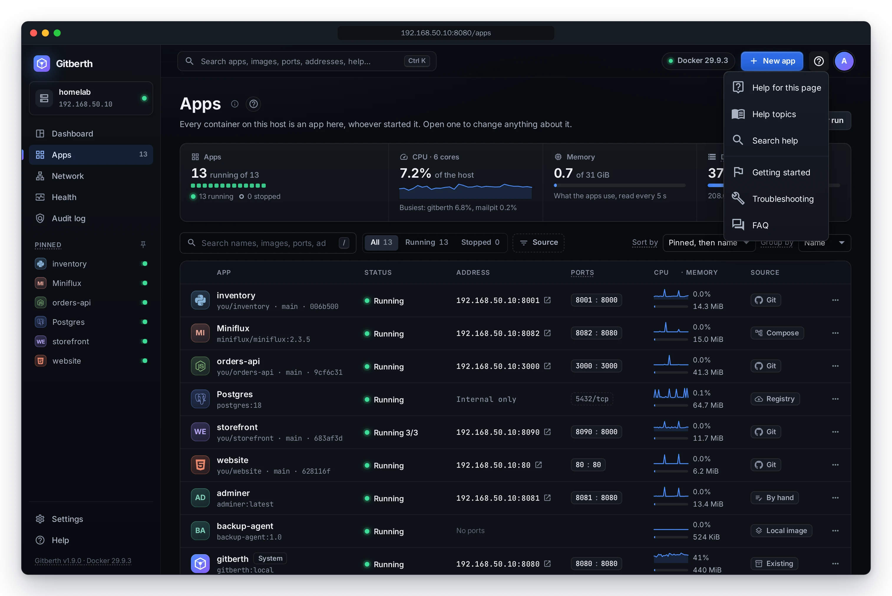
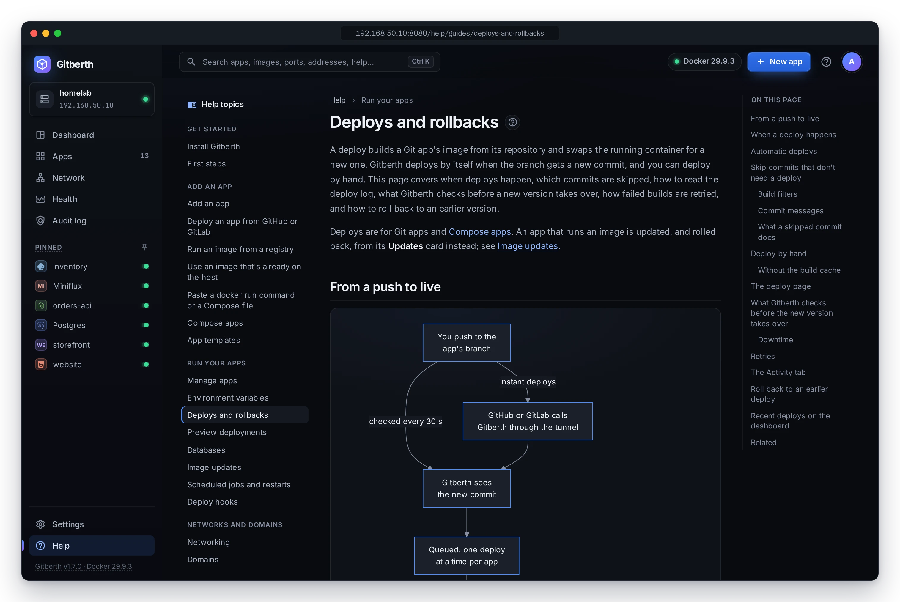
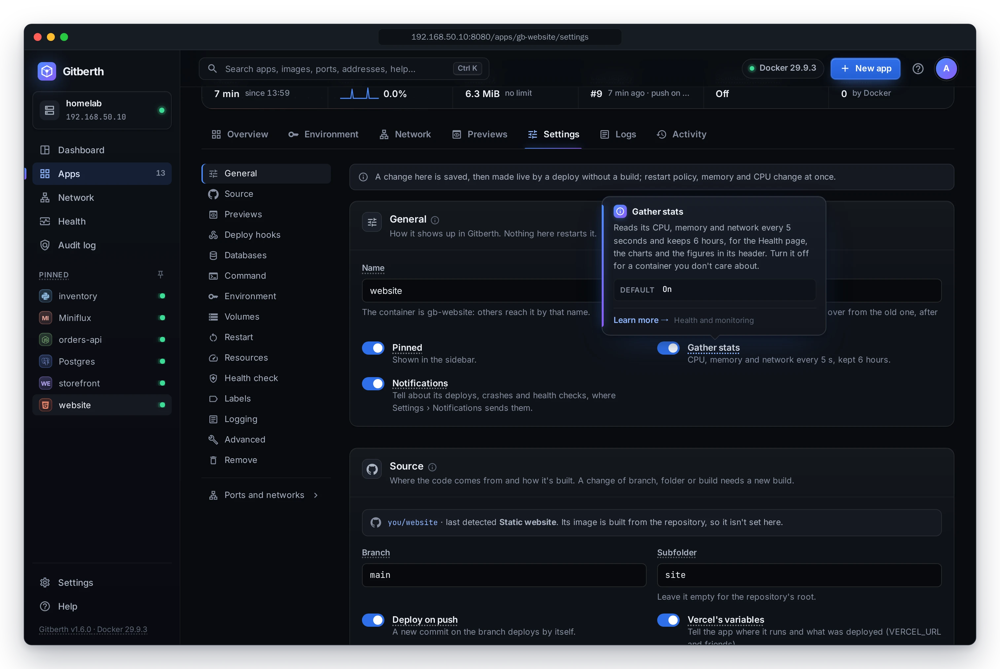
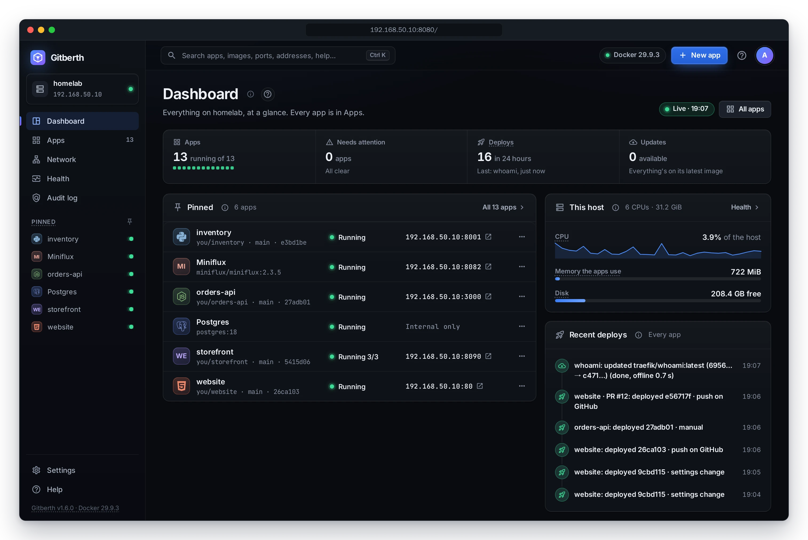
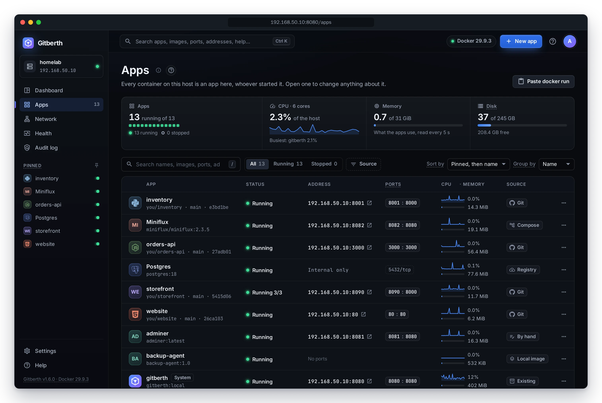
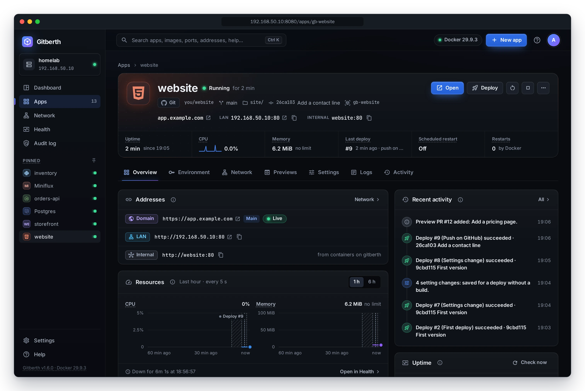
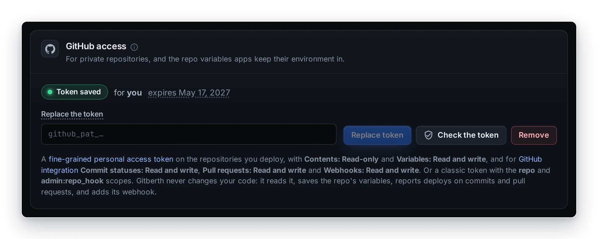

# First steps

This page is a short tour of Gitberth after you sign in for the first time: what's on each page, where to find help, how
to connect GitHub for private repositories, and where to go to run your first app. It assumes you've
[installed Gitberth](install.md) and can open `http://192.168.50.10:8080` (your own host's address in its place).

## Sign in

Open Gitberth and sign in as `admin` with the password from your `.env` file, or the generated one from
`docker compose logs gitberth`. The **A** button at the top right has **Settings** and **Sign out**.

## Find your way around

The sidebar on the left holds:

- **The host card** at the top: this machine's name and LAN address, with a dot that shows whether Gitberth can read
  Docker. Click it to open the Health page.
- **Dashboard**, **Apps**, **Network**, **Health** and **Audit log**. The number next to **Apps** is how many apps are
  running.
- **Pinned**: the apps you've pinned, with their state.
- **Settings**, **Help**, and the versions of Gitberth and Docker, like `Gitberth v1.8.0 · Docker 28.5.1`, at the bottom.

The top bar has a search box, the Docker engine's version (or **Docker offline**), the **?** button for help, the
**New app** button and the account menu. While something needs you now, such as a token its service refused, a pill
before the **?** says what; click it to go where it's put right. Press **Ctrl K** to jump to the search. It finds apps by name, image, port or
address; **Enter** opens the one highlighted, and **All matches in Apps** opens the Apps list filtered by what you typed.

## Get help in Gitberth

These docs are built into Gitberth, so they work without the internet:

- **?** in the top bar opens the help menu:
  - **Help for this page** opens the page of these docs about the page you're on, at the right heading.
  - **Help topics** lists every page, in sections.
  - **Search help** finds a page or a heading by its words.
  - **Getting started**, **Troubleshooting** and **FAQ** open those pages.
- **Help** at the foot of the sidebar opens the help's start page, with its search.
- **Tips.** A label with a dotted underline, or a small info icon next to one, shows a tip when you point at it, tab to
  it or tap it: what the setting does, when to change it, and its default. **Learn more** in the tip opens the help page
  that explains it. **Esc** closes the tip.

## The dashboard

The dashboard shows the whole host at a glance:

- **Apps**: how many are running, out of how many.
- **Needs attention**: apps that crashed, report unhealthy, or whose container is gone.
- **Deploys**: how many deploys ran in the last 24 hours, and the last one.
- **Updates**: apps with a newer image available. Apps set to update **When I ask** aren't counted.

Below these are the apps that need attention, your pinned apps, **This host** (CPU, the memory the apps use, and disk),
and **Recent deploys** of every app. The **Live** pill at the top says the figures are current; they're read every 5
seconds. **All apps** opens the Apps list.

Above the figures, a banner says when something needs your attention, such as Docker's disk getting full or a token
about to expire, and its buttons lead to where it's put right. It goes by itself once it's dealt with. One that can
wait has a dismiss button: dismissed, it stays hidden until it has something new to say. The GitHub, GitLab and
Cloudflare tokens get one 3 weeks, a week and a day before they expire (an API token in use, a week and a day before),
and a red one with a pill in the top bar on every page once one has expired, or its service refused it, as for a
registry sign-in (see [Tokens and sign-ins](../guides/troubleshooting.md#tokens-and-sign-ins)).

## Apps

**Apps** lists every container on the host, whoever started it: the ones Gitberth built from GitHub or GitLab, images
you started from Gitberth, Compose apps, and containers started some other way, such as a database you ran by hand. Each
one is an app you can open, start, stop and change.

Click an app's name to open its page. The header shows its state, addresses, uptime, CPU and memory, and its buttons.
The tabs sit below it: **Overview**, **Environment**, **Network**, **Previews** (for an app from Git), **Settings**,
**Logs** and **Activity**.

[Manage apps](../guides/manage-apps.md) explains the list and the app page in full.

## The other pages

- **Network** lists every host port in use and who uses it, lets you check whether a port is free, and shows Docker's
  networks. See [Networking](../guides/networking.md).
- **Health** charts CPU, memory and network traffic for every container over the last 6 hours. See
  [Health and monitoring](../guides/health-and-monitoring.md).
- **Audit log** lists every change to Gitberth and its apps: who made it, from where, and how it ended. See
  [Audit log](../guides/audit-log.md).
- **Settings** holds GitHub and GitLab access, notifications, registry sign-ins, update checks, domains, uptime checks
  and the status page, the network, deploys, apps' databases, your password, tokens for AI agents, and the audit log's
  settings. See [Gitberth's settings](../reference/gitberth-settings.md).

## Connect GitHub

Public repositories need nothing. To deploy private ones, and to keep an app's environment variables in its repo, give
Gitberth a GitHub token.

1. On GitHub, create a [fine-grained personal access token](https://github.com/settings/personal-access-tokens/new).
2. Under **Repository access**, choose **Only select repositories** and pick the repos you'll deploy.
3. Under **Permissions**, set **Contents** to **Read-only** and **Variables** to **Read and write**. Variables are where
   apps from a repo keep their environment (see [Environment variables](../guides/environment-variables.md)). For
   deploys reported on GitHub and instant deploys, also set **Commit statuses**, **Pull requests** and **Webhooks** to
   **Read and write** (see [GitHub integration](../guides/github-integration.md)).
4. Copy the token.
5. In Gitberth, go to **Settings** › **GitHub access**, paste it into **Token** and click **Save token**.

   Gitberth shows **Token saved**, the GitHub account it belongs to, and when it expires.

A classic token with the `repo` scope (and `admin:repo_hook` for the webhook) works too. To change the token later, paste a
new one into **Replace the token** and click **Replace token**. Gitberth never changes your code: it reads the repo, reads
and saves its variables, and reports deploys on its commits and pull requests.

Your code is on GitLab? Set up **Settings** › **GitLab** instead: see [GitLab](../guides/gitlab-integration.md).

## Check the LAN address

Every address Gitberth shows, like `192.168.50.10:3001`, uses this host's LAN address. Gitberth detects it, and takes
`GITBERTH_PUBLIC_HOST` from `.env` if you set it. If the addresses on the Apps list show the wrong host, set the right
one in **Settings** › **Network** › **LAN address of this host**. See [Networking](../guides/networking.md).

## Next steps

Click **New app** and pick where the app comes from ([Add an app](../guides/add-an-app.md) explains the page):

- [Deploy an app from GitHub or GitLab](../guides/deploy-from-github.md) (the **Git repository** card)
- [Run an image from a registry](../guides/run-a-registry-image.md), such as `postgres:18` or `louislam/uptime-kuma:1`
- [Use an image that's already on the host](../guides/use-a-local-image.md)
- [Paste a `docker run` command or a Compose file](../guides/paste-docker-run-or-compose.md) (the **By hand** card)
- [Install an app from a template](../guides/templates.md), such as Uptime Kuma or Vaultwarden

## Related

- [Install Gitberth](install.md)
- [Manage apps](../guides/manage-apps.md)
- [Architecture](../concepts/architecture.md)
