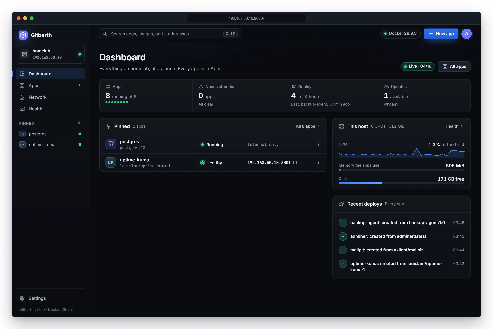
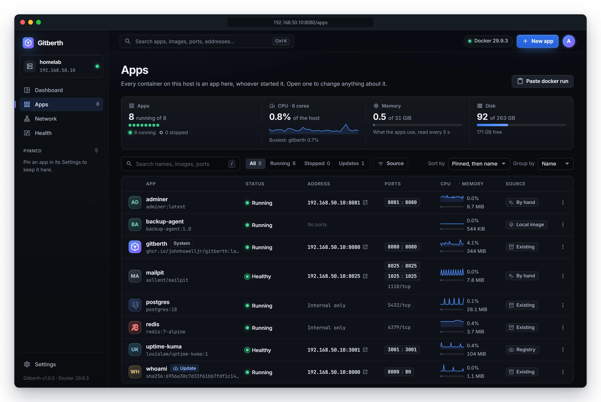
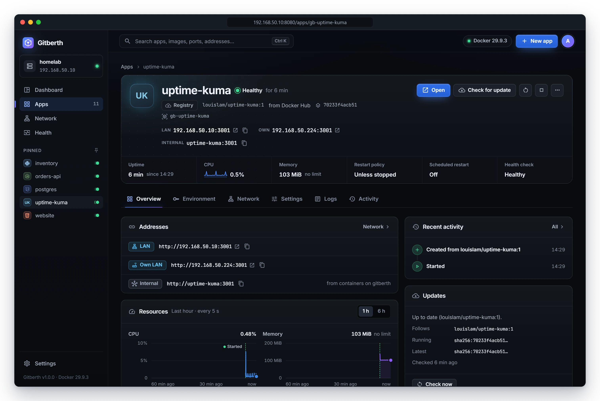
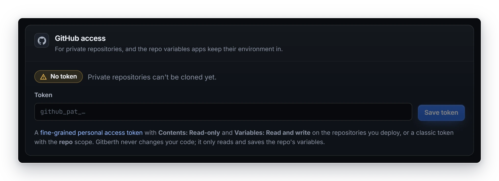

# First steps

This page is a short tour of Gitberth after you sign in for the first time: what's on each page, how to connect GitHub
for private repositories, and where to go to run your first app. It assumes you've [installed Gitberth](install.md) and
can open `http://192.168.50.10:8080`.

## Sign in

Open Gitberth and sign in as `admin` with the password from your `.env` file, or the generated one from
`docker compose logs gitberth`. The **A** button at the top right has **Settings** and **Sign out**.

## Find your way around

The sidebar on the left holds:

- **The host card** at the top: this machine's name and LAN address, with a dot that shows whether Gitberth can read
  Docker. Click it to open the Health page.
- **Dashboard**, **Apps**, **Network** and **Health**. The number next to **Apps** is how many apps are running.
- **Pinned**: the apps you've pinned, with their state.
- **Settings**, and the versions of Gitberth and Docker, like `Gitberth v1.0.0`, at the bottom.

The top bar has a search box, the Docker engine's version (or **Docker offline**), and the **New app** button. Press
**Ctrl K** to jump to the search. It finds apps by name, image, port or address; **Enter** opens the one highlighted.

## The dashboard

The dashboard shows the whole host at a glance:

- **Apps**: how many are running, out of how many.
- **Needs attention**: apps that crashed, report unhealthy, or whose container is gone.
- **Deploys**: how many deploys ran in the last 24 hours, and the last one.
- **Updates**: apps with a newer image available. Apps set to update **When I ask** aren't counted.

Below these are the apps that need attention, your pinned apps, **This host** (CPU, the memory the apps use, and disk),
and **Recent deploys** of every app. The **Live** pill at the top says the figures are current; they're read every 5
seconds.

## Apps

**Apps** lists every container on the host, whoever started it: the ones Gitberth built from GitHub, images you started
from Gitberth, and containers started some other way, such as a database you ran by hand. Each one is an app you can open,
start, stop and change.

Click an app's name to open its page. The header shows its state, addresses, uptime, CPU and memory, and its buttons. Six
tabs sit below it: **Overview**, **Environment**, **Network**, **Settings**, **Logs** and **Activity**.

[Manage apps](../guides/manage-apps.md) explains the list and the app page in full.

## The other pages

- **Network** lists every host port in use and who uses it, lets you check whether a port is free, and shows Docker's
  networks. See [Networking](../guides/networking.md).
- **Health** charts CPU, memory and network traffic for every container over the last 6 hours. See
  [Health and monitoring](../guides/health-and-monitoring.md).
- **Settings** holds GitHub access, registry sign-ins, update checks, domains, the network, deploys and your password.
  See [Gitberth's settings](../reference/gitberth-settings.md).

## Connect GitHub

Public repositories need nothing. To deploy private ones, and to keep an app's environment variables in its repo, give
Gitberth a GitHub token.

1. On GitHub, create a [fine-grained personal access token](https://github.com/settings/personal-access-tokens/new).
2. Under **Repository access**, choose **Only select repositories** and pick the repos you'll deploy.
3. Under **Permissions**, set **Contents** to **Read-only** and **Variables** to **Read and write**. Variables are where
   apps from a repo keep their environment (see [Environment variables](../guides/environment-variables.md)). For
   deploys reported on GitHub and instant deploys, also set **Commit statuses**, **Pull requests** and **Webhooks** to
   **Read and write** (see [GitHub integration](../guides/github-integration.md)).
4. Copy the token.
5. In Gitberth, go to **Settings** › **GitHub access**, paste it into **Token** and click **Save token**.

   Gitberth shows **Token saved**, the GitHub account it belongs to, and when it expires.

A classic token with the `repo` scope (and `admin:repo_hook` for the webhook) works too. To change the token later, paste a
new one into **Replace the token** and click **Replace token**. Gitberth never changes your code: it reads the repo, reads
and saves its variables, and reports deploys on its commits and pull requests.

## Check the LAN address

Every address Gitberth shows, like `192.168.50.10:3001`, uses this host's LAN address. Gitberth detects it, and takes
`GITBERTH_PUBLIC_HOST` from `.env` if you set it. If the addresses on the Apps list show the wrong host, set the right
one in **Settings** › **Network** › **LAN address of this host**. See [Networking](../guides/networking.md).

## Next steps

Click **New app** and pick where the app comes from:

- [Deploy an app from GitHub](../guides/deploy-from-github.md)
- [Run an image from a registry](../guides/run-a-registry-image.md), such as `postgres:18` or `louislam/uptime-kuma:1`
- [Use an image that's already on the host](../guides/use-a-local-image.md)
- [Paste a `docker run` command or a Compose service](../guides/paste-docker-run-or-compose.md)

## Related

- [Install Gitberth](install.md)
- [Manage apps](../guides/manage-apps.md)
- [Architecture](../concepts/architecture.md)
