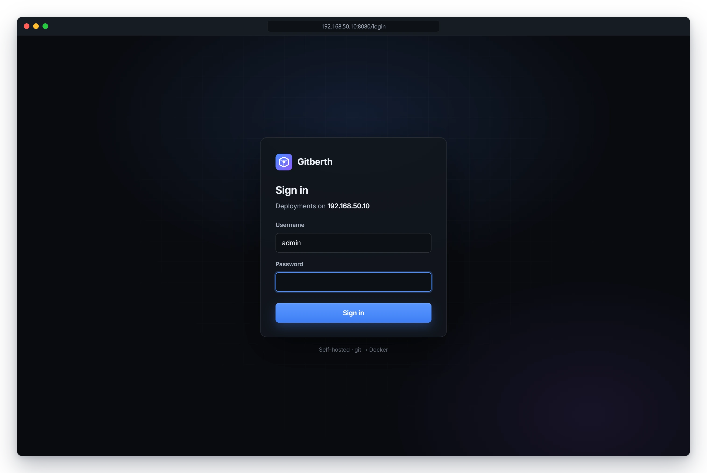

# Install Gitberth

Gitberth is one container that runs next to the apps it manages. This page sets up a Proxmox LXC for it, installs Docker,
starts Gitberth from its Compose file and signs you in. When you're done, Gitberth answers at
`http://192.168.50.10:8080` (your container's address in place of `192.168.50.10`).

The examples use a container called `homelab` at `192.168.50.10`.

## Before you start

- **Proxmox VE 9.1 or later**, or 8.4.16 or later on 8.x. Late-2025 runc security updates broke Docker inside LXCs with
  `open sysctl net.ipv4.ip_unprivileged_port_start … permission denied`. `lxc-pve` 6.0.5-2 and later fix it, so update
  the Proxmox host first.
- **A free static address on your LAN** for the container. Gitberth and every app it runs are reached at this address.

## 1. Create the LXC

1. In Proxmox, create a container from the **Debian 13** template, and leave it **unprivileged**.
2. Give it 4 vCPU, 8 GB of RAM (4 GB is enough for small apps), a 64 GB disk and a static IP, such as
   `192.168.50.10/24`.
3. On the Proxmox host, turn on nesting and keyctl for it. Replace `<id>` with the container's ID:

   ```bash
   pct set <id> --features nesting=1,keyctl=1
   ```

4. Start the container and open its console.

## 2. Install Docker

Inside the LXC, run:

```bash
apt update && apt install -y curl
curl -fsSL https://get.docker.com | sh
```

## 3. Get the Compose file and the settings file

```bash
mkdir -p /opt/gitberth && cd /opt/gitberth
curl -fsSLO https://raw.githubusercontent.com/johnhowelljr/Gitberth/main/docker-compose.yml
curl -fsSL https://raw.githubusercontent.com/johnhowelljr/Gitberth/main/.env.example -o .env
```

`docker-compose.yml` runs the ready-made image `ghcr.io/johnhowelljr/gitberth`, built for Intel/AMD and ARM, so nothing
is compiled on your machine. It publishes port 8080, gives Gitberth the Docker socket, and keeps its data in a volume
called `gitberth_gitberth-data`. [Configuration](../reference/configuration.md) describes the file line by line.

## 4. Fill in `.env`

Open the file with `nano .env` and set three values:

```text
GITBERTH_ADMIN_PASSWORD=choose-a-long-password
GITBERTH_PUBLIC_HOST=192.168.50.10
TZ=UTC
```

| Setting | What it does |
|---|---|
| `GITBERTH_ADMIN_PASSWORD` | The password you sign in with as `admin`. It's read on the first start only; after that you change it in Gitberth. Leave it empty to have one generated. |
| `GITBERTH_PUBLIC_HOST` | This machine's LAN address. Gitberth uses it in every app address and connection string it shows. |
| `TZ` | The time zone for every time Gitberth shows, its logs and the window for automatic updates, like `UTC` or `America/New_York`. |

## 5. Start Gitberth

```bash
docker compose up -d
```

Docker pulls the image and starts a container called `gitberth`.

## 6. Sign in

1. Open `http://192.168.50.10:8080` in your browser.
2. Sign in with the username `admin` and the password from `.env`.



If you left the password empty, find the generated one in the log:

```bash
docker compose logs gitberth
```

Look for the line that starts with `No GITBERTH_ADMIN_PASSWORD was set. Sign in as 'admin' with this generated password:`.

To change the password later, go to **Settings** › **Admin password**. The new one needs at least 10 characters, and
changing it signs every other browser out.

> **Note**
> After 5 failed sign-ins from one address within 15 minutes, Gitberth refuses that address for a while and says
> **Too many failed attempts. Try again in a few minutes.** See [Security](../concepts/security.md).

## Build it yourself instead

You can build the image on your own machine rather than pull it. It's the same container with the same data; only where
the image comes from changes.

```bash
apt install -y git
git clone https://github.com/johnhowelljr/Gitberth.git /opt/gitberth
cd /opt/gitberth
cp .env.example .env
nano .env
docker compose -f docker-compose.yml -f docker-compose.build.yml up -d --build
```

To update a Gitberth you built, run `git pull` and the same `docker compose` command again. [Updating
Gitberth](../guides/updating-gitberth.md) covers both ways of installing it.

## If something's wrong

- **The page doesn't load.** Check that the container runs with `docker compose ps`, and read
  `docker compose logs gitberth`.
- **The dashboard says Docker can't be read.** Gitberth can't reach the Docker socket. Check that the `volumes:` section of
  `docker-compose.yml` still mounts `/var/run/docker.sock`.
- **App addresses show the wrong host.** Set `GITBERTH_PUBLIC_HOST`, or set the address in **Settings** › **Network**.

[Troubleshooting](../guides/troubleshooting.md) has more.

## Related

- [First steps](first-steps.md): a tour of Gitberth and connecting GitHub
- [Configuration](../reference/configuration.md): Gitberth's own environment variables, volume and port
- [Updating Gitberth](../guides/updating-gitberth.md)
- [Security](../concepts/security.md)
