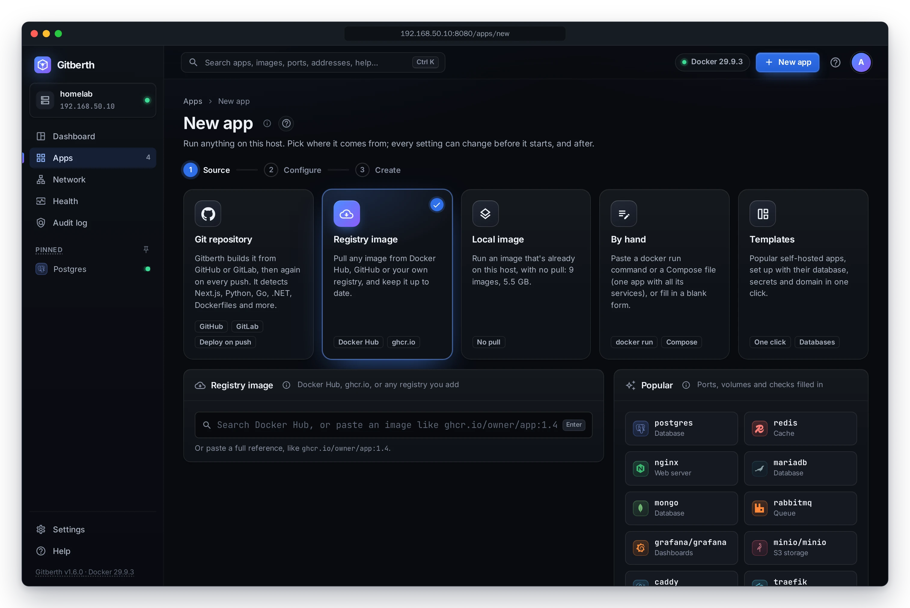

# Add an app

**New app**, in the top bar, makes an app from wherever it comes from: your code in a Git repository, an image from a
registry or already on the host, a pasted `docker run` command or Compose file, or a template. This page covers the New
app page itself: the sources it offers and the three steps every app goes through. Each source's own guide has the
details.

## Choose where it comes from

The page opens on its first step, **Source**, with a card for each source. **Registry image** is picked when the page
opens.

| Card | Use it for | Guide |
|---|---|---|
| **Git repository** | Your own code on GitHub or GitLab. Gitberth works out how to build it, and deploys every new commit. | [Deploy an app from GitHub or GitLab](deploy-from-github.md) |
| **Registry image** | A ready-made image from Docker Hub, ghcr.io or your own registry, kept up to date. | [Run an image from a registry](run-a-registry-image.md) |
| **Local image** | An image that's already on this host, with no pull. The card says how many the host has. | [Use an image that's already on the host](use-a-local-image.md) |
| **By hand** | A pasted `docker run` command or Compose file (one app with all its services), or a blank form. | [Paste a docker run command or a Compose file](paste-docker-run-or-compose.md) |
| **Templates** | Popular self-hosted apps, set up with their database, secrets and domain in one click. | [App templates](templates.md) |

Other ways in: **Paste docker run** on the **Apps** page opens **By hand**, and a search on the Apps list that matches
no app offers **New app from …** with what you typed.

## The three steps

The steps show at the top of the page: **Source**, **Configure** and **Create**. Every setting can change before the app
starts, and after.

1. **Source.** Pick the card, then what it asks for: an image and its tag, an image on the host, or a paste.
2. **Configure.** The app's settings, filled in from the source, with **What will run** beside them. Click **Review and
   create**, or **Back to the source**. See [Configure](#configure).
3. **Create.** The review of what will be made. Nothing exists yet. Click **Create and start**, or **Change settings** to
   go back to Configure. See [Create](#create).

A **Git repository**, a whole Compose file and a template work a little differently: their settings are on the source's
own page, and **Create and deploy** (or **Install**) creates the app and starts its first deploy at once.

[App settings](../reference/app-settings.md) describes each field, as the app's own **Settings** tab has it later.

### Configure

The settings come in the sections the app's **Settings** tab has later, filled in from the source. Check the ones that
matter to you; the rest can stay as they are.

| Section | What's in it |
|---|---|
| **Basics** | **Name**, what Gitberth calls the app, and **Network name**, made from it and unique on this host: containers on `gitberth` reach the app by it, and its container is `gb-` and that name. **Free on this host and on gitberth** says it isn't taken. Then the image, **Already on this host** or **Pulled when it's created**, and what reading a paste found, such as what couldn't be carried over. |
| **Ports** | The ports from the image or the paste. New ones are on the LAN, at a free host port, and each host port is checked as you type. **Add port** adds one. |
| **Network** | **Network mode**: **Its networks** (`gitberth`, and any other network you tick), **The host's** or **None**. A network the source names that this host doesn't have says **Doesn't exist**, with **Create it** and **Remove**. **Own LAN address (optional)** gives the app an address of its own on your LAN. |
| **Storage** | Where it keeps data: a **Volume**, a **Host folder** or **tmpfs**, the path inside, and **Read-only** for one it only reads. The folders the image keeps data in come filled in. **Add volume** and **Host folder** add one. |
| **Environment** | Its own variables, each with **Secret** to mask its value everywhere; **Add variable** adds one. **From the image** lists the ones the image sets: change one and it becomes the container's own. |
| **Command** | **Command**, **Entrypoint**, **Working directory** and **User**. A field left empty uses the image's own, which it shows. |
| **Restart & resources** | **Restart** (**Never**, **On failure**, **Unless stopped** or **Always**), **Memory limit**, **CPU limit**, **Shared memory**, **CPU priority** and **Process limit**. |
| **Health check** | **Image default**, **Command** (with how often it runs, **Every**) or **None**. |
| **Labels**, **Logging**, **Advanced** | As on the app's **Settings** tab. **Advanced** starts folded. |
| **Everything else** | What the source set that has no field here, kept as it was given. |

**What will run** follows every change (**Updates as you type**): the app's name and image, a diagram of how it's
reached, its **Addresses**, where its **Data** lives (**in the container only** when nothing keeps it), when it
**Starts** (when it's created, or after the pull), and the `docker run` it amounts to.

**Review and create** checks the ports first: when one needs changing, it says so and stays on Configure.

### Create

The last step is a review: nothing exists yet. Its first line says what will happen, such as **Pulls postgres:18, then
creates gb-postgres and starts it. Reached at 192.168.50.10:5432.** Below it:

- **Name** and **Container**, with a tag when that container name is taken and it gets another.
- **Network name**, and any other network it joins (or **Network**, on the host's network or none).
- **Image**, with **Pulled first** or **On this host**.
- **Disk**, what's free on Docker's disk, with **Getting low** or **Too little to pull** (see
  [Docker's disk is filling up](troubleshooting.md#dockers-disk-is-filling-up)).
- **The docker run it amounts to**.

When a setting needs changing, **One setting needs changing** (or how many) says what, with **Change settings**, and
**Create and start** waits until none does.

Click **Create and start**. Gitberth pulls the image if the host doesn't have it, with how far the pull has got, then
creates the container, starts it and checks it, showing each step as it runs. It carries on if you leave the page. When
the app is up, its page opens; when it isn't, see [If something stops it](#if-something-stops-it).

## If something stops it

- **On Configure**, a name or a port that's wrong shows under its field. With a port problem, **Review and create** stays
  on Configure until it's fixed.
- **On the review**, **One setting needs changing** (or how many) says what, with **Change settings**. **Not enough disk
  to pull it** means Docker's disk is too full for the image.
- **If the container doesn't start**, the page says why and what was left behind, with **Try again** and **Edit the
  settings**, and **Its last output** shows what the container printed. See
  [If it doesn't start](run-a-registry-image.md#if-it-doesnt-start).

## Related

- [First steps](../getting-started/first-steps.md)
- [Manage apps](manage-apps.md)
- [App settings](../reference/app-settings.md)
