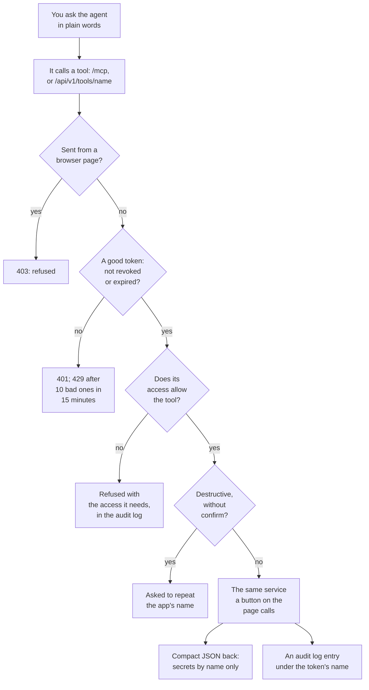
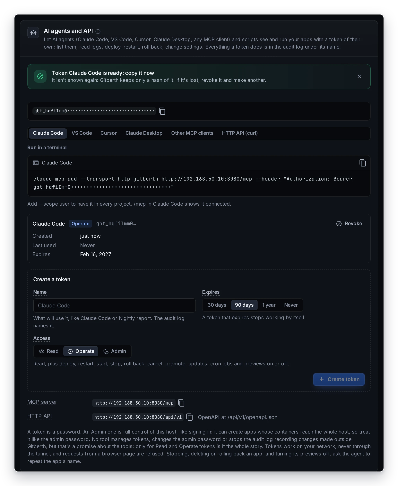

# AI agents and the API

Gitberth has an MCP server, so an AI agent (Claude Code, Claude Desktop, VS Code, Cursor, or any client that speaks the
Model Context Protocol) can see and run your apps the way you do on the web page: list them, read their logs and deploys,
deploy, restart and roll back, install [app templates](templates.md), change their settings, variables, domains and
databases, and read the audit log. Scripts
and agent frameworks that don't speak MCP get the same tools over plain HTTP. Each agent uses a token of its own that you
make and can revoke, and everything it changes is in the [audit log](audit-log.md) under the token's name.

## How it works

- The MCP server is at `/mcp` on Gitberth's own address (`http://192.168.50.10:8080/mcp`), using stateless Streamable
  HTTP: no sessions, so it works behind any proxy. The same tools are at `/api/v1` for scripts.
- Every tool calls the same service the button or form on the web page calls, with the same checks. An agent can't do
  anything a signed-in person couldn't, or skip a check a person gets.
- Results are compact JSON. A secret variable comes back by name only, and no tool returns a token, a password, a
  connection string or a deploy hook's URL (except a new hook's, once).
- Logs come back bounded: a line longer than 8 KB is cut, and at most about 1 MB is returned, the oldest lines dropped
  first; `truncated: true` says when. A `grep` is plain text, or a regular expression (between slashes, up to 200
  characters) that runs without backtracking, so no pattern can tie Gitberth up.
- Deploys and updates run in the background: the tool returns the deploy's number at once, or follows it to the end
  (up to 10 minutes) when the agent asks to wait. One still going after 10 minutes comes back as still running, with its
  number to follow.
- Production builds its own branch, as on the web page: its newest commit, or with `deploy_app`'s `commit` an earlier
  one of that branch (or one production ran before). A preview's code reaches production only through `promote_preview`.

[The tools reference](../reference/api.md) lists every tool with its arguments.



## Make a token

1. Open **Settings** and go to **AI agents and API**.
2. Give the token a name for what will use it, like `Claude Code` or `Nightly report`. The audit log names the token
   for everything it does, so make one per agent or script.
3. Choose its **Access** (see below) and when it **Expires**: in 30 days, 90 days, a year, or never.
4. Click **Create token**.

The token (`gbt_` and 43 characters) is shown once, with a copy button and the setup for each client. Copy it now:
Gitberth keeps only its SHA-256 and its first characters, so it can't be shown again. If it's lost, revoke it and make
another.



The list shows each token's name, access, first characters, when it was made, when and from which address it was last
used, and when it expires. **Revoke** ends a token at once: every request with it is refused from then on. Making,
revoking and the expiry of a token are recorded in the audit log, by name, never the token.

### When a token expires

A token that expires within the week has **expires in 5 days** (or **tomorrow**, **today**) next to its name. When
something used it in the last 30 days, the dashboard and this section also get a banner a week and a day before it
expires, and once it has (**The API token Claude Code expires in 5 days**), with when and from which address it was last
used, so you know which agent it is. Each sends a notice too (see [Notifications](notifications.md)). Make a new token,
give it to that agent or script, and revoke the old one. A token nobody uses isn't warned about.

## Access levels

| Access | What the token can do |
|---|---|
| **Read** | See everything: apps and their settings (secrets by name only), logs, stats, deploys and their logs, previews, health, domains, uptime and the status page, the audit log, databases, updates waiting, the app templates, and Gitberth's settings. |
| **Operate** | Read, plus deploy, restart, start, stop, roll back, cancel a deploy, promote a preview, check for and apply image updates, run a cron job now, and turn previews on and off. |
| **Admin** | Full control of this host, like signing in: create and delete apps (from a repo, an image, a Compose file or a template), change their settings and variables, domains, databases, deploy hooks and previews' settings (forks, protection, databases), set up a Postgres server for apps' databases, and Gitberth's notification, update, uptime and status page settings. |

**Treat an Admin token like the admin password.** It can create apps, and an app's container can be given the Docker
socket or the host's files, which reach everything on the host. No tool makes, lists or revokes tokens, changes the admin
password, or stops the audit log recording Docker changes made outside Gitberth, but that's a promise about the tools:
only for Read and Operate tokens is it the whole story.

An agent is shown only the tools its token may call. One that calls another anyway is told which access it needs (and
the refusal is in the audit log). Over HTTP, `GET /api/v1/tools` lists every tool, with `allowed` saying whether this
token may call it.

## Connect a client

Each client's setup is shown with the new token in Settings, ready to paste. In what follows, `http://192.168.50.10:8080`
stands for your Gitberth's address.

### Claude Code

```bash
claude mcp add --transport http gitberth http://192.168.50.10:8080/mcp --header "Authorization: Bearer gbt_…"
```

Add `--scope user` to have it in every project. `/mcp` in Claude Code shows it connected.

### VS Code

In `.vscode/mcp.json` (or **MCP: Open User Configuration** for every workspace):

```json
{
  "servers": {
    "gitberth": {
      "type": "http",
      "url": "http://192.168.50.10:8080/mcp",
      "headers": { "Authorization": "Bearer ${input:gitberth-token}" }
    }
  },
  "inputs": [
    { "type": "promptString", "id": "gitberth-token", "description": "Gitberth API token", "password": true }
  ]
}
```

VS Code asks for the token when the server first starts and keeps it in its secret storage, so the file can be shared.

### Cursor

In `~/.cursor/mcp.json` (or `.cursor/mcp.json` in a project):

```json
{
  "mcpServers": {
    "gitberth": {
      "url": "http://192.168.50.10:8080/mcp",
      "headers": { "Authorization": "Bearer gbt_…" }
    }
  }
}
```

### Claude Desktop

Claude Desktop reaches Gitberth through [mcp-remote](https://github.com/geelen/mcp-remote), which needs Node.js. In
`claude_desktop_config.json` (**Settings › Developer › Edit Config**):

```json
{
  "mcpServers": {
    "gitberth": {
      "command": "npx",
      "args": ["mcp-remote", "http://192.168.50.10:8080/mcp", "--allow-http", "--header", "Authorization:${GITBERTH_AUTH}"],
      "env": { "GITBERTH_AUTH": "Bearer gbt_…" }
    }
  }
}
```

Restart Claude Desktop after saving. `--allow-http` lets mcp-remote use your network's plain HTTP address; the header's
value is in `env` because Claude Desktop on Windows doesn't pass spaces in arguments through. Claude Desktop's own custom
connectors are reached from Anthropic's cloud and can't send this header, so they don't work for a server on your network.

### Other MCP clients

Any client that speaks Streamable HTTP: the URL `http://192.168.50.10:8080/mcp` and the header
`Authorization: Bearer gbt_…`.

### Scripts: the HTTP API

The same tools, with the same token, access and audit log:

```bash
# Every tool, its description, its input schema, and whether this token may call it ("allowed")
curl -s http://192.168.50.10:8080/api/v1/tools -H "Authorization: Bearer gbt_…"

# Call one: a JSON object of its arguments
curl -s -X POST http://192.168.50.10:8080/api/v1/tools/deploy_app \
  -H "Authorization: Bearer gbt_…" -H "Content-Type: application/json" \
  -d '{"app": "orders-api", "wait": true}'
```

`/api/v1/openapi.json` describes every tool as an OpenAPI 3.1 document, for agent frameworks and API clients that read
one. See [the tools reference](../reference/api.md#calling-a-tool) for the answers and status codes.

## What an agent can ask

Ask in plain words; the agent picks the tools. For example:

- "Which of my apps aren't running, and why?" (`list_apps`, `get_app`, `get_app_logs`)
- "Deploy orders-api and tell me if it worked." (`deploy_app` with `wait`)
- "The last deploy of orders-api broke the checkout: roll it back." (`list_deployments`, `rollback_app`)
- "Build orders-api from commit 1d2948c of main." (`deploy_app` with `commit`)
- "Give website a Postgres database." (`add_database`)
- "Install Miniflux for me." (`list_templates`, then `create_postgres_server` if there's no Postgres server yet, then
  `create_app` with `template` and its inputs)
- "Set STRIPE_KEY on orders-api as a secret, for production only." (`set_env_vars`)
- "What did the nightly report token change this week?" (`query_audit_log`)

## Safety

- **Give each agent the least access it needs.** A Read token is enough to look into problems; Operate to deploy and
  restart; Admin only for an agent you'd trust with the admin password, since it's full control of this host.
- **Destructive tools ask twice.** Stopping, deleting and rolling back an app, turning its previews off (when it has
  some), removing a domain and deleting a database's data need `confirm` set to the app's name (or the domain), the way
  the web page asks you to type it. Agents usually show you such a call before they make it.
- **Everything is in the audit log** under the token's name, over MCP or the API, with the address it came from: what it
  changed, and every deploy it started, how it ended. Refused requests are there too: a tool a token isn't allowed is
  recorded at most once a minute per token and tool, with how many more times it was refused in between.
- **Tokens stay on your network.** `/mcp` and `/api` are on Gitberth's own address, which is never published through the
  tunnel. Requests from a browser page (with an `Origin` header) are refused, which stops another website, or DNS
  rebinding, from using a token in your browser. The sign-in cookie never works on `/mcp` or `/api`, and a token never
  works anywhere else.
- **Bad tokens are throttled.** After 10 bad tokens from one address in 15 minutes, further bad ones get 429. A good token
  always gets in.
- **A token is a password.** Keep it out of shared files (VS Code's setup asks for it instead of storing it), give it an
  expiry, and revoke it the moment it's no longer needed.

## Related

- [Tools for AI agents and the HTTP API](../reference/api.md): every tool and its arguments.
- [Gitberth settings](../reference/gitberth-settings.md#ai-agents-and-api): the **AI agents and API** section.
- [Audit log](audit-log.md): what every token did.
- [App templates](templates.md): what `create_app`'s `template` source installs.
- [Security](../concepts/security.md)
