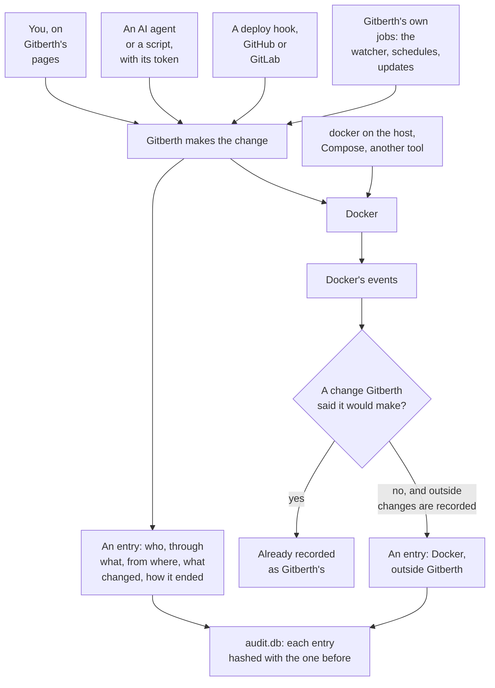
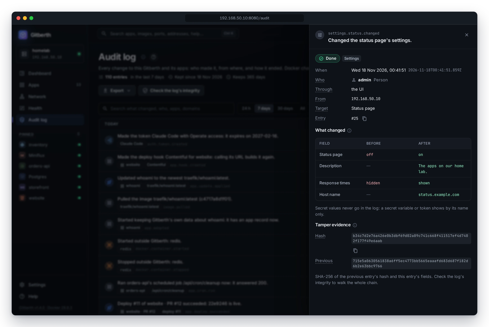

# Audit log

Gitberth records every change to itself and its apps in an audit log: who made it, from where, and how it ended. A
setting changed on an app's page, a deploy a push started, an automatic update, a domain added, a sign-in that failed:
each is one entry. Docker changes made outside Gitberth, with `docker` on the host, Compose or another tool, are recorded
too. Open it from **Audit log** in the sidebar.

The log is a file of its own, `audit.db` in Gitberth's data volume. It needs no database server and nothing more to run.

## What's recorded

| Area | What it records |
|---|---|
| **Sign-ins** | Each sign-in that worked, failed (a wrong password, an unknown user name) or was refused after too many failed attempts, with the browser's address; signing out; changing the admin password. |
| **Apps** | A new app and where it came from (a template too); a settings change, with each field before and after; ports, and the ports noted for a container; variables added, changed or removed, and the repo's variables saved to or deleted from GitHub or GitLab on an app's **Environment** tab; start, stop and restart; a rename; removal; deploy hooks made and deleted; networks joined and left; an own LAN address; previews and update settings; a scheduled job run by hand; **Keep the new one** or **Put the original back** after a change that needed your decision; [databases](databases.md) added and removed (with their data kept or deleted), and each preview's own made and dropped, by name only. |
| **Deploys** | Each deploy when it's queued, when it starts, and how it ended: succeeded, failed, rolled back, cancelled (a queued one too, when stopping or deleting the app cancels it) or skipped. Image updates found, applied, failed and rolled back. |
| **Domains** | An app's domains added, removed, made its main one, protected or not; what Gitberth changed in Cloudflare for them (DNS records, Access applications, the tunnel's routes); turning domains on or off. |
| **Settings** | Every section of the Settings page: GitHub access and integration, GitLab, notification destinations, registries, updates, uptime checks and the status page, the network, own LAN addresses, deploys, clearing the build cache, the default Postgres server and setting one up (**Databases**), API tokens made, revoked and expired (by name and access, never the token), and the audit log's own settings. |
| **Outside Gitberth** | Docker changes Gitberth didn't make: see [below](#changes-made-outside-gitberth). |

An entry has:

- **When**, to the millisecond, kept in UTC and shown in Gitberth's time zone.
- **Who**, **Through** and **From**: the actor, how the change came in, and the address it came from.
- **What**: one sentence, such as **Changed website's settings: memory limit and health URL.**, and the action's name, such as
  `app.settings.changed`.
- **Outcome**: done, **Failed** or **Refused**. A change that didn't work is recorded too, with the reason.
- The **App** it's about, its **Target** (a domain, a variable's name, a token's name), and **What changed**: each field,
  before and after.
- A link to the **Deploy** and its log, for an entry about one.

## Who made it

| Who | For |
|---|---|
| **admin**, through the UI, from the browser's address | Everything done on Gitberth's pages, and the deploys they start, even though a deploy runs on its own time. |
| **An API token**, by its name, through MCP or the API, from the caller's address | What an [AI agent or a script](ai-agents.md) does with that token, and the calls it was refused. |
| **A deploy hook**, by its name, from the caller's address | The deploys and updates a [deploy hook](deploy-hooks.md) call starts. |
| **GitHub** or **GitLab**, through a webhook | The deploys a push starts when [instant deploys](github-integration.md#instant-deploys) are on. |
| **Gitberth**, through one of its jobs: the repo watcher, a schedule, startup, the update checks, the health checks, a sync | What Gitberth does by itself: a new commit deployed, a scheduled restart, an automatic update, apps created again when it starts, domains and webhooks kept in step. |
| **Docker**, outside Gitberth | A change to Docker that Gitberth didn't make. |

A deploy is told against whoever asked for it, from the moment it's queued to how it ended. The deploy's page and the
app's **Activity** tab say so too, with **by admin** next to its trigger.

## Changes made outside Gitberth

Gitberth follows Docker's events. A change it didn't make is recorded as Docker's, **outside Gitberth**, against the app
whose container it was:

- containers created, removed, renamed, started, stopped, killed, restarted, paused, or changed with `docker update`
- images pulled, removed, tagged, loaded or imported
- networks created or removed, and containers connected to them or disconnected
- named volumes created or removed

One command is one entry: `docker stop gb-website` is **Stopped outside Gitberth: gb-website.**, not its kill, die and stop
events. What isn't a change is left out: Docker's own restart of a container that crashed (its restart policy; the crash
is on the [Health page](health-and-monitoring.md)), the networks a container joins as it starts and leaves as it stops,
and Gitberth's own container and helpers. Changes made while Gitberth wasn't running aren't known.

Docker says a container joined or left a network apart from the container's own events, and on a busy host seconds
later. So a join or leave waits for the container's next event before it's recorded: followed by its start, or its stop,
it was part of that; followed by nothing within 30 seconds, it's **Connected … outside Gitberth** or **Disconnected …
outside Gitberth** on its own.

Gitberth's own changes are never recorded as outside ones: every Docker command it runs says first what it will change.

To leave changes made outside Gitberth out, turn off **Record changes made outside Gitberth** in
**Settings › Audit log**. Gitberth's own changes are recorded either way.

## Find a change

The page lists entries newest first, grouped by day, 100 at a time; **Load more** shows older ones.

| Filter | What it does |
|---|---|
| **Search** | Words in what changed, who made it, the app, a domain or the action's name. |
| **24 h**, **7 days**, **30 days**, **All** | How far back. **7 days** unless you change it. |
| **Who** | One actor: admin, an API token, a deploy hook, GitHub, GitLab, Gitberth, or **Outside Gitberth**; **Anyone** clears it. |
| **App** | One app, by its container's name, so its history stays after it's deleted. |
| **Area** | **Apps**, **Deploys**, **Domains**, **Settings**, **Sign-ins** or **Outside Gitberth**. |
| **Outcome** | **Done**, **Failed** or **Refused**. |

The filters are part of the page's address, so a view can be bookmarked or sent: `/audit?range=all&app=gb-website` is
everything that ever happened to `gb-website`. Each app's **Activity** tab links to it: **All changes to website in the audit
log**. While the page is open, new entries wait above the list (**2 new entries: show**), so it never moves under you.

Click an entry for everything about it: see [An entry's details](#an-entrys-details).

## An entry's details

Clicking an entry opens its details beside the list. The panel starts with the action's name and the entry's sentence,
then how it ended (**Done**, **Failed** or **Refused**), its area, and **Outside Gitberth** for a change Gitberth didn't
make. **Close**, a click outside the panel, or Esc puts it away.

| Line | What it shows |
|---|---|
| **When** | The day and time in Gitberth's time zone, and the exact time in UTC, like `2026-11-14T09:30:12.345Z`. |
| **Who** | The actor by name, and what it is: **Person**, **API token**, **Deploy hook**, **GitHub**, **GitLab**, **Docker**, **Cloudflare** or **Gitberth**. |
| **Through** | How the change came in: **the UI**, **an AI agent (MCP)**, **the API**, **a webhook** or **a deploy hook**; one of Gitberth's own jobs (**the repo watcher**, **a schedule**, **startup**, **the update checks**, **the health checks**, **a sync**); or **Docker's events**, for a change made outside Gitberth. |
| **From** | The address the request came from, when there is one: the browser's, the agent's or the caller's. |
| **App** | The app it's about, a link to its page, with the container's own name when the app goes by another, and **All its changes**: the log filtered to that app. |
| **Target** | What the change was made to besides the app: a domain, a variable's name, a token's name, a network. |
| **Deploy** | For an entry about a deploy, **Deploy #12 and its log**, a link to the deploy's page. When the entry knows only the deploy's number, **Follows** shows it instead, like `deployment:12`. |
| **Entry** | Its number in the log. The copy button by it copies a link that opens this entry, like `/audit?range=all&entry=1234`. |

**What changed** lists each field the change touched, with its value **Before** and **After** (`—` for none). Secret
values never go in the log: a secret variable or a token shows by its name only (see [Secrets stay out](#secrets-stay-out)).

**Tamper evidence** shows the entry's **Hash**, with a copy button, and the **Previous** entry's. The hash is SHA-256 of
the previous entry's hash and this entry's fields, which **Check the log's integrity** works out again for every entry
(see [Check the log's integrity](#check-the-logs-integrity)).

## Export

**Export** › **This view as CSV** or **This view as JSON Lines** downloads every entry the filters match, not only the
ones the page has shown. **Settings › Audit log** exports the whole log.

| Column (CSV) | What it holds |
|---|---|
| `id`, `time` | The entry's number and its time in UTC, like `2026-11-14T09:30:12.345Z`. |
| `actor_kind`, `actor`, `via`, `ip` | Who: `User` `admin` `UI` `192.168.50.20`, or `Docker` `outside Gitberth` `Docker`. |
| `action`, `outcome` | Like `app.deploy.succeeded` and `Succeeded`, `Failed` or `Denied`. |
| `app_id`, `app`, `container`, `target` | What it's about. |
| `summary`, `changes` | The sentence, and each field as `Memory limit: 512 MB → 1 GB`. |
| `correlation` | What it follows up, like `deployment:12`. |
| `prev_hash`, `hash` | Its place in the chain. |

JSON Lines has the same fields, one entry per line, with `changes` as a list of `{"field", "from", "to"}`. A CSV cell
that starts with `=`, `+`, `-` or `@` gets a `'` in front, so a spreadsheet shows it rather than running it.

The export is at `/audit/export?format=csv` (or `jsonl`) with the page's filters, for a signed-in browser only.

## Check the log's integrity

Each entry carries a hash: SHA-256 of the entry before it and its own fields. Changing or deleting an entry, or cutting
the newest ones off, breaks the chain from there on. **Check the log's integrity** walks the whole of it and says
**The audit log is intact**, with how many entries it checked, or **The audit log was changed** with the first entry that
doesn't match (**Show entry 1234**).

> **Note**
> The chain shows a change made to the file after the fact. It can't stop someone with root on the host from writing a
> whole new file with hashes that match. To keep a copy that can't be rewritten from there, export the log now and then,
> or back up the volume, and keep it somewhere else.

## How long entries are kept

**Settings › Audit log › Keep entries for**: 30 to 3650 days, a year unless you change it. Once a day, the first time a
few minutes after Gitberth starts, entries older than that are removed, and the removal is an entry of its own
(`audit.pruned`). The rest still check out: the last removed entry's hash is kept as the chain's start.

## Secrets stay out

Secret values never go in the log. A secret variable shows by its name and scope only (**Added the secret variable
API_TOKEN to website (all deploys).**), a token or password only that it was saved, replaced or removed, and a deploy hook's
URL not at all. A sign-in with an unknown user name doesn't record the name typed: it's often a password typed in the
wrong box. A plain variable's value is kept, cut short after 100 characters.

## Where it's kept

`/data/audit.db` in Gitberth's volume, next to `gitberth.db`, with `audit.db-wal` and `audit.db-shm` beside it while
Gitberth runs. Recording never holds anything up: entries go into a queue that one writer stores in order, and whatever
is still queued is written when Gitberth stops. While the file can't be written (a full disk, a failing one, a file made
read-only), entries wait in that queue, in order, however long it takes, and go in once it can be written again;
Gitberth's own log says so meanwhile. Back it up with the rest of the volume (see
[Backups and restore](backups-and-restore.md)). If the file is missing, Gitberth starts a new one.

## Related

- [Gitberth settings](../reference/gitberth-settings.md#audit-log)
- [Security](../concepts/security.md)
- [Backups and restore](backups-and-restore.md)
- [Deploy hooks](deploy-hooks.md)
