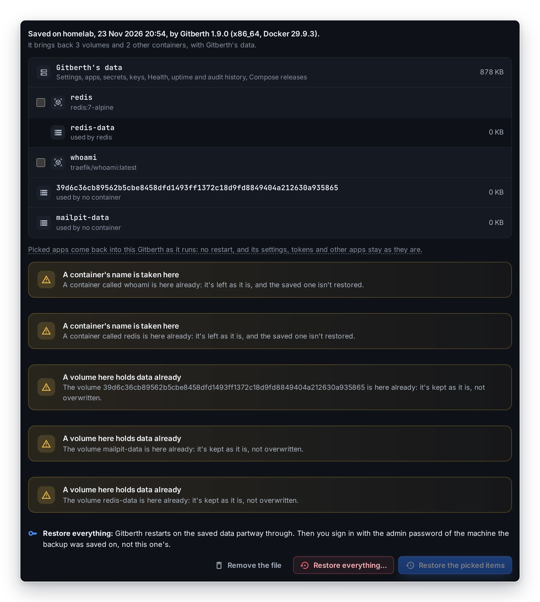

# Back up and restore

**Settings › Save and restore** saves everything this host runs in one file: Gitberth's settings and secrets, every app, the other containers, the data in their volumes, and the databases. The file is compressed and encrypted with a passphrase you choose. Restore it onto a fresh install, on this machine or another, and everything comes back: the apps run again once their repos are cloned and built.

## What a backup holds

| What | How it's saved |
|---|---|
| Gitberth's data (always) | Its database (settings, apps, ports, domains, variables, deploy history), the keys its secrets are encrypted with, the Health, uptime and audit history, and Compose apps' releases. Copied from a consistent snapshot while Gitberth runs. |
| Apps | Their settings come with Gitberth's data. A Git or Compose app is built again from its repo, at the commit it ran; an app from an image is made again from its image. |
| Volumes | Their files. The containers that use a volume are paused for the moment its copy takes, then go on. |
| Database servers | Postgres, MySQL and MariaDB are dumped with their own tools, which take a consistent copy while they keep serving. Their own data volumes aren't copied: the dump is. |
| Other containers | cloudflared, a container started by hand, an app's Redis: everything `docker inspect` says about them (image, command, environment, ports, volumes, networks, restart policy). |
| Images only this host has | Saved whole, so their apps can come back. An image from a registry is pulled again instead. |

Never saved: Gitberth's own container and its helpers, `gitberth-buildkit` (Railpack's build cache), and previews, which Gitberth makes again from their pull requests and branches.

Saving changes nothing on the host: it's a backup as much as a move.

## The file is compressed and encrypted

- **Compressed.** Every part of it (each dump, each volume's files, Gitberth's own data) is compressed before it's encrypted. A part that doesn't shrink, such as photos or video, is stored as it is, so it costs no time.
- **Encrypted.** The whole file is encrypted with AES-256-GCM, with a key made from your passphrase (PBKDF2-HMAC-SHA256, 600,000 rounds). A wrong passphrase, or a file with a byte changed, removed or moved, is refused before anything is restored.
- **The passphrase is never kept.** It's 12 characters at least, and Gitberth holds it in memory only while it saves or opens the file. It never writes it anywhere, and nobody can recover it: without it, nobody can open the file, Gitberth included. Keep it in a password manager.

The file holds every secret Gitberth has (tokens, passwords, variables) and the keys they're encrypted with, so the passphrase is all that protects them.

## Save a backup

1. Open **Settings › Save and restore**.
2. Look through the list. Each row shows its size on this host; an app's volumes and databases sit under it. Untick what you don't need back, such as a cache's volume or a sample container: unticking an app unticks what's under it. **Gitberth's data** is always saved.
3. Type a passphrase in **Passphrase** and again in **Passphrase again**.
4. Click **Save backup**. Your browser downloads `gitberth-backup-<date>.gbak` while Gitberth makes it, so it never takes room on the host. The line under the button says what's being saved and how much is written, then **Saved**.

Keep the file somewhere other than this host, with its passphrase somewhere else again.

### Stop everything while saving

Off, the containers keep running: databases are dumped while they serve, and a container is paused only while its own volume is copied. That gives each part a consistent copy of its own, but two apps that write to each other's data may be saved a few seconds apart.

On, Gitberth writes down which containers run, stops them all (itself aside), saves, and starts exactly those again. Everything is saved at one moment, at the cost of downtime for the whole save. If Gitberth restarts in the middle, it starts the containers on its list again when it comes back.

## Restore a backup

A backup is restored onto a Gitberth with no apps yet: a fresh install, on a new machine, or on this one after a reinstall.

### Before you start

- Install Gitberth on the new machine (see [Install](../getting-started/install.md)) and sign in with its own password. Its dashboard says **Moving from another machine? Restore a backup.**
- Open Gitberth by its LAN address to upload the file: through a Cloudflare domain, an upload stops at 100 MB.
- If the backup brings back cloudflared and the old machine still runs it, stop it there once the new one is up: two machines on the same tunnel share its visitors.

### Steps

1. Open **Settings › Save and restore** (or click **Restore a backup** on the dashboard's banner) and, under **Restore from a file**, click **Choose a backup file…**. The file uploads with its progress.
2. Type its passphrase and click **Open the file**. Gitberth reads what the file holds, and restores nothing yet: where and when it was saved, what it brings back, and what to know first (see [What the warnings mean](#what-the-warnings-mean)).

   

3. Click **Restore…** and type `restore` to confirm.
4. The **Restoring** page shows each step and the live log. First, from the file: networks, volumes and their data, images, database servers with their dumps loaded, and the other containers, databases first. Then Gitberth restarts on the saved data.
5. The page comes back by itself after the restart. Sign in with the admin password of the machine the backup was saved on, not the new one's.
6. Gitberth deploys each Git and Compose app at the commit it ran, one at a time, then routes the domains. The page says **Restored** when it's done.

The uploaded file is deleted from Gitberth when the restore ends.

### What the warnings mean

| Warning | What happens |
|---|---|
| **Stop the tunnel on the other machine** | The backup brings back cloudflared. If the old machine still runs it, both share the tunnel's visitors: stop it there. |
| **A host port is taken here** | Another program on this host uses a port an app had. That app can't publish it until the port is free. |
| **A container's name is taken here** | A container with a saved container's name already runs here. It's left as it is, and the saved one isn't restored. |
| **A volume here holds data already** | A volume with a saved volume's name has files. They're kept, and the saved ones aren't copied over them. |
| **Another kind of CPU** | The backup was saved on another architecture (`amd64` and `arm64`, say). Images that only the old host had may not run. |
| **Docker is older here** | This host's Docker is older than the old one's, or older than Gitberth needs. |
| **A host folder isn't here** | A folder a container mounted from the old host doesn't exist here: it's made empty. Copy its files over yourself. |
| **Not enough disk space** | What the backup holds doesn't fit. Free some room first: the restore can't start until it does. |

A warning in red stops the restore until it's dealt with; the others only say what will happen.

### After a restore

- **Secrets** read as before: the keys they're encrypted with come in the file. Tokens, registry sign-ins and variables need nothing.
- **Your browsers** sign in again, with the saved machine's admin password.
- **Domains** work again once the apps answer on their old host ports and cloudflared runs with its token.
- **The LAN address.** If the new machine has another address, **Settings › Network** says the saved one isn't the host's any more and offers the detected one with **Use it**.
- **Own LAN addresses.** `gitberth-lan` isn't restored: its block is the old network's. **Settings › Own LAN addresses** offers to turn it on again.
- **Health, uptime and audit history** carry on from the backup.

A step that fails is marked on the **Restoring** page, and the log says why; the others go on.

## By hand

Gitberth's data and your apps' volumes can also be copied with plain Docker commands, for example before an update.

### What's in Gitberth's volume

Everything Gitberth knows lives in the `gitberth-data` volume, which Docker names `gitberth_gitberth-data`, mounted at `/data`:

| File or folder | What it holds |
|---|---|
| `gitberth.db` (with `gitberth.db-wal` and `gitberth.db-shm` while it runs) | Settings, apps, ports, domains, deploy history and every secret, encrypted |
| `keys/` | The keys those secrets are encrypted with |
| `logs/` | Each deploy's log and the Dockerfile (or Railpack plan) it used |
| `stats.db` | The Health page's last 6 hours of readings and events |
| `uptime.db` | The uptime checks' history and incidents, for the Uptime cards and the status page |
| `audit.db` | The [audit log](audit-log.md) |
| `compose/` | Compose apps' releases, and the folders their services write to |
| `work/` | Clones and build folders while a deploy runs. Emptied when Gitberth starts; no need to keep it. |

[Configuration](../reference/configuration.md#the-data-volume) has the details. The keys sit next to the database, so anyone with a copy of the volume can read every secret in it: keep copies private, and keep the keys with the database.

### Back up Gitberth's data

Gitberth writes its database while it runs. For a consistent copy, stop it for the moment the copy takes; your apps keep running.

```bash
cd /opt/gitberth
docker compose stop gitberth
docker run --rm -v gitberth_gitberth-data:/data:ro -v "$PWD":/backup alpine \
  tar czf /backup/gitberth-data-$(date +%F).tgz -C /data .
docker compose start gitberth
```

The same command copies any named volume (`docker volume ls` lists them): stop the app first, so its files don't change during the copy. For a database you'd rather not stop, use its own dump tool, such as `docker exec postgres pg_dumpall -U postgres > postgres.sql`.

To put a copy back, unpack it into the volume of a Gitberth that isn't running (the installer's `GITBERTH_START=no` sets one up without starting it), as [Updating Gitberth](updating-gitberth.md#go-back-to-an-earlier-version) shows.

## Related

- [Gitberth's settings](../reference/gitberth-settings.md#save-and-restore)
- [Configuration](../reference/configuration.md)
- [Updating Gitberth](updating-gitberth.md)
- [Security](../concepts/security.md#how-secrets-are-stored)
- [Install](../getting-started/install.md)
