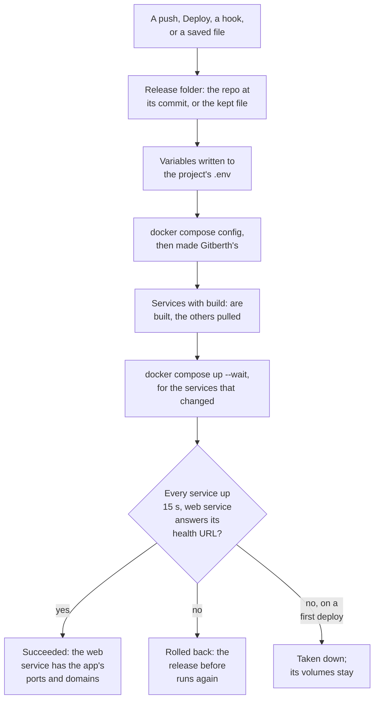
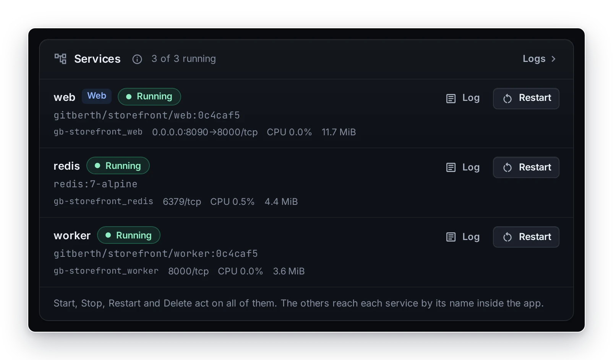

# Compose apps

Many self-hosted projects ship as a `compose.yaml` with several services: a web app, a worker, a database, a cache.
Gitberth deploys such a file as **one app with all its services**, the way `docker compose up` would, but with what every
Gitberth app has: its variables, a LAN port and domains for its web service, deploys you can roll back, previews of pull
requests, logs, charts and an audit trail. A repo's file is deployed again on every push; a file you paste is kept by
Gitberth and deployed when you change it.

## Which files

| Where the file comes from | What it is in Gitberth |
|---|---|
| A [GitHub repo or GitLab project](deploy-from-github.md) with a `compose.yaml`, `compose.yml`, `docker-compose.yaml` or `docker-compose.yml` in the app's folder | A Git app deployed with Compose. New commits deploy by themselves, and [previews](previews.md), [build filters](deploys-and-rollbacks.md#skip-commits-that-dont-need-a-deploy), the [GitHub integration](github-integration.md) (or [GitLab's](gitlab-integration.md)) and [deploy hooks](deploy-hooks.md) work as for any Git app. |
| A whole Compose file [you paste](paste-docker-run-or-compose.md#paste-a-whole-compose-file) | An inline Compose app: Gitberth keeps the file (encrypted) and deploys it. Change it on the app's **Settings** tab. |

Gitberth runs `docker compose` itself (its image has the Compose plugin), so the host needs nothing more than Docker.

## Deploy a repo with Compose

1. Click **New app**, then **Git repository**, paste the repo's URL and click **Check**.
2. When the folder has a Compose file, Gitberth says **This repo has a compose.yaml with N services** and offers:
   - **With Compose**: all its services as one app. This is the first choice when the file has several services, or when
     there's nothing else in the folder to build.
   - **As one container**: the repo built into one image, as Gitberth does without Compose.
3. With Compose, check:
   - **Compose file**, when the folder has more than one;
   - **Web service**: the service that is the app's own container. Gitberth picks the one that publishes a web port (never
     a database); pick another if it guessed wrong.
4. Fill in the **Settings** card: the name, a health URL, **Deploy on push**, the web service's **Ports** (from its file,
   at a free host port) and the **Variables** the file uses (`${…}`: one left empty takes the file's default).
5. Click **Create and deploy**.

The first deploy builds each service that has a `build:` section and pulls the others, then brings them all up.

## What a deploy does



1. **Fetches the release.** The repo at its commit (or the file Gitberth keeps) becomes a release folder,
   `/data/compose/<app>/<commit>/`, in Gitberth's data volume. The last three releases are kept, and the one that runs.
2. **Fills in the variables.** The app's variables (with their scopes, the repo's GitHub or GitLab variables and
   [Vercel's](environment-variables.md#variables-gitberth-sets-like-vercel)) are written to the project's `.env`, after the
   repo's own `.env`, so `${NAME}` and `env_file: .env` both work. A service gets a variable only where the file passes it
   on (`DATABASE_URL: ${DATABASE_URL}`). The connection string of each of the app's [databases](databases.md) is there
   too, and in parts (see [Use a database's parts](#use-a-databases-parts)).
3. **Reads the file with `docker compose config`**, then makes it Gitberth's:
   - every service is labelled as the app's, and restarts **unless stopped** where the file doesn't say;
   - its containers are `gb-<app>_<service>`, and the project is `gb-<app>`;
   - the web service publishes the app's ports (the **Network** tab's), joins Gitberth's shared network as `<app>`, and
     is the container domains, the LAN address, the health URL, logs and uptime checks go to.
4. **Builds** each service with a `build:` section, one build at a time across the host, into
   `gitberth/<app>/<service>:<commit>`, with the app's build-time variables and secrets, and without the cache when you
   deploy without it. A build that needs SSH, build secrets or several platforms is left to `docker compose build`.
5. **Brings it up** with `docker compose up --wait`, then checks that every service stays up for 15 seconds (healthy,
   where it has a health check) and that the web service answers the app's health URL. A one-off job (a migration) that
   ends well with `restart: "no"` has done its part.
   - The containers are made first and join Gitberth's shared network before any of them starts, so a service that
     connects to its database server (`postgres`) or another app as it starts finds it by name.
   - `up` waits 3 minutes for the services to run and be healthy, or longer when a service's health check gives it a
     longer start (`healthcheck: start_period: 10m`, for an app that installs itself on its first start), at most 20.
   - The health URL is asked as `localhost`: a Compose container's name (`gb-website_web`) has a `_` in it, which apps
     such as Django's and Nextcloud refuse as a host name.
6. **Rolls back when it fails.** The release that ran before comes back, as it was, with its images: the deploy ends
   **Rolled back** and the log shows the failing service's last output. A first deploy that fails is taken down instead
   (its volumes stay).

Each deploy records the image every service ran, by its ID, and keeps a pulled one under a tag of the app's own,
`gitberth/<app>/<service>:pin-<id>`. So when a tag moves on (a later pull of `redis:8`, `:latest`, a deploy without the
build cache), a rollback, **Roll back to this** and a deploy without a build still run the images that release ran; the
log says which services run by their pin. The pins go with their releases.

Only the services that change are replaced: a service the new release runs exactly as the running one does (the same
image, settings and variables) keeps its container, so a new commit of the web app never restarts its database. The log
says which ones were left running. A scheduled restart replaces them all. While the web service is replaced, the app's
domains show Gitberth's [down page](uptime-and-status-page.md).

> **Note**
> A service that asks for several containers (`deploy: replicas: 3`, `scale: 3`) is refused with a plain message:
> Gitberth runs one container a service. So is a provider service (`provider:`), a program `docker compose` would run
> next to Gitberth itself.

Gitberth runs every `docker compose` from a folder of its own, never from a release, and never reads a file of a repo's
(its Compose file, its `.env`) through a link that leads out of the repo: such a deploy is refused.

## Files a service mounts

| In the file | What it mounts |
|---|---|
| A relative path, read-only: `./nginx.conf:/etc/nginx/nginx.conf:ro` | The release's copy, so each release mounts its own. |
| A relative path a service writes to: `./data:/data` | The app's kept folder, `/data/compose/<app>/data/data`, which outlives every deploy. Files the repo changes are brought up to date there, unless the app changed them. |
| A relative path that leaves the repo: `../../etc:/etc`, or a link in the repo that leads out of it | Refused, as is a `build:` context or Dockerfile outside the repo. |
| An absolute path: `/srv/photos:/photos`, `/var/run/docker.sock` | The host's own, as written: it's your file. |
| A named volume: `data:/data` | `gb-<app>_data`, kept from one deploy to the next. |

## Use the app



| On the app's page | What it does for a Compose app |
|---|---|
| The Apps list | One row, with how many of its services run: **Running 3/3**, or **Degraded 2/3** while one is down. |
| **Overview › Services** | Each service's state, image, container, ports, CPU and memory, with its **Log** and a **Restart** of that service alone. |
| **Start**, **Stop**, **Restart** | Every service, with `docker compose start`, `stop` and `restart`. A service without a container comes back with the current release. |
| **Deploy** | A new build of the branch (a Git app), or the kept file again with its images pulled anew (an inline app). |
| **Activity › Roll back to this** | That release again, with its images and the app's variables now. |
| **Logs** | The web service's log; pick another service above it. |
| **Environment** | The variables the file is filled with. A change applies with a deploy without a build. |
| **Network** | The web service's ports and the app's domains. |
| **Settings › Compose** | The Compose file (a Git app's path in the repo, or an inline app's whole file), the web service, and **Put every service on Gitberth's network**. **Save and deploy** says what changes, then deploys. |

A crash of another service is told as the app's, by the service's name ("website's worker service crashed"), and follows
the app's notifications switch.

Only the web service is on Gitberth's shared network, as `<app>`; the others reach each other on the project's own. Turn
on **Put every service on Gitberth's network** when a worker or a cron service needs what's there too, like the app's
database server or another app: they join it with no name of their own, so nothing else reaches them by name. Turning it
off takes them off it again.

## Use a database's parts

When the app has a [database](databases.md), Gitberth sets its connection string in its variable (`DATABASE_URL`,
`REDIS_URL`) as for any app. Many self-hosted apps want it one piece at a time instead (`DB_HOST`, `DB_PORT`…), so for a
Compose app every such variable `V` also comes in parts, in the project's `.env`:

| Part | Postgres | Redis |
|---|---|---|
| `V_HOST` | The server's name on Gitberth's network (`postgres`) | The Redis's (`website-redis`) |
| `V_PORT` | `5432` | `6379` |
| `V_NAME` | The database | |
| `V_USER` | The role | |
| `V_PASSWORD` | The role's password | The Redis's password |

A service gets them only where its file uses them, as any variable:

```yaml
services:
  web:
    image: n8nio/n8n:2.47.7
    environment:
      DB_POSTGRESDB_HOST: ${DATABASE_URL_HOST}
      DB_POSTGRESDB_DATABASE: ${DATABASE_URL_NAME}
      DB_POSTGRESDB_USER: ${DATABASE_URL_USER}
      DB_POSTGRESDB_PASSWORD: ${DATABASE_URL_PASSWORD}
```

So nothing changes for a file that doesn't use them. They win over the app's own variables of those names, as the URL
does, and the password is masked in the deploy log like the URL. The deploy log lists which parts were set, and says
**In place of the value set on the Environment tab: DATABASE_URL_HOST** when the app has one of its own by a part's
name. The **Environment** tab tags such a row **Replaced by Gitberth**, and lists each variable's parts under **Set by
Gitberth from its databases**. A preview's parts are its own database's.

## Previews

A pull request's preview is a project of its own, `gb-<preview>`, with its own named volumes and network, whatever names
its file gives them (production's `gb-<app>_default` included). Its web service gets a LAN port of its own; nothing else
of it is published. A pull request can change the Compose file, so a preview never gets more of the host than a preview
of one container. Its file keeps only what Gitberth knows stays inside its containers, key by key; anything else is taken
out, and the deploy log says what. Among what goes: privileged mode, added capabilities, devices and GPUs, the host's
network, processes or namespaces, security options (but `no-new-privileges`), sysctls, runtimes, log drivers,
`post_start` and `pre_stop` hooks, the Docker API socket, bind mounts (the Docker socket above all), file secrets and
secrets from variables that aren't the app's, host names that lead to the host, other projects' networks, production's
named volumes, volume and network drivers' options (which can mount the host's folders or put a service on the LAN), and a
build's extra tags, local cache and SSH. A preview never runs, or builds from, an image Gitberth built for another app
(`gitberth/…`) or an image by its ID. Its file is read in a helper container that sees nothing but the release.

The release folders under `/data/compose` can be opened by Gitberth alone: they hold the app's variables (the `.env`, and
the file each deploy ran).

## Delete it

**Settings › Remove** takes the whole project down (`docker compose down`): every service's container, its network and
its releases. Its named volumes and kept folder go only when you tick **Also delete its named volumes**, and its images
only with **Also delete its images**: the ones Gitberth built for it and its pins, and the ones it pulled when no
container and no other app (running it, or keeping it for a rollback) uses them. Another app's images never go with it,
and a preview never takes what it pulled.

## Related

- [App templates](templates.md): popular self-hosted apps, installed as Compose apps in one click
- [Deploy from GitHub or GitLab](deploy-from-github.md)
- [Paste a docker run command or a Compose file](paste-docker-run-or-compose.md)
- [Deploys and rollbacks](deploys-and-rollbacks.md)
- [Preview deployments](previews.md)
- [App settings](../reference/app-settings.md#compose)
