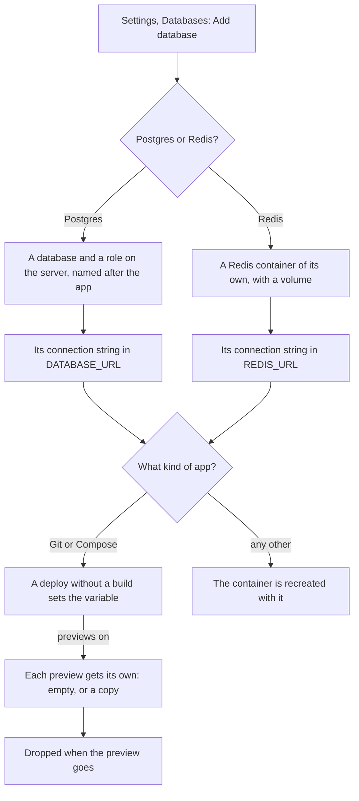
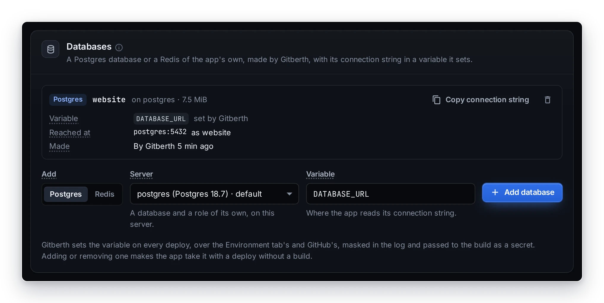

# Databases

An app can have a Postgres database or a Redis of its own, added from its page, like a database integration on Vercel.
Gitberth makes the database and its login, and puts the connection string in a variable the app reads, such as
`DATABASE_URL`. Each [preview](previews.md) gets its own, empty or a copy of production's, and loses it when it goes.

## Postgres servers

Gitberth puts each app's Postgres database on a Postgres server of this host: a container of a Postgres image
(`postgres`, `postgis`, `timescaledb`, `pgvector`…). **Settings › Databases** lists the ones it found, and says for each
whether Gitberth can use it:

| A server Gitberth can use | Why |
|---|---|
| Runs | Gitberth works on it inside its container. |
| Is on Gitberth's network (`gitberth`) | Apps reach it by its name there, such as `postgres`. |
| Lets Gitberth sign in as its superuser inside its container | Gitberth runs `psql` there as its `POSTGRES_USER` (else `postgres`). The official image trusts that local sign-in; with another, Gitberth passes its `POSTGRES_PASSWORD`. |

New databases go on the **Default** server. When Gitberth can use only one, it's the default by itself; with several, click
**Make it the default** on one. An app can still pick another when it adds a database.

### Create a Postgres server

With none yet, click **Create a Postgres server** in **Settings › Databases**. Gitberth pulls `postgres:18` and makes an
app of it, like [New app from a registry image](run-a-registry-image.md):

| What it gets | |
|---|---|
| Container | `postgres`, or the first free name after it (`postgres-2`) when that one is taken |
| Network | Gitberth's network, where apps reach it as `postgres` (its own name) |
| Ports | None published: only containers on its network reach it |
| Data | A named volume at the image's data path, `gb-postgres-postgresql` |
| Superuser password | Generated, kept as a secret variable, `POSTGRES_PASSWORD` |
| Updates | **Tell me**: a badge when there's a newer image. A database is never updated by itself. |

It shows in **Apps** like any other app, and becomes the default server unless you chose one before.

## Add a database to an app

1. Open the app's **Settings** tab and go to **Databases**.
2. Choose **Postgres** or **Redis**. For Postgres, choose the **Server** (the default is chosen).
3. Check the **Variable**: `DATABASE_URL` for Postgres and `REDIS_URL` for Redis unless you type another. When the app
   already has a value by that name, on its **Environment** tab or in the repo's GitHub variables, the field says so:
   Gitberth's value takes its place.
4. Click **Add database**.

| | Postgres | Redis |
|---|---|---|
| What Gitberth makes | A database and a role of the app's own, both named after the app (`website`, `orders_api`; `website_2` when the server has a `website` already). The role owns the database, and only it (and the server's superusers) may connect. | A container of the app's own, `gb-website_redis`, from `redis:8-alpine`, with a password, its data appended to a named volume of its own (`gb-website_redis-data`). |
| Where the app reaches it | The server's name on Gitberth's network | `website-redis` on Gitberth's network, a name no app can ever take |
| The variable | `postgres://website:<password>@postgres:5432/website` | `redis://:<password>@website-redis:6379` |

The app takes the variable the way it takes any change of its settings:

| App | How it gets it |
|---|---|
| A [Git app](deploy-from-github.md) | Every deploy sets it, over a value of the same name on the **Environment** tab or in GitHub. A deploy without a build makes the running app take it now; a stopped app gets it when it starts. It's masked in the deploy log, and the build gets it too, as a secret build value (for a framework that migrates while it builds). |
| A [Compose app](compose-apps.md) (a repo's, a pasted file's or a [template's](templates.md)) | As a Git app, in the project's `.env`, and in parts too (`DATABASE_URL_HOST`, `_PORT`, `_NAME`, `_USER`, `_PASSWORD`) for a file that wants them one by one: see [Use a database's parts](compose-apps.md#use-a-databases-parts). A service gets them where its file uses them. |
| Any other app: from a registry, a local image, made by hand, or a container already on the host | It's put in the container's environment by the change engine, which recreates it with its checks, as an edit on its **Environment** tab would. A container that isn't on Gitberth's network joins it first, so it reaches the database by name. |

Every app can have databases but Gitberth itself and its tunnel (the app's **Settings** tab has no **Databases** section for them). A preview's follow its parent's (see [Previews](#previews)),
and a container that Docker Compose made can't get one from here: Compose would undo the change to its environment.

> **Note**
> Gitberth never touches a database or role it didn't make. Its names never clash with one the server has, and only a
> database Gitberth made is ever dropped.

## What you see

- **Settings › Databases** on the app lists each database: Postgres or Redis, its name, its server, its size (the
  database's for Postgres, the memory it holds for Redis), its variable, and when Gitberth made it. **Copy connection
  string** copies the URL with its password; the page never shows it.
- The **Environment** tab lists the variables under **Set by Gitberth from its databases**, with where each comes from.
  For an app that isn't a Git or Compose app, its row in the environment says **Set by Gitberth**, and isn't edited there.
  For a Git or Compose app, a value of the same name above says **Replaced by Gitberth**; for a Compose app, so does one
  named like a part (`DATABASE_URL_HOST`), and the card lists each variable's parts.
- The **Overview** has a **Databases** card.
- The [audit log](audit-log.md) records each database added, removed, made for a preview or dropped with one, and each
  server set up, by name only: no password ever goes in it.

## Connect to a database

**Connect** gives the host, port, user, password and database of a database container, ready to copy, from your PC or
from another app. It works for any container Gitberth recognizes as one, whoever started it: Postgres (and PostGIS,
TimescaleDB, pgvector), MySQL and MariaDB, MongoDB, Redis (and Valkey, KeyDB, Dragonfly) and RabbitMQ. The user, password
and database come from the container's own settings, such as its `POSTGRES_USER`, `POSTGRES_PASSWORD` and `POSTGRES_DB`
(or Redis's `--requirepass`), with the image's defaults where it sets none.

1. Open the database's page and click **Connect** in the header. It's there while the database runs; the **Overview**'s
   **Addresses** card and the **Network** tab have it too.
2. **Connect to postgres** opens on the tab that reaches it:
   - **LAN**: **From any device on your network.** Use it for a database client on your PC. The host is the host's LAN
     address and the port its host port, like `192.168.50.10:5432`. A database reached at more than one address (its
     own LAN address too, say) has **Reach it at**, to pick one.
   - **Internal**: **From containers on gitberth.** Use it for another app. The host is the container's name, like
     `postgres`, on its own port. The line says which apps' settings name it already, like **Used by website.**
3. Copy what you need: **Host**, **Port**, **User**, **Password**, **Database**, or the **URL** that puts them together,
   like `postgres://postgres:…@postgres:5432/postgres`. The password shows as dots until **Show**; copying always copies
   the password itself.

When the database isn't published, the **LAN** tab says so (**postgres isn't published on the LAN.**, or that it's
published on the host only, where the LAN can't reach it) and offers **Publish on LAN**. From the header, that opens the
**Network** tab; on the **Network** tab, it picks the database's port and a free host port, and goes straight to the
change dialog (for a container Docker Compose manages, to the lines for its Compose file). See
[Publish a port on the LAN](networking.md#publish-a-port-on-the-lan). When it's on no shared network, the
**Internal** tab says to join `gitberth` under **Networks** on its **Network** tab first.

To connect another app, put the **Internal** URL in one of its variables on its **Environment** tab, such as
`DATABASE_URL`: the two must be on the same network, and every app Gitberth makes is on `gitberth`. A database added to
an app in **Settings › Databases** needs none of this: Gitberth sets the variable for it (see
[Add a database to an app](#add-a-database-to-an-app)).

## Previews

Each preview of a Git app can get a database of its own, so its migrations and test data never touch production's.
Choose what in the app's **Settings › Previews**, under **Each preview's database**:

| Choice | Each preview gets |
|---|---|
| **None of its own** | No database. A variable that would give it production's database [stops its deploy](previews.md#productions-database), as before. |
| **An empty one** (the default) | A database and a role of its own on the same server, empty, so its migrations make their own tables. |
| **A copy of production's** | The same, with production's data copied in when it's made (`pg_dump` piped into `pg_restore`, inside the server's container, owned by the preview's role). |

> **Note**
> **A copy of production's** puts whatever production's database holds, people's personal data too, in every preview,
> which runs a pull request's code. Choose it only when everyone who can open a pull request may see that data.

Gitberth copies only a database the app may read itself: the app's own database (added as above), or the one a
`postgres://` URL names when that URL's own user and password sign in to the server, and that role owns the database, was
granted `CONNECT` on it, or is a superuser. A URL that doesn't (one pointed at another app's database in the repo's GitHub
variables, say) gets the preview an empty database instead, and its deploy log says why.

A preview gets its own database for a variable when:

- the app has a Postgres database of its own (added as above), for that database's variable; or
- production's value of a variable (on the **Environment** tab, or one of the repo's GitHub variables) is a
  `postgres://` or `postgresql://` URL whose host is a Postgres server on this host that Gitberth can use. So an app set
  up by hand, whose `DATABASE_URL` points at the shared `postgres`, gets previews with one switch.

A variable the app gives a value for **Previews** on its **Environment** tab is yours: Gitberth leaves it as it is.

The preview's database is named after production's and the preview, such as `website_pr_12` for pull request 12 of `website`,
and is made before the preview's first build. The preview's deploys set the same variable, pointing at it: the same URL
as production's, with the preview's own role, password and database (its query, such as `?schema=public`, stays). Two
variables that name the same database (Prisma's `DATABASE_URL` and `DIRECT_URL`) point at the same preview database, each
with its own query. An app with a Redis of its own gives each preview a Redis of its own too, empty. The preview's deploy
log says what it made.

When the preview goes (its pull request closed or merged, its branch deleted, it expired, or you removed it), its
database and role are dropped and its Redis removed, with their data. That holds while its first deploy is still making
them too: a database whose copy of production's data was cut short (the preview removed meanwhile, Gitberth restarted)
is dropped, and made again by the preview's next deploy if it stays.

## Remove a database

Click the bin (**Remove**) next to it, then choose, and click **Remove it** (or **Delete it**):

| Choice | What happens |
|---|---|
| **Keep the data** | The variable goes from the app. A Postgres database stays on its server as it is, with its role: Gitberth forgets it. A Redis's container goes, and its data stays in its volume. |
| **Delete the data** | The same, and the data goes for good: the Postgres database and its role are dropped (whoever is connected is disconnected), or the Redis's volume is removed. Type the database's name to confirm. |

The app takes the change as it took the database: a deploy without a build, or a recreate. A database Gitberth didn't
make can only be removed with its data kept.

## Delete an app

Deleting an app lists its databases. Unless you tick **Also delete their data**, their data stays where it is (a Postgres
database on its server, a Redis's in its volume) and only Gitberth forgets them. Its previews' own databases always go,
with their previews.

**Forget…** (for an app whose container is gone or was renamed outside Gitberth) lets go of its databases the same way,
their data kept: its Redis's container goes with the record rather than run on with no app to look after it.

## Related

- [App templates](templates.md): apps that come with their database, made at install
- [Preview deployments](previews.md)
- [Environment variables](environment-variables.md)
- [App settings](../reference/app-settings.md#databases)
- [Gitberth settings](../reference/gitberth-settings.md#databases)
