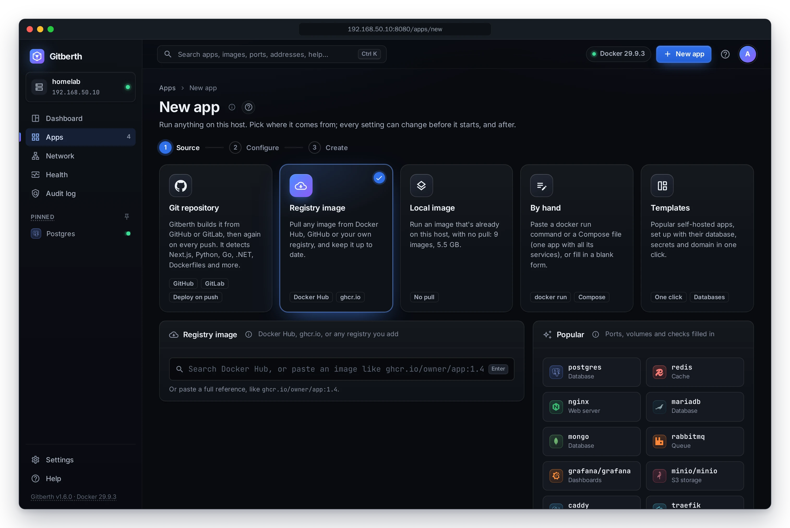
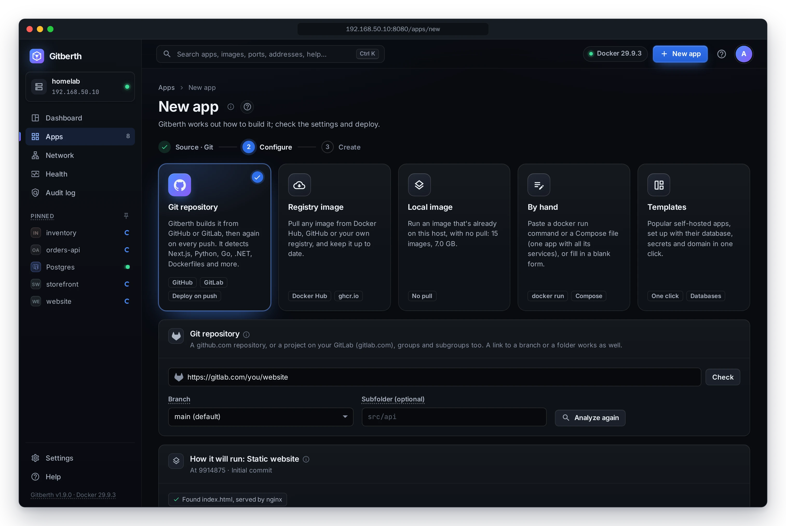
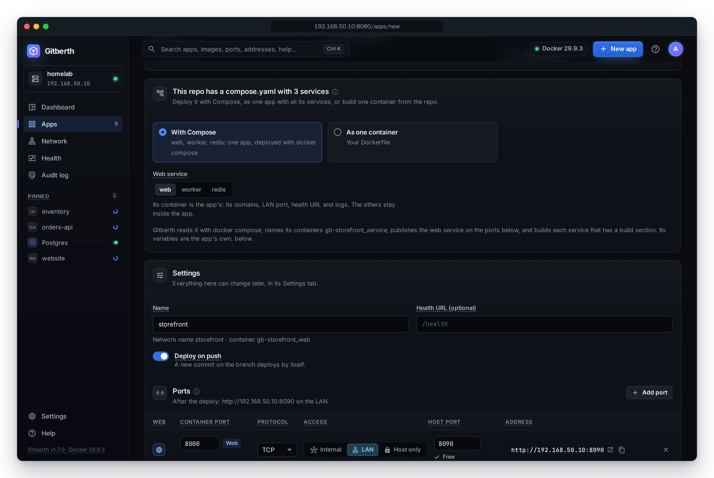
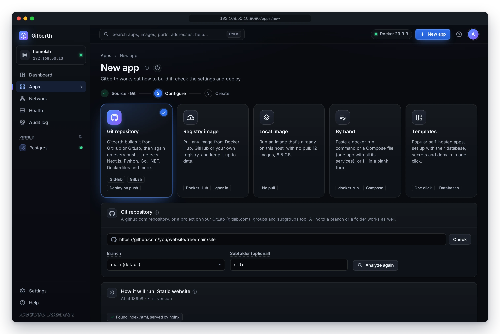
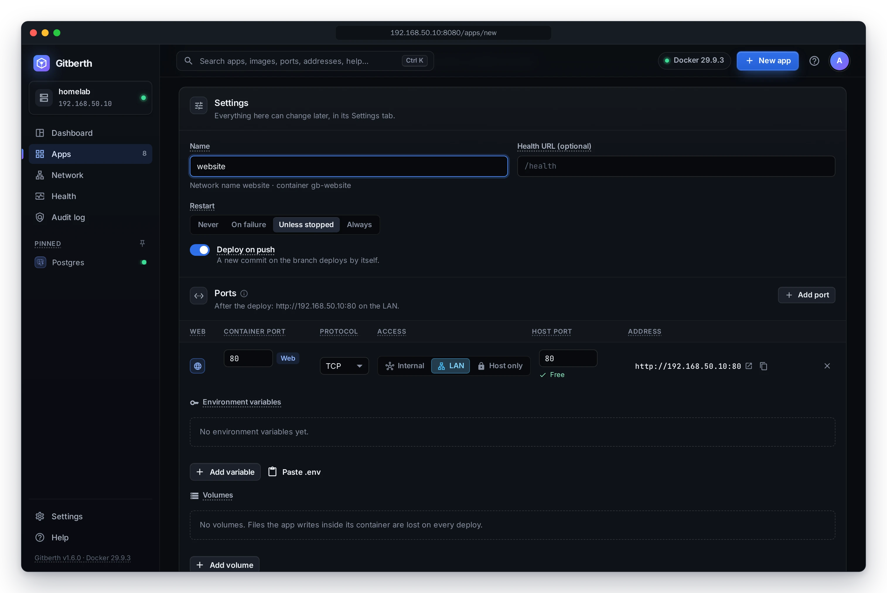
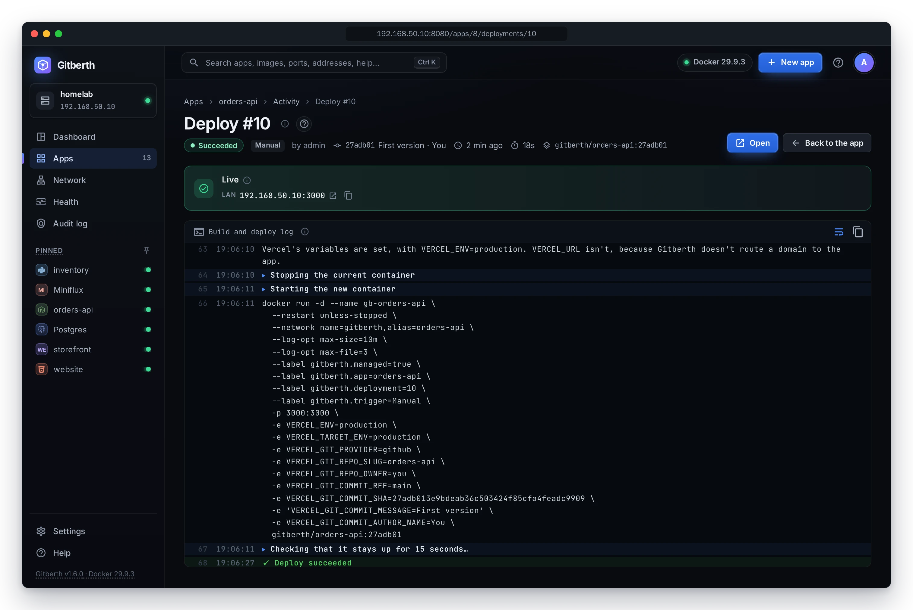

# Deploy an app from GitHub or GitLab

Give Gitberth a GitHub repository or a GitLab project and it works out how to build it, builds a Docker image, and runs it
with your ports, environment variables and volumes. After that it deploys every new commit on the branch by itself. Use
this for your own code: a static site, a Node.js or Python API, a Go, Rust or .NET service, anything with a Dockerfile,
anything [Railpack](../reference/railpack.md) builds (an Elixir app or a shell script, say), or a repo with a Compose
file.

The examples deploy `github.com/you/website`, a static site.

## Before you start

- The repository is on github.com, or on the GitLab set in **Settings** › **GitLab** (gitlab.com unless you changed it).
  See [GitLab](gitlab-integration.md) for a GitLab of your own.
- A private repository needs a token: a GitHub token in **Settings** › **GitHub access** (see
  [Connect GitHub](../getting-started/first-steps.md#connect-github)), or a GitLab token in **Settings** › **GitLab**.
  Without one, New app says **Public repositories only, for now** (or **Public projects only, for now** for GitLab).

## Pick the repository

1. Click **New app** in the top bar.
2. Click the **Git repository** card.

   

3. Paste the repository's URL into the field and click **Check**, or press **Enter**.

   Any of these work:

   ```text
   https://github.com/you/website
   github.com/you/website
   https://github.com/you/website.git
   git@github.com:you/website.git
   https://github.com/you/website/tree/main/site
   https://gitlab.com/you/website
   https://gitlab.com/you/team/website/-/tree/main/site
   ```

   A link to a branch and a folder (`/tree/<branch>/<folder>`, or GitLab's `/-/tree/<branch>/<folder>`) fills in
   **Branch** and **Subfolder** for you. A GitLab project can sit in groups and subgroups.

   Gitberth reads the repository's branches, clones the default one and looks for everything in it that it can run.

   


4. If the repository holds more than one app, Gitberth says **This repo has N apps Gitberth can run. The most likely one is
   picked.** Click another card to pick a different one. See
   [Repos with several apps](../reference/build-detection.md#repos-with-several-apps).
5. Check **Branch** (the repository's default is marked **(default)**) and **Subfolder (optional)**. If you change either,
   click **Analyze again**.

## A repo with a Compose file

When the app's folder has a `compose.yaml` (or `compose.yml`, `docker-compose.yaml`, `docker-compose.yml`), Gitberth says
**This repo has a compose.yaml with N services** and offers **With Compose** (all its services as one app) or **As one
container** (the repo built into one image, as below). With several services, or nothing else to build, Compose is the
first choice. Pick the **Compose file** when there are several, and the **Web service**: the one whose container is the
app's, with its ports, domains and health URL. The **Settings** card then has the web service's ports and the variables
the file uses; restart policy, volumes and limits are the file's own. See [Compose apps](compose-apps.md).




## Check how it will run

Gitberth shows **How it will run:** and the kind of project it found, such as **Static website**, with:

- the commit it looked at, like `At 3f9c2a1 · Update the home page`;
- ticks for what it found, such as which file it serves or which command starts the app;
- **Worth knowing** notes about anything that might trip the app up, such as a missing lockfile or a server that only
  listens on `localhost`;
- the **Generated Dockerfile**, or **Gitberth builds with the repo's own Dockerfile** when the repo has one.



A .NET solution with several runnable projects also shows **Project to run**.

To write the Dockerfile yourself, turn on **Customize the Dockerfile**. The text box starts with the generated one. Your
Dockerfile is stored with the app and used as it is on every deploy, and your repository is never changed. Keep the
`# gitberth:build-args` and `# gitberth:volumes` lines: Gitberth fills them in with the build-time variables and the
volume folders. When neither Gitberth nor Railpack can work out how to build the project, this switch is on already
with a starter Dockerfile.

**Build with Railpack** has Railway's builder make the image instead of the Dockerfile Gitberth would write, or instead
of the repo's own Dockerfile: for a repo set up for Railway, or to build an app the way Railway does. It's on by itself
when the app's folder has a `railpack.json` and no Dockerfile. It and **Customize the Dockerfile** turn each other off.
If Railpack can't plan the build while it's on, the card says why, and **Create and deploy** is refused with it.

[How Gitberth builds each kind of project](../reference/build-detection.md) lists everything it detects.

### A project Gitberth doesn't know

When Gitberth finds nothing it knows how to build, it asks Railpack, Railway's open-source builder (**Asking
Railpack…**). The card then says what Railpack found, such as **How it will run: Shell script with Railpack**, with a
tick for each file it went by, **Railpack 0.43.0 plans the build: no Dockerfile needed**, the command that starts the
app, and **Gets PORT=8080, the port Gitberth publishes**. **Railpack's plan** shows the steps Railpack will run, as it
prints them. Railpack plans the build again on every deploy. See [Railpack builds](../reference/railpack.md).

When Railpack can't work out how to build it either, the card says why, **Railpack couldn't work out how to build it
either: …**, and **Customize the Dockerfile** is on with a starter Dockerfile.

## Fill in the settings

The **Settings** card below holds the app's settings. Everything here can change later, on the app's **Settings** tab.

1. **Name**: the app's name, filled in from the repository (and folder). The line under it shows the network name other
   containers use to reach it and its container's name, like **Network name website · container gb-website**.
2. **Health URL (optional)**: a path such as `/health`. A new version must answer it before it replaces the running one.
3. **Restart**: what Docker does when the container stops: **Never**, **On failure**, **Unless stopped** (the default) or
   **Always**. A Compose app has no **Restart** here: its services' restart policies are its file's.
4. **Deploy on push**: on by default, so a new commit on the branch deploys by itself. Turn it off to deploy only when
   you click **Deploy**.
5. **Ports**: the port Gitberth detected, published on the LAN at a free host port: the same number when it's free, else
   the next free one above it. Click **Add port** for more. See [Networking](networking.md).
6. **Environment variables**: what Gitberth found in `.env.example` and in the code, with empty values for the ones it
   can't guess. Fill in what the app needs, tick **Secret** for passwords, and tick **Build-time** for values the build
   needs, like `VITE_*` or `NEXT_PUBLIC_*`. **Add variable** and **Paste .env** add more. An empty value means "not set". A variable the repo already keeps shows **Set in the
   repo's GitHub variables** (or **Set in the project's GitLab CI/CD variables**). For a Compose app these are
   **Variables (they fill the Compose file's ${…})**. See [Environment variables](environment-variables.md).
7. **Volumes**: storage that outlives the container. Click **Add volume**, then type a name such as `data` for a Docker
   volume (it becomes `gb-website-data`) or a path such as `/srv/website` for a folder on the host under **Volume name or
   host folder**, and the **Path in the container**. Tick **Read-only** if the app only reads it. Without a volume, files
   the app writes inside its container are lost on every deploy.
8. **Resources**: the same fields as the app's **Settings** tab: **Memory limit** (in **MiB** or **GiB**, at least 6 MiB),
   **CPU limit** (of the host's CPUs), **Shared memory**, **CPU priority** and **Process limit**. Leave them empty for no
   limit. See [App settings](../reference/app-settings.md#resources).



## Create and deploy

Click **Create and deploy**. Gitberth creates the app (its container will be `gb-website`), starts its first deploy and
opens the app's page. **Cancel** goes back to the Apps list without creating anything.

While it builds, the app shows **Deploying**. To watch the build, open the **Activity** tab and click **Log** on the
deploy, or click the deploy's number under **Last deploy** in the header. The log shows each step: cloning, detecting,
building the image, starting the container and checking that it stays up.



When the deploy succeeds, its page shows **Live** with the app's LAN address (this host's address and the app's host
port), and its domain once it has one. **Open** opens the app.

If the build fails, nothing runs yet: fix the problem in the repository or the app's settings and click **Deploy** on the
app's page. [Deploys and rollbacks](deploys-and-rollbacks.md) explains what each step checks.

If **Create and deploy** finds a problem, such as a host port that's taken, it shows it under the field or in a **Not
created yet** box, and creates nothing.

## What happens next

- **New commits deploy by themselves.** Gitberth checks the branch every 30 seconds and deploys a new commit within about
  that long, or at once with [instant deploys](github-integration.md#instant-deploys). The interval is in **Settings** ›
  **Deploys**. A commit whose message says `[skip ci]`, or that changes only files the app's build filters leave out, is
  skipped.
- **The Dockerfile follows the repo.** Unless you customized it, Gitberth generates it again on every deploy, so a new
  Node.js or .NET version in the repo is picked up by itself. Railpack plans an app's build again on every deploy too.
- **The container port follows the app.** When a deploy finds the app now listens on another port, Gitberth moves the
  container port to match and keeps the host port. A container port you set yourself stays.
- **GitHub or GitLab hears how it went**, when the token allows it: a status on each commit, and a comment on each pull
  or merge request that has a [preview](previews.md). See [GitHub integration](github-integration.md) and
  [GitLab](gitlab-integration.md).

## Change it later

On the app's **Settings** tab, the **Source** section holds:

- **Branch** and **Subfolder**.
- **Deploy on push**: the same switch as when you created it.
- **Vercel's variables**: see [Environment variables](environment-variables.md#variables-gitberth-sets-like-vercel).
- **Build**: **Detect automatically** (Railpack builds a project Gitberth doesn't know), **Railpack** (always), or
  **Custom Dockerfile**, with the Dockerfile to edit.
- **Project to run**, for a .NET solution.
- **Watch paths** and **Ignored paths**: build filters, so a commit that only changes the docs isn't deployed. See
  [Skip commits that don't need a deploy](deploys-and-rollbacks.md#skip-commits-that-dont-need-a-deploy).

A change of branch, folder or build is saved for the next build. The page then says **Saved, not live yet**; click
**Rebuild and deploy** to build it now. See [App settings](../reference/app-settings.md#source). An app deployed with
Compose has a **Compose** section too, with its Compose file and web service. The **Previews**, **Deploy hooks** and
**Databases** sections are there too: see [Preview deployments](previews.md), [Deploy hooks](deploy-hooks.md) and
[Databases](databases.md).

## If Check fails

Gitberth says what went wrong in a **Gitberth couldn't use it** box. The usual causes:

- **Gitberth deploys from github.com and from its GitLab, gitlab.com. For another GitLab, set its address in Settings ›
  GitLab.** The URL is on another host.
- **This repository has no branches yet. Push a commit first.**
- The repository is private and no token is saved, or the token can't see it.
- **The subfolder '…' doesn't exist on main.** Check the folder's name and the branch.

See [Troubleshooting](troubleshooting.md) for more.

## Related

- [Compose apps](compose-apps.md)
- [GitLab](gitlab-integration.md)
- [How Gitberth builds each kind of project](../reference/build-detection.md)
- [Deploys and rollbacks](deploys-and-rollbacks.md)
