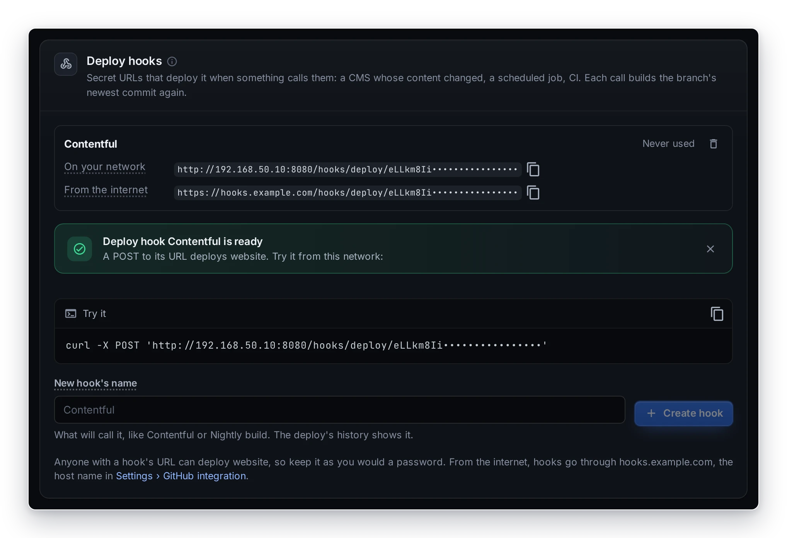
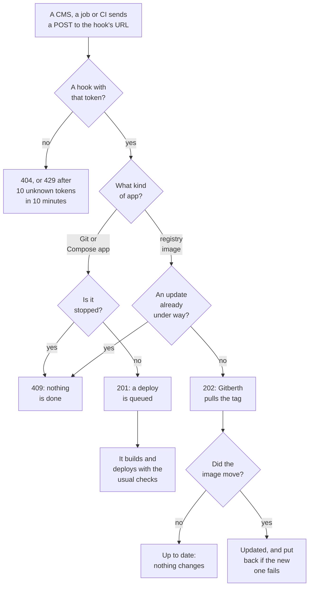

# Deploy hooks

A deploy hook is a secret URL that deploys an app when something calls it, like Vercel's. Give one to a headless CMS so a
site is rebuilt when its content changes, to a scheduled job for a nightly build, or to CI so an app picks up the image it
just pushed. Nothing else is needed: whatever calls the URL sends a `POST`, and Gitberth does the rest.

## Which apps can have them

| App | What a call does |
|---|---|
| A [Git app](deploy-from-github.md) | Builds the branch's newest commit again and deploys it, even when that commit already runs, since what changed is usually outside the repo (a CMS's content). |
| A [Compose app](compose-apps.md) Gitberth keeps the file of | Deploys its Compose file again, with its services' images pulled anew: for CI that pushed new images. |
| An app that runs a registry's tag, such as `ghcr.io/you/website:latest`: one made [from a registry image](run-a-registry-image.md), or a container already on the host that follows one | Pulls the tag, and when the image moved, updates the app the way an [automatic update](updates.md) does: the new container is checked, and the old one comes back if it fails. |

[Previews](previews.md) have no hooks of their own: they deploy with their own commits. An app that runs a
[local image](use-a-local-image.md), one pinned to a digest, and Gitberth itself have none either, since there's nothing to
pull. An app that can't have hooks has no **Deploy hooks** section on its **Settings** tab.

## Make a hook

1. Open the app's **Settings** tab and go to **Deploy hooks**.
2. In **New hook's name**, type a name for what will call it, like `Contentful` or `Nightly build`, and click
   **Create hook**.

The hook shows its URL, **On your network**, with a copy button. **Deploy hook Contentful is ready** shows once, with a
`curl` line to try it from your network:

```bash
curl -X POST 'http://192.168.50.10:8080/hooks/deploy/3hJx…'
```



Make one hook for each thing that calls the app: its name shows on every deploy it starts, and you can delete one without
touching the others. An app has at most 10 hooks, and their names are its own (two apps can each have a `CI`).

> **Note**
> Anyone with a hook's URL can deploy the app, so keep it as you would a password. Gitberth keeps the token encrypted,
> and finds a call's hook by the token's SHA-256.

## Call it

Send a `POST` to the URL. Gitberth ignores the body (a CMS often sends the whole entry), and reads no more than 64 KB of
it.



What it answers:

| Gitberth answers | When |
|---|---|
| `201` | A Git or Compose app's deploy was queued. The body says which: `{"deployment": 12, "app": "website", "status": "queued"}`. |
| `202` | An image app's update started. The body is `{"app": "website", "status": "updating"}`; the pull and the update run on after the answer. |
| `404` | No hook has that token: it was deleted, or the URL is wrong. |
| `405` | Anything but a `POST`. |
| `409` | The app is stopped (a hook never starts an app), or being deleted, or an update or change of an image app is already under way. |
| `429` | The address sent 10 calls with unknown tokens in 10 minutes. A call with a hook's own token always gets through. |

Every answer is only a status code, and JSON for `201` and `202`: never one of Gitberth's pages.

When calls come in quick succession, as a CMS sends one for every entry you save, one build runs and the newest call waits
behind it; the calls in between are cancelled as superseded. So ten saves give at most two builds, the second with
everything in it.

## What you see

- The deploy's trigger is the hook, by name, wherever a trigger shows: **Deploy hook "Contentful"** on the deploy's page,
  on the **Activity** tab and in the app's **Last deploy**, and in [notifications](notifications.md).
- Each call is a line on the app's **Activity**: **Deploy hook "Contentful" started deploy #12** for a Git app, and for an
  image app what came of the update, such as **Deploy hook "CI" updated it to the newest ghcr.io/you/website:latest** or
  **Deploy hook "CI": it's up to date**.
- Each hook says when it was last used.

## Call it from the internet

A hook's URL works on your network as it is. To call it from a CMS in the cloud or from GitHub Actions, give
[instant deploys](github-integration.md#instant-deploys) a host name in **Settings › GitHub integration**, which needs
[domains](domains.md). The same host name takes deploy hooks: the tunnel sends `/hooks/github`, `/hooks/gitlab` and
`/hooks/deploy/<token>` to Gitberth, never behind Cloudflare Access, and every other address on it answers 404. Each hook
then shows a second URL, **From the internet**:

```text
https://hooks.example.com/hooks/deploy/3hJx…
```

A tunnel set up before deploy hooks had a rule for `/hooks/github` alone. Gitberth's next sync of the tunnel (within 15
minutes of the update) gives that rule the deploy hooks' path too, where it stands; nothing needs doing.

## Delete a hook

Click the bin next to the hook, and click **Delete**. Its URL answers `404` from then on; a new hook gets a new URL.
Deleting an app deletes its hooks too. Making and deleting a hook are recorded in the [audit log](audit-log.md), never its
token.

## Related

- [GitHub integration](github-integration.md)
- [Deploys and rollbacks](deploys-and-rollbacks.md)
- [Image updates](updates.md)
- [App settings](../reference/app-settings.md#deploy-hooks)
