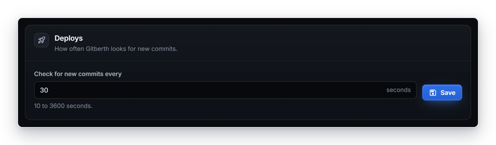
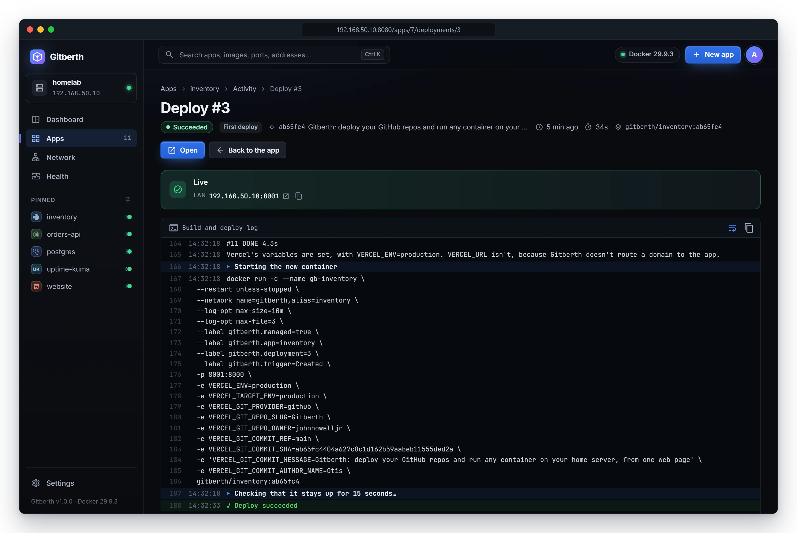
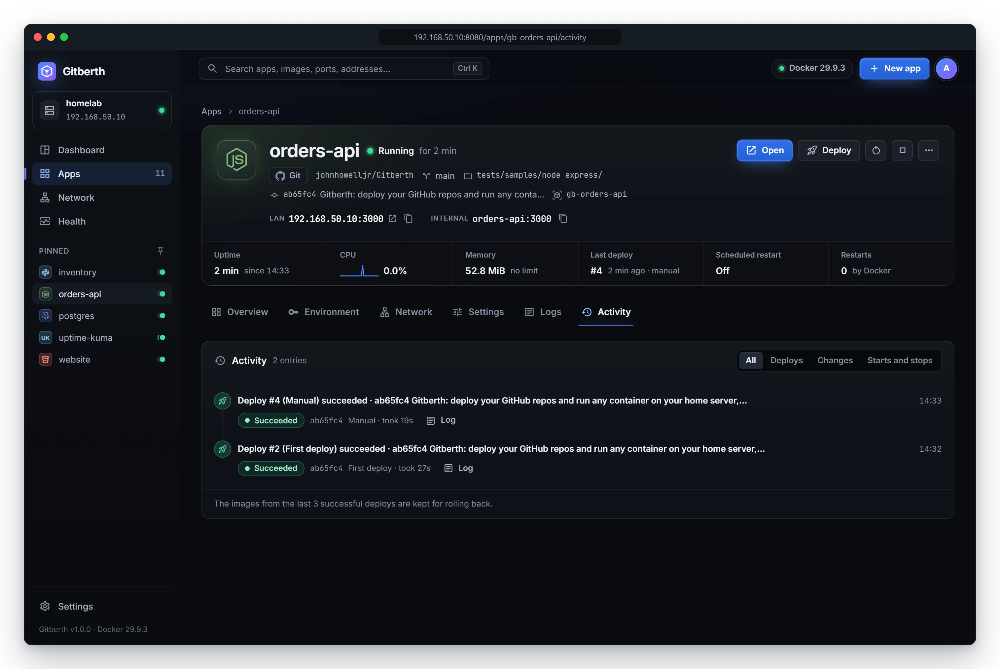

# Deploys and rollbacks

A deploy builds a Git app's image from its repository and swaps the running container for a new one. Gitberth deploys by
itself when the branch gets a new commit, and you can deploy by hand. This page covers when deploys happen, how to read
the deploy log, what Gitberth checks before a new version takes over, how failed builds are retried, and how to roll back
to an earlier version.

Deploys are for Git apps. An app that runs an image is updated, and rolled back, from its **Updates** card instead; see
[Image updates](updates.md).

## When a deploy happens

Each deploy records what started it:

| Trigger | When |
|---|---|
| **First deploy** | You created the app with **Create and deploy**. |
| **New commit** | Gitberth saw a new commit on the app's branch. |
| **Manual** | You clicked **Deploy** on the app's page. |
| **Settings change** | You applied settings that need a new container. This deploy reuses the current image and builds nothing. |
| **Start** | You started a stopped app whose saved settings weren't live yet, one that was never deployed, or one whose container is gone. |
| **Rollback** | You clicked **Roll back to this** on an earlier deploy. |
| **Automatic retry** | Gitberth tried a commit again after its build failed. See [Retries](#retries). |
| **Scheduled restart** | The app's [scheduled restart](scheduled-jobs-and-restarts.md#scheduled-restarts) came due. |

## Automatic deploys

Gitberth checks every watched repository for new commits every 30 seconds, with one `git ls-remote` per repository, however
many apps use it. When an app's branch has a commit it hasn't run or tried yet, it deploys it.

- **Change how often.** Go to **Settings** › **Deploys** and set **Check for new commits every**, from 10 to 3600 seconds.
  Saving it also checks right away.

  

- **Turn it off for one app.** Turn off **Deploy on push** in the app's **Settings** › **Source**. The app then deploys
  only when you click **Deploy**.
- **Stopped apps aren't deployed.** While an app is stopped, Gitberth doesn't watch its branch.
- **A commit is deployed once.** A commit that was already tried isn't deployed again as if it were new, so a broken
  commit doesn't loop. See [Retries](#retries) for the exceptions.
- If GitHub can't be reached, Gitberth tries that repository again 5 minutes later.

## Deploy by hand

Click **Deploy** on the app's page. Gitberth clones the branch's latest commit, builds it and opens the deploy's page.

## The deploy page

A deploy's page shows its number, its state, what started it, the commit with its message and author, when it started,
how long it took, and the image it built (such as `gitberth/website:3f9c2a1`). Below is the **Build and deploy log**, which
follows the deploy live.

The state is one of **Queued**, **Cloning**, **Building**, **Starting**, **Succeeded**, **Failed**, **Rolled back** or
**Cancelled**.

- While it runs, **Cancel** stops it. The running container isn't touched.
- When it succeeds, a **Live** box shows where the app answers, and **Open** opens it.
- When it fails, **The deploy failed** says why. **Rolled back: the old version kept running** means the build worked
  but the new container didn't pass its checks.
- **Back to the app** returns to the app's page.

The log shows each step, in order:

- How many variables came from the repo's GitHub settings, if any.
- **Cloning** the repository and branch, then the **Commit** it got.
- **Detected …** with the generated Dockerfile, **Using the repo's …** Dockerfile, or **Using your custom Dockerfile**,
  with any warnings.
- **Building** the image. Gitberth builds one image at a time; another deploy waits with **Waiting for another build to
  finish…**. A build reaches the containers on Gitberth's network by name, such as `postgres:5432`, so it can run
  database migrations; the log lists them after **Reachable by name while building**.
- Which of Vercel's variables are set.
- **Starting the new container**, then **Checking that it stays up for 15 seconds…**, and the health URL, if you set one.
- **Deploy succeeded**, and the app's domains, if it has any.

To find an older deploy's log, click **Log** next to it on the app's **Activity** tab.

## What Gitberth checks before the new version takes over

- **A failed build never touches the running container.** The app keeps running the last good version.
- **The new container must stay up for 15 seconds**: no exit, no restart, and, if the image has a `HEALTHCHECK`, not
  unhealthy. If the image's check is still starting, Gitberth waits up to another 60 seconds for it to report healthy.
- **It must answer the health URL**, if you set one in **Settings** › **General**, with a status below 400 within 60
  seconds.
- **If it fails a check, the previous container comes back.** Gitberth removes the new one, starts the old one again and
  shows the new container's last output in the log. The deploy ends as **Rolled back**.

### Downtime

An app with a domain is deployed without downtime for its domain's visitors, when it can be. The new version starts next
to the old one on a spare port, passes the same checks, and the tunnel moves the domain to it before the old one stops.
That needs domains turned on, a running app with no volume, a web port published on the host, and `cloudflared` on the
host's network. The log says when it can't, and why.

Every other deploy swaps the containers with a few seconds offline: the old one stops, then the new one starts on the
same host port. Visitors who use the host port rather than the domain always see that gap.
[How deploys work](../concepts/how-deploys-work.md) describes both, step by step.

## Retries

A commit whose build failed is retried by itself, but only twice:

- **Once, 15 minutes later**, in case it was a network or registry hiccup.
- **Once after each update of Gitberth**, which may have fixed how the repository builds.

It never loops. A deploy that built but was rolled back isn't retried, because that would take the running app down again.
A build cut short because Gitberth restarted is retried.

## The Activity tab

The app's **Activity** tab lists what happened to it, newest first. **Show** filters it: **All**, **Deploys**, **Changes**,
or **Starts and stops**.

Each deploy shows its state, its commit, what started it and how long it took, with:

- **Log**, which opens the deploy's page;
- **Roll back to this**, on an earlier successful deploy whose image is still on the host.

Gitberth keeps the images of the last 3 successful deploys, as the tab's footer says, so those are the ones you can roll
back to. An older deploy has no **Roll back to this**: its image was cleaned up, and a deploy always builds the branch's
newest commit, so Gitberth can't make it again.

## Roll back to an earlier deploy

1. Open the app's **Activity** tab.
2. Find the deploy you want and click **Roll back to this**.
3. Gitberth asks **Roll back to #N?** and says the container restarts from the image built from that commit. Click
   **Roll back**.

Gitberth starts a deploy that recreates the container from that image, without building, and opens its page. It goes
through the same checks as any deploy.

A rollback stays until the branch gets a new commit: new commits still deploy by themselves. To stay on the old version
while you fix things, turn off **Deploy on push** in **Settings** › **Source** first.

## Recent deploys on the dashboard

The dashboard's **Deploys** figure counts the deploys of the last 24 hours and names the last one. Its **Recent deploys**
card lists the latest of every app: new apps, pushes, updates, rollbacks and changes that recreate a container. Click one
to open it.

## Related

- [Deploy an app from GitHub](deploy-from-github.md)
- [How deploys work](../concepts/how-deploys-work.md)
- [Domains](domains.md)
- [Troubleshooting](troubleshooting.md)
