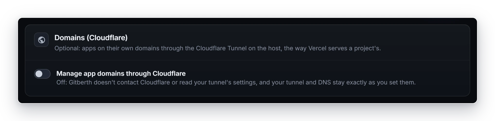
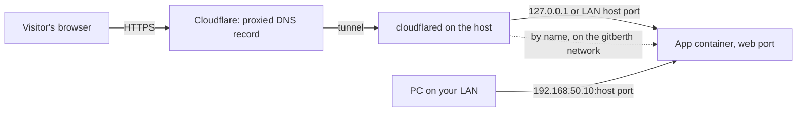

# Domains

Gitberth can give any app domains of its own, like `app.example.com`, served over HTTPS through the Cloudflare Tunnel on the host, the way Vercel gives a project its domains. You add a domain on the app's page, and Gitberth writes the tunnel's route and the DNS record. This is optional: it's off until you turn it on, and apps stay reachable on your LAN either way.

## Before you start

- **A Cloudflare account** with your domain's zone (`example.com`) on it.
- **A Cloudflare Tunnel** created in Cloudflare's Zero Trust dashboard, and **cloudflared running on the host** as a container started with the tunnel's token. Gitberth reads which tunnel to use from that container's `--token` option, its `TUNNEL_TOKEN` variable or its token file, so there's nothing to type in about the tunnel. Only one tunnel may run on the host. For example:

  ```bash
  docker run -d --name cloudflared --restart unless-stopped --network host \
    cloudflare/cloudflared:latest tunnel --no-autoupdate run --token <your tunnel token>
  ```

  You can also paste that command into **New app** (see [Paste a docker run or Compose service](paste-docker-run-or-compose.md)), so cloudflared shows up as an app like any other.
- **A Cloudflare API token.** In Cloudflare, go to your profile's API tokens and choose **Create Token**, then **Create Custom Token**, with these permissions, for your account and your domains' zones:
  - **Account › Cloudflare Tunnel › Edit**
  - **Zone › DNS › Edit**
  - **Zone › Zone › Read**

cloudflared on the host's network (`--network host`, as above) reaches apps through their host ports. cloudflared on the `gitberth` network reaches them by name. If it's on neither, Gitberth joins it to `gitberth` when you save the token.

## Turn on domains

1. Go to **Settings › Domains (Cloudflare)**.
2. Turn on **Manage app domains through Cloudflare**.
   Gitberth says **Domains turned on.**, and the section shows the token fields.
3. Paste the token in **Cloudflare API token** and click **Save token**.
   Gitberth finds the cloudflared container, checks the token against its tunnel, saves the token encrypted, and routes the domains your apps already have. It says **Token saved. Domains are routed.** The section shows **Token saved** and the tunnel, like **Tunnel 1a2b3c4d from the cloudflared container**.



Routes you already made in Cloudflare that go to an app become that app's domains (see [Domains made in Cloudflare](#domains-made-in-cloudflare)). If anything needs attention, the notes under the token say what. When the token can't be saved, the message says why: no cloudflared container, more than one tunnel, a tunnel run from a credentials file, or a token without the permissions above. [Troubleshooting](troubleshooting.md#domains) lists them.

## Add a domain to an app

1. Open the app's page and click the **Network** tab.
2. In the **Domains** card, type the domain, like `app.example.com`, and click **Add domain**.
   Gitberth adds the tunnel route and the DNS record, and the domain shows in the card.
3. Check the pill next to it: **Live** means visitors reach the app. **Not working** comes with a line that says why, and a button to fix it when there's one (see [When a domain isn't working](#when-a-domain-isnt-working)).

The line under each domain says where its route goes, for example **Port 3000, through host port 3001**, or **Port 3000, by name (orders-api:3000)** when cloudflared is on the `gitberth` network.

The app needs a web port: domains go to it. Without one the card says **Mark a web port in Ports first: domains go to the web port.** See [The web port](networking.md#the-web-port).

### When the web port is Internal

With cloudflared on the host's network, the tunnel reaches apps through a host port. If the app's web port is **Internal**, the button reads **Add domain and publish**, and the line under it says what happens: Gitberth also publishes the web port as **Host only**, on `127.0.0.1` at a free host port, so the tunnel reaches it and the LAN still doesn't.

- A Git app restarts once to take the port (or takes it when it next starts, if it's stopped).
- Any other app is recreated once. The change dialog opens first, titled **Publish port 80 for app.example.com?**, and its button is **Recreate and add the domain**. The domain is added once the port is published.

## What Gitberth does in Cloudflare

- **Tunnel route.** One route for the domain that covers every path: pages, `/_next` scripts, APIs and sign-in. It goes to the web port where the app's running container publishes it, so settings you haven't applied yet can't break a live domain. A stopped app's routes stay as they are.
- **DNS.** A proxied DNS record that sends the domain to the tunnel. Gitberth marks the records it adds with the comment **Added by Gitberth**.
- **Checking.** Gitberth checks the routes and records again after every deploy and every change to an app's settings or ports, and moves a route when the app's host port changes. **Check again** at the top of the card reads them again; **Fix** writes what's missing.

## The main domain

When an app has several domains, one is its main domain, tagged **Main**: the address Gitberth tells the app it has, in `VERCEL_URL` and, for apps that use Auth.js, `AUTH_URL` (see [Environment variables](environment-variables.md)). It's the shortest one unless you click **Make main** on another. Front ends build that address into their code, so a new main domain reaches the app with its next build.

## Domains made in Cloudflare

Gitberth works alongside routes and records you made yourself:

- A route that already goes exactly where Gitberth would send the domain (plain HTTP to the app's port) is taken over as the app's domain.
- A route with a path filter is taken over as it is. Cloudflare answers 404 for anything outside the filter, `/_next` scripts included, until you click **Serve every path** and confirm. Widening it could expose more of an app than you meant to, so Gitberth never does it by itself. If you narrow one of Gitberth's routes in Cloudflare later, Gitberth keeps it narrowed.
- Path rules on the domain that go to other services stay ahead of Gitberth's rule, and your other rules keep their order. Routes to anything else are left alone. When Gitberth rewrites a rule, its settings carry over, Cloudflare Access included.
- A DNS record that points somewhere else, such as an old Vercel record, is never replaced unless you click **Point it here** and confirm. If the new record can't be added, the old ones are put back.

## When a domain isn't working

The line under a **Not working** domain says why. The button next to it fixes what Gitberth can:

| What the card says | What to do |
|---|---|
| The tunnel has no route for it yet. | Click **Fix**. |
| The tunnel still sends it to …, where the app was before. | Click **Fix**. |
| A wildcard rule above it in the tunnel catches its traffic first. | Click **Fix**: Gitberth moves the domain's rule above the wildcard. |
| It has no DNS record yet. | Click **Fix**. |
| Its DNS record leads to the tunnel, but Cloudflare's proxy is off for it. | Click **Fix**: Gitberth turns the proxy on. |
| Only addresses matching "…" reach the app, so Cloudflare answers 404 for its other pages, scripts and sign-in. | Click **Serve every path** if the whole app should answer there. |
| Its DNS points somewhere else (…), so visitors don't reach the tunnel on the host. | Click **Point it here** to replace the record. |
| Gitberth's token can't see a Cloudflare zone for it in the tunnel's account. … | Add the domain's zone to that Cloudflare account, or give the token access to it. |
| Not serving: … isn't running, or its saved ports aren't live yet. | Start the app, or apply its saved settings. |

A domain two or more levels below the zone, like `a.b.example.com`, also shows **Cloudflare's free certificate covers example.com and *.example.com only, so a.b.example.com needs Total TLS or an advanced certificate in Cloudflare.**

## Remove a domain

1. In the **Domains** card, click the bin next to the domain.
2. Confirm with **Remove**.
   Gitberth takes the route out of the tunnel, and removes the DNS record if Gitberth added it. A record you made yourself stays. The app keeps running.

Deleting an app takes its domains out the same way. If Cloudflare can't be reached at that moment, the note says **…: … Gitberth tries again every 15 minutes until it's done.** Gitberth does that while domains are on, and also tries at every sync; the route is never taken over again in the meantime.

## Turn domains off

Turn off **Manage app domains through Cloudflare** in **Settings › Domains (Cloudflare)**. Nothing changes in Cloudflare: the tunnel, DNS, token and domains stay as they are, and Gitberth stops contacting Cloudflare and reading the tunnel container. Each app's **Domains** card says **Domains are off**.

An app deleted while domains are off keeps its routes until you turn them back on, and in the meantime no new app gets the port or name those routes go to. The dialog that removes it says so: the domains stay in your Cloudflare Tunnel for now, and Gitberth takes them out when domains are turned back on. When you turn domains back on with a token saved, Gitberth syncs right away and picks up where it left off.

## How traffic reaches the app



cloudflared makes an outbound connection to Cloudflare, so there's no port to open on your router. Visitors on the domain and devices on your LAN reach the same container. An app with an own LAN address keeps using its host port for its domains, because the tunnel can't reach own LAN addresses.

For apps with a domain, a Git deploy starts the new version next to the old one and moves the domain's visitors to it before the old one stops. See [How deploys and changes work](../concepts/how-deploys-work.md#deploys-without-downtime).

> **Note**
> Gitberth's own page is an app too, so you could give it a domain. Whoever reaches Gitberth controls Docker on the host. Put Cloudflare Access in front of that domain before you add it. See [Security](../concepts/security.md#putting-a-domain-in-front-of-gitberth).

## Related

- [Networking](networking.md)
- [Gitberth's settings](../reference/gitberth-settings.md#domains-cloudflare)
- [Troubleshooting](troubleshooting.md#domains)
- [Security](../concepts/security.md)
