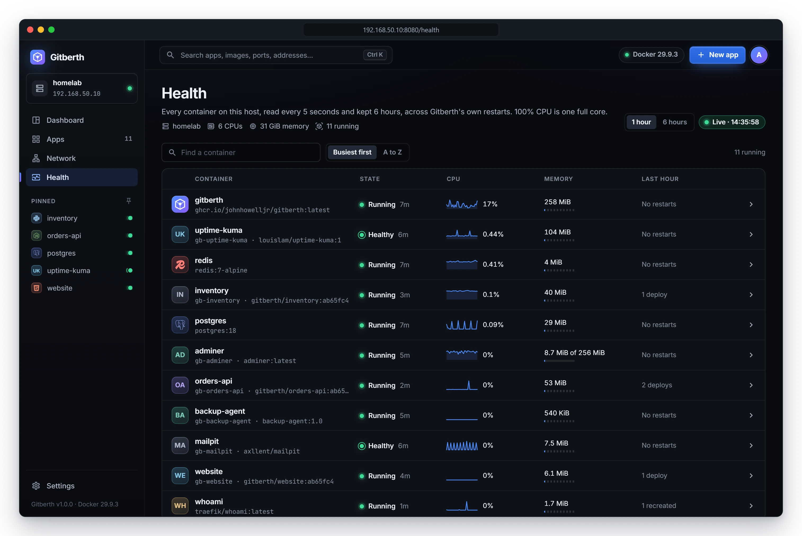
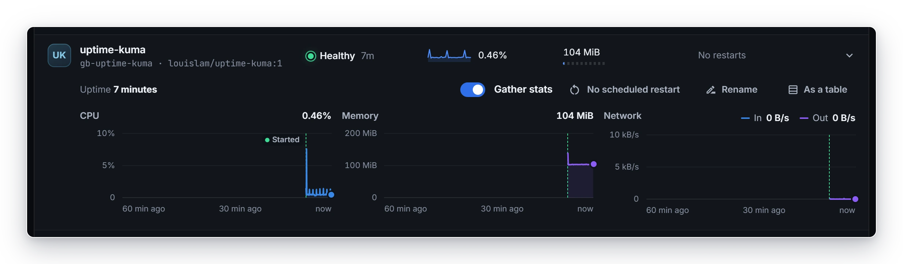
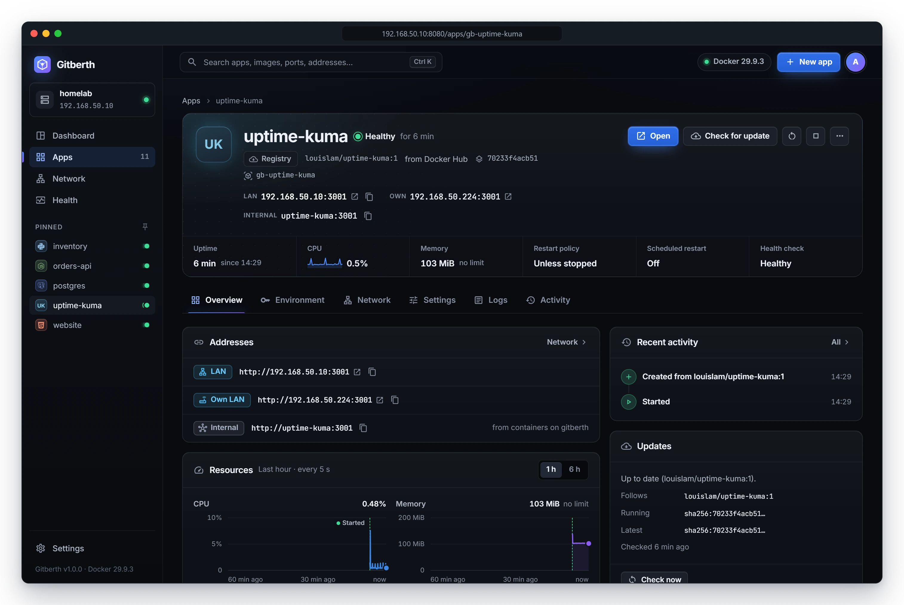

# Health and monitoring

Gitberth records the CPU, memory and network traffic of every container on the host every 5 seconds, including the ones it didn't start, such as cloudflared and Gitberth itself. It keeps 6 hours of readings, across its own restarts, and marks deploys, restarts, crashes and health changes on the charts. This page covers the **Health** page, an app's own charts, and health checks: how to add one and what Gitberth does with it.

## The Health page

Click **Health** in the sidebar. The page lists every container that runs on the host, one row each, the busiest first.

- **The header** shows the host's name, its CPUs, its memory and how many containers run. **Live** with the time of the last reading means the page is current. **Not updating** means Gitberth can't read Docker right now, and the last readings stay on screen.
- **1 hour** shows every reading. **6 hours** shows 30-second averages.
- **Find a container** searches by name, title or image. **Busiest first** and **A to Z** set the order.
- The twelve busiest show first. **Show the other …** lists the rest.
- **Each row** shows the container's name (and its image), its state, a CPU sparkline with the latest reading, its memory, and what happened to it in the time shown, like `1 deploy · 2 restarts`.
- **Stopped** collects the containers that stopped but have readings or events from the last 6 hours. Their state says whether they were stopped or crashed, like **Exited (1)**.

### Open a container's charts

Click the arrow at the end of a row. It opens to three charts: **CPU**, **Memory** and **Network** (in and out).

Above the charts:

- **Gather stats** turns the readings for this container off or on (see [Stop gathering stats for a container](#stop-gathering-stats-for-a-container)).
- **No scheduled restart** (or **Restarts every …**) sets a scheduled restart. See [Scheduled jobs and restarts](scheduled-jobs-and-restarts.md).
- **Rename** gives the container another name in Gitberth (see [Rename a container](#rename-a-container)).
- **As a table** lists the readings and events instead, newest first. **Charts** goes back.

The app page's **More** menu has **On the Health page**, which opens the page at that app's charts.

### Reading the charts

- **CPU** uses the `docker stats` scale: 100% is one full core, so a busy container on a 6-core host can show up to 600%.
- CPU time and network bytes are running totals, so nothing between two readings is missed. Each point is the average over its 5 seconds: a 1-second burst still shows, at a fifth of its height.
- **Memory** is a reading taken at that moment, so a spike that comes and goes between readings isn't seen. With a memory limit set, the chart says how much of it is in use, like `of 512 MiB limit`.
- Containers that use the host's network (`--network host`, as cloudflared often does) have no network counters of their own: the chart says **Uses the host's network, so Docker can't count its traffic separately.**
- A new container shows **Collecting. The first point appears within 10 seconds.**

**Dashed lines** mark what happened, from Docker's own events, so they include containers Gitberth didn't start and restarts it didn't do. Point at a line for the details. The stretch a container was down is shaded.

| Mark | Meaning |
|---|---|
| **Deploy #12** | A deploy started this container |
| **Settings applied** | A deploy applied saved settings |
| **Rollback #12**, **Rolled back** | A rollback, or the previous version running again after a failed deploy |
| **Scheduled restart** | A scheduled restart |
| **Recreated** | A new container took its place |
| **Started**, **Stopped**, **Restarted** | Started, stopped, or restarted by Docker or by hand |
| **Exited** | Its process ended with exit code 0 |
| **Crashed** | It exited with an error code |
| **Out of memory** | It ran out of memory |
| **Paused**, **Resumed** | Paused and resumed |
| **Unhealthy**, **Healthy** | Its health check started failing, and passes again |

After Gitberth itself was down, it picks up whatever events Docker still remembers.

### Rename a container

Containers named by Compose or by hand can be hard to tell apart. **Rename** on the Health page gives one another name:

- **An app's** name changes everywhere in Gitberth, as it would in its **Settings › General**. The container keeps its own name, so nothing is redeployed.
- **Any other container** gets a title that only Gitberth shows. Leave it empty to show the container's own name again.

Either way, the container's own name stays visible under the title.

### Stop gathering stats for a container

Turn off **Gather stats** above a container's charts. It moves to **Not gathering stats** at the bottom of the page, where its switch turns it back on. Its last 6 hours are kept. Every app has the same switch in its **Settings › General**.

## An app's own charts

An app's **Overview** tab has a **Resources** card with its **CPU** and **Memory** charts. **1 h** shows the last hour, every 5 seconds; **6 h** shows the last 6 hours, every 30 seconds. The card says how long the app was last down, and **Open in Health** opens its row on the Health page.

When stats aren't gathered for the app, the card says **Stats aren't gathered for it**, with **Turn it on in Settings**.

The app's header also shows its uptime, CPU (with a sparkline) and memory, against its limit when it has one.

## Health checks

There are two kinds, and an app can have both:

- **A Docker health check** is a command Docker runs inside the container every so often. The container then reports **Starting**, **Healthy** or **Unhealthy**.
- **A health URL** is a path on the app's web port, like `/health`, that Gitberth checks after a deploy or a change, before the new container takes over.

### Add a Docker health check

1. Open the app's **Settings** tab and go to **Health check**.
2. Under **Check**, choose one:
   - **Image default**: the image's own check, if it has one. The section shows it, or says the image has none.
   - **Command**: a command of your own.
   - **None**: no health check.
3. For **Command**, type the **Command**, for example `curl -fsS http://localhost:3000/health || exit 1`. It runs in the container's shell and passes when it exits with 0. Optionally set **Every**, **Timeout**, **Retries** and **Grace period**; empty fields use Docker's defaults (30 s, 30 s, 3 and 0 s).
4. Click **Review and apply**, then **Recreate …** in the change dialog.
   The container is recreated with the new check. For a Git app the button is **Apply**, and the change goes live with a deploy without a build.

The command needs the tool it calls (`curl` here) to be in the image.

### Set a health URL

1. Open the app's **Settings** tab and go to **General**.
2. Type a path in **Health URL**, like `/health`.
3. Click **Apply** in the bar at the bottom. Nothing restarts.

The field shows for Git apps and for apps with a web port.

### What Gitberth does with them

- **Shows them.** The app's state reads **Healthy**, **Unhealthy** or **Starting** wherever it's shown. The **Container** card on the **Overview** shows the check's state and command, or **None.** with **Add one**.
- **Counts unhealthy apps.** An unhealthy app is counted under **Needs attention** on the dashboard and the **Apps** list.
- **Marks the charts** when a check starts failing and when it passes again.
- **Waits for healthy before a new container takes over.** After a deploy, an update or a change that recreates the container, a container with a Docker health check has to report healthy, instead of only staying up for 15 seconds. A deploy waits up to 60 seconds after those 15 seconds. A change or an update waits for the check's grace period plus its interval times (retries + 1), plus 10 seconds.
- **Checks the health URL.** After the container is up, Gitberth requests the health URL on the web port. Any answer below 400 passes; redirects aren't followed. A deploy tries every 2 seconds for up to 60 seconds.
- **Rolls back when they fail.** If the new container reports unhealthy, never reports healthy in time, or the health URL doesn't answer, the old container keeps running (or comes back), and the deploy log or change dialog says which check failed.

Gitberth doesn't restart a container that turns unhealthy later. To restart an app now and then, give it a scheduled restart (see [Scheduled jobs and restarts](scheduled-jobs-and-restarts.md)).

## Related

- [Manage apps](manage-apps.md)
- [App settings](../reference/app-settings.md)
- [How deploys and changes work](../concepts/how-deploys-work.md)
- [Troubleshooting](troubleshooting.md)
