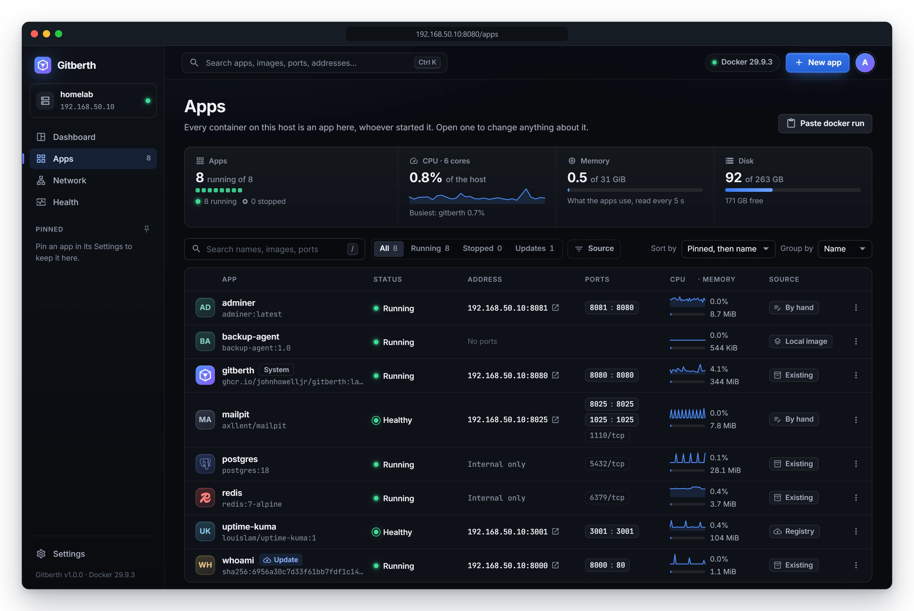
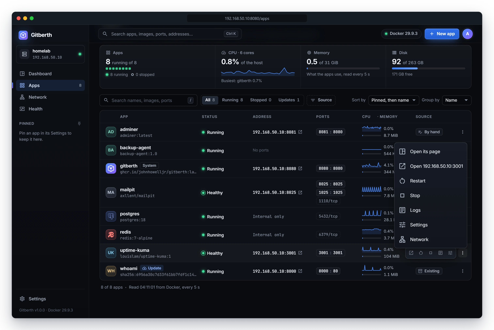
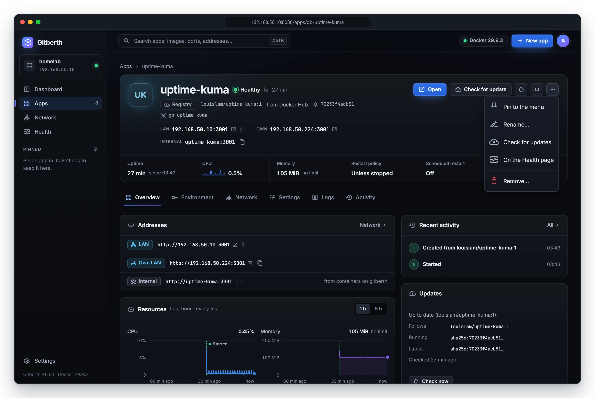
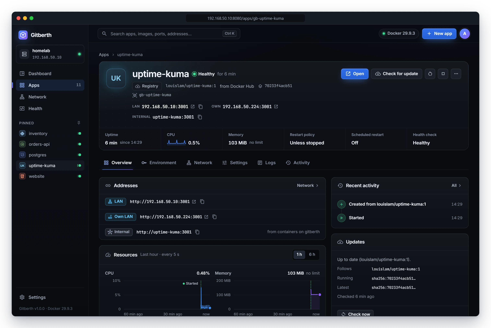
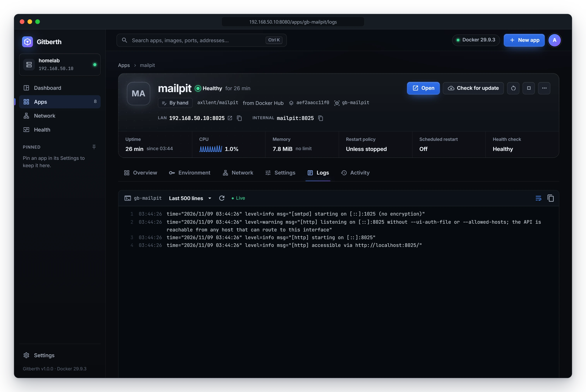
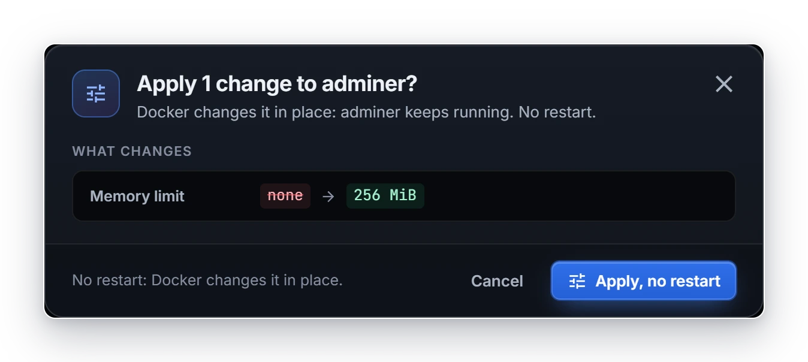
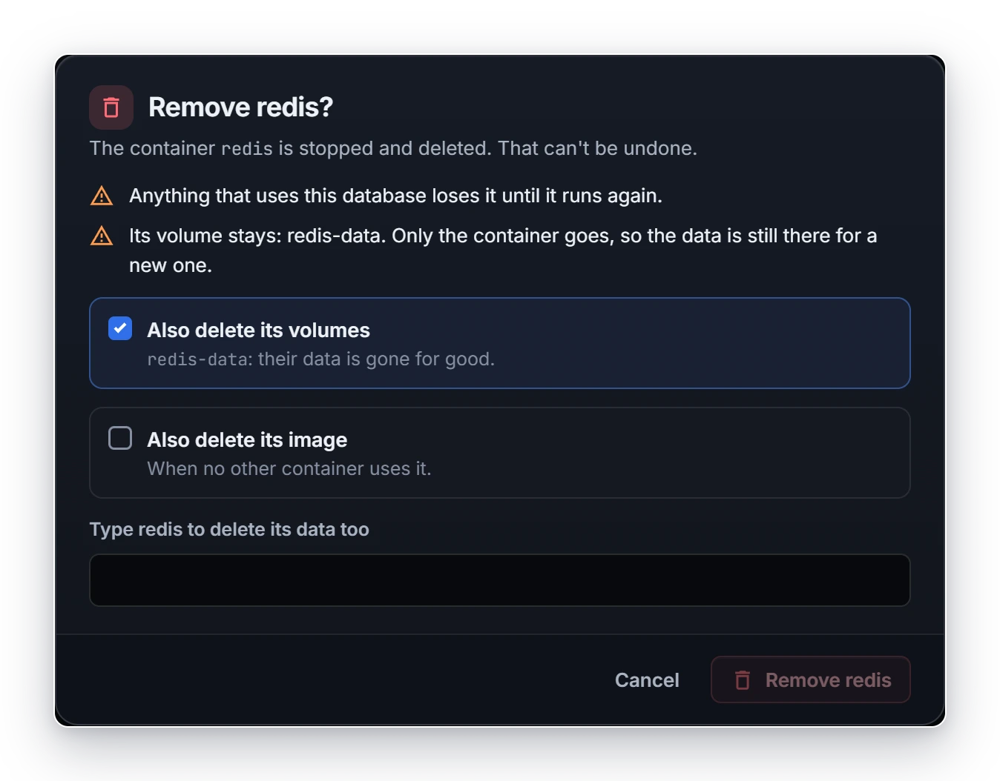

# Manage apps

In Gitberth every container on the host is an app, whoever started it: the ones it builds from GitHub, the images you run
from it, and containers started some other way, such as a database you ran by hand or `cloudflared`. You find them all on
the **Apps** page, and each one has a page where you start, stop and restart it, change any of its settings, and remove it.
This page covers the list, the app page, and what each action does.

## The Apps list

Click **Apps** in the sidebar. The strip at the top shows how many apps are running, the host's CPU, the memory the apps
use, and the disk. If any app is in trouble (crashed, unhealthy, or missing its container), a box says so; click
**Show them** to list only those.

Each row shows:

| Column | What it shows |
|---|---|
| **App** | The app's name, and its repository and branch, or its image. **Update** means a newer image is available (never shown for an app set to **When I ask**); **System** marks Gitberth itself and the Cloudflare tunnel. |
| **Status** | **Running**, **Healthy**, **Stopped**, **Exited with an error**, **Deploying** and so on, with how long it has run. |
| **Address** | Where you reach it. A web address opens in a new tab; a lock means it's reachable from the host only. **Internal only** means no port is published; **No ports** means it has none. |
| **Ports** | Its ports, Docker's way round (`5432:5432`). Click a web port to open it, or any other published port to copy its address. A lock marks a host-only port, and a faint one, like `5432/tcp`, isn't published. |
| **CPU · Memory** | The latest reading, with a small CPU chart. 100% CPU is one full core. |
| **Source** | Where it came from: **Git**, **Registry**, **Local image**, **By hand**, or **Existing** for a container started outside Gitberth. |

The list refreshes every 5 seconds.

### Search, filter, sort and group

- **Search**: type in **Search names, images, ports, addresses** (press **/** to jump there). It finds apps by name, image,
  repository, port or address. Several words narrow it down. When nothing matches, **New app from …** starts a new app
  from what you typed.
- **Show**: **All**, **Running**, **Stopped**, and **Needs attention** or **Updates** when there are any. Each has a count.
- **Source**: pick one or more sources; **Every source** clears it.
- **Sort by**: **Pinned, then name** (the default), **Name**, **Status**, **Address**, **Source**, **CPU** or **Memory**.
  You can also click a column's heading. Click it again, or the arrow next to **Sort by**, to reverse the order. CPU and
  memory start with the highest. The order stays in the page's address, so it's still there when you come back from an
  app.
- **Group by**: **Name** (the default) gathers apps whose names share a first word, like `sample-*`, once there are three
  or more; **Source** groups by where they came from; **Nothing** shows one list. A big group is split by runtime, and
  **Start N stopped** starts the apps in it that were stopped on purpose.

### The row's menu

Hover over a row for quick buttons (open, restart, stop or start, logs, settings), or click the **⋯** button at the end of
the row for its menu:

- **Open its page**
- **Open** and the app's address, when it has a web address and runs
- **Restart** and **Stop**, or **Start** when it's stopped
- **Logs**, **Settings** and **Network**, which open those tabs

**Paste docker run**, at the top of the page, starts a new app from a command. See
[Paste a docker run command or a Compose service](paste-docker-run-or-compose.md).

## The app page

Click an app's name to open its page.

The header shows the app's state, where it came from (its repository, branch, folder and commit, or its image), its
addresses (its domain, **LAN**, **Own**, **Host** and **Internal**), and these figures: **Uptime**, **CPU**, **Memory**,
**Last deploy** for a Git app (or **Restart policy**), **Scheduled restart**, and **Health check** (or **Restarts**).

The buttons are:

- **Open**, when it has a web address; **Connect** for a database; otherwise **Logs**.
- **Deploy** for a Git app. For an app that runs an image, **Update** when a newer image is available, else **Check for
  update**.
- Restart, and stop or start.
- **⋯** (More): **Pin to the menu** (or **Unpin from the menu**), **Rename…**, **Check for update** for an app that runs
  an image, **Roll back to …** after an update (see [Roll back an update](updates.md#roll-back-an-update)), **On the
  Health page**, and **Remove…**.

### The tabs

| Tab | What's on it |
|---|---|
| **Overview** | **Addresses**, with copy buttons and **Connect** for a database; **Resources**, its CPU and memory over the last hour or 6 hours; **Container**: image, command, restart policy, health check, limits, environment, volumes, networks and ID; **Recent activity**; **Updates** for an app that runs an image, with **Check now** and, after an update, **Roll back to …**; and **Scheduled jobs** for a Git app that has any. When the image's tag names another image on the host than the one the container runs (after a new pull or build, or a rollback), the **Container** card still shows the image by its tag, and adds **the tag has moved on**. |
| **Environment** | Its variables. See [Environment variables](environment-variables.md). |
| **Network** | How it's reached, its ports, domains, networks and own LAN address. See [Networking](networking.md) and [Domains](domains.md). |
| **Settings** | Every other setting, in sections. See [Change settings](#change-settings) and [App settings](../reference/app-settings.md). |
| **Logs** | Its live output, with timestamps. The menu chooses how much history to show (**Last 100 lines**, **Last 500 lines** or **Last 2000 lines**); the button next to it reconnects. |
| **Activity** | What happened to it, newest first: deploys, settings changes, updates, starts, stops and crashes. See [Deploys and rollbacks](deploys-and-rollbacks.md#the-activity-tab). |

### Banners

A banner under the header says when something needs you:

- **Saved, not live yet** (Git apps): settings you saved wait for a deploy. Click **Apply now** for a deploy without a
  build, or **Rebuild and deploy**.
- **A change is waiting for you**: a change was cut short, and Gitberth can't tell which container should stay. Click
  **Keep the new one** or **Put the original back**.
- **Its container is gone**, **Not created yet** or **Not deployed yet**: Gitberth has the app's settings but no
  container. For an app from an image or by hand, **Start** (or **Create it again**) makes it from the saved settings, and
  **Forget…** drops the record. For a Git app, the banner says what **Start** will do: make the container again from its
  last image, without a build, or, when that image isn't on the host any more, build the branch again and deploy it. A
  container started outside Gitberth that was removed can only be forgotten here: start it again the way it was started.
- **Renamed outside Gitberth**: its container runs under another name now. Open that one, or forget this record.

## Start, stop and restart

Use the buttons in the app's header, its row on the Apps list, or the dashboard.

- **Stop** always asks first. It says the app stops until you start it again and, for a Git app, that new commits aren't
  deployed while it's stopped.
- **Restart** and **Stop** say first what else they affect, such as the domains `cloudflared` serves, or the apps whose
  settings name this one (an app whose `DATABASE_URL` points at `postgres`).
- **Start** of a Git app whose saved settings aren't live yet recreates it with them. A Git app that was never deployed is
  deployed. One whose container is gone gets it back from its last image, without a build, or is built again from its
  branch when that image isn't on the host any more.
- While Gitberth deploys or changes an app, it can't be started, stopped, restarted or removed until that's done.
- A stopped database won't start while another running one uses the same volume: two servers on the same files can damage
  them. Stop the other one first.
- Gitberth won't stop or remove its own container. Use `docker compose` on the host for that.

## Rename and pin

- **Rename**: click **⋯** › **Rename…**, or go to **Settings** › **General**, and change **Name**. The container keeps its
  own name, so other containers still reach it by it. Nothing restarts.
- **Pin**: click **⋯** › **Pin to the menu**, or turn on **Pinned** in **Settings** › **General**. Pinned apps show in the
  sidebar and on the dashboard.

## Change settings

The **Settings** and **Environment** tabs, and the ports on the **Network** tab, are a draft until you apply them. A
changed field gets **Changed** next to its label and **was …** under it, with an undo button.

While there are changes, a bar at the bottom says how many (**3 unsaved changes**) and what applying does, such as
**No restart.** or how long the app will be offline. Click **Discard** to drop them, or **Apply** (**Review and apply**
when the container is recreated).

What a change does depends on the setting and the app:

| What you change | What happens |
|---|---|
| Name, pinned, gathering stats, health URL, update choice, scheduled restart | Saved at once. Nothing restarts. |
| Restart policy, memory limit, CPU limit, process limit | Changed in place with `docker update`. No restart. |
| Anything else, for an app that isn't from Git | The container is recreated with the new settings. The change dialog shows what happens first. |
| Anything else, for a Git app | Saved, then made live by a deploy without a build. **Save for next deploy** keeps it for later instead. |
| Branch, folder, build, build-time variables or Vercel's variables, for a Git app | Saved. The next deploy builds the app with them. |
| A container that Docker Compose made | Limits change in place. Anything that needs a recreate shows **Change it in Compose**: the lines for its Compose file and the command to run. Gitberth doesn't recreate a Compose container, since Compose would undo it. |
| An app with no container | Saved. It applies when the container is created. |

Gitberth's own container shows its settings, and any change gives the lines for its Compose file.

### The change dialog

When applying recreates the container, the change dialog opens first. It calls the app by its name in Gitberth, not by
its container's: **Apply 1 change to adminer?**, not `gb-adminer`. It shows:

- **What changes**: each setting, old and new.
- **What's kept**: its name, image, command, environment, volumes and the rest.
- **Impact**: about how long it's offline, who notices (the apps whose connections drop, the domains that pause), and
  what happens if the new container fails.

Click **Recreate adminer** to go ahead, or **Cancel**. A change that needs no restart shows **Apply, no restart** instead.

Gitberth creates the new container first, so a setting Docker refuses fails before anything stops. Then it stops the old
one, starts the new one and checks it stays up. The dialog shows each step as it runs, such as **Starting the new
container**, and says **adminer is back** when it's done. If the new container fails its checks, the original comes back
as it was, and the dialog says **Not applied: … runs as before**; **Its last output** shows why. You can close the dialog
while it runs; the change carries on. Your volumes are never removed by a recreate, and a stopped app is recreated
stopped.

## Remove an app

Click **⋯** › **Remove…** on the app's page, or **Remove …** at the bottom of its **Settings** tab.

- **A Git app**: **Delete …?** stops and removes the container and deletes its deploy history and logs. **Also delete its
  images** is ticked; **Also delete its named volumes (their data is lost)** isn't. Its domains come out of the Cloudflare
  Tunnel. Click **Delete app**.
- **Any other app**: **Remove …?** lists what else it affects. The container is stopped and deleted; its volumes stay unless
  you tick **Also delete its volumes**, and then you type the container's name to confirm. **Also delete its image**
  removes the image unless another container uses it or another app keeps it for **Roll back**. The message afterwards
  says why an image stays, like **Its image … stays: … keeps it for Roll back.** Its domains stop answering, as their
  routes come out of the tunnel. Click **Remove …**.

With domains turned off in **Settings**, either dialog says instead that the app's domains stay in your Cloudflare Tunnel
for now, and that Gitberth takes them out when domains are turned back on.

Removing can't be undone. An app with no container left shows **Forget…** instead, which deletes Gitberth's record and
touches no container, volume or image.

## Related

- [App settings](../reference/app-settings.md)
- [Environment variables](environment-variables.md)
- [Networking](networking.md)
- [Health and monitoring](health-and-monitoring.md)
