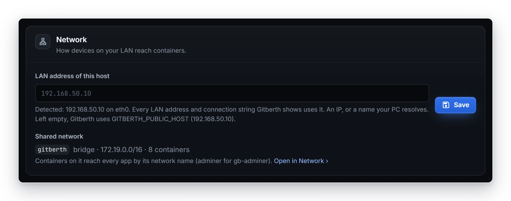
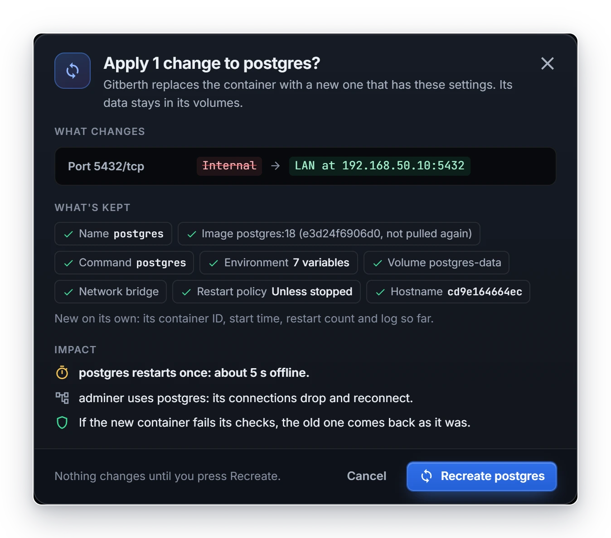
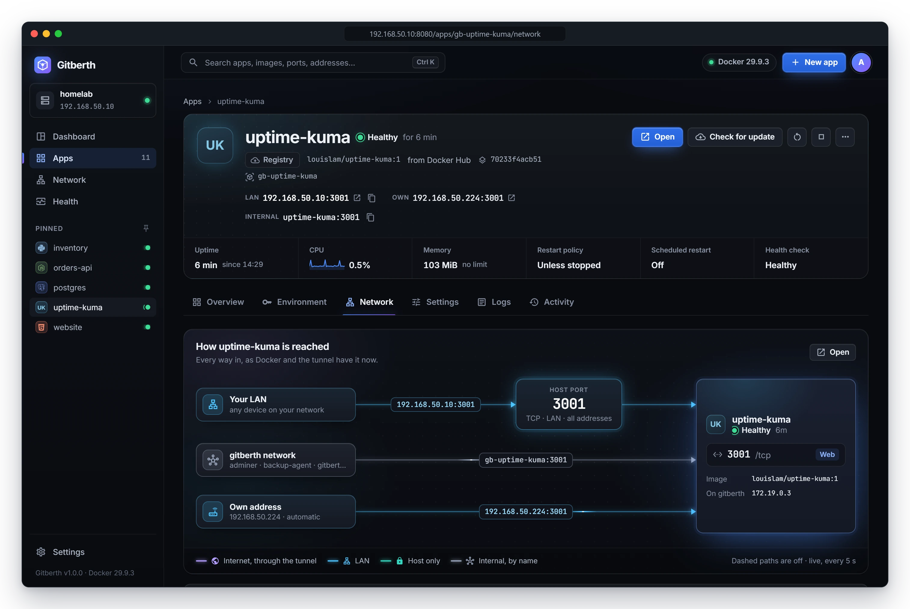
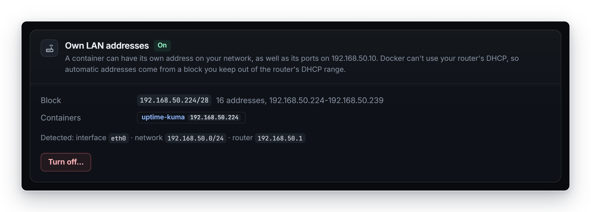
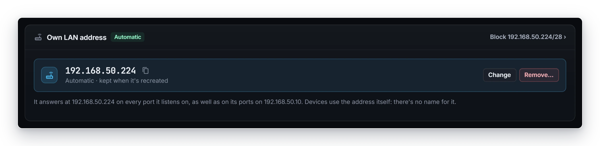
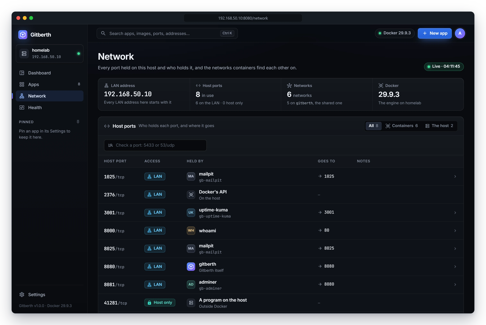
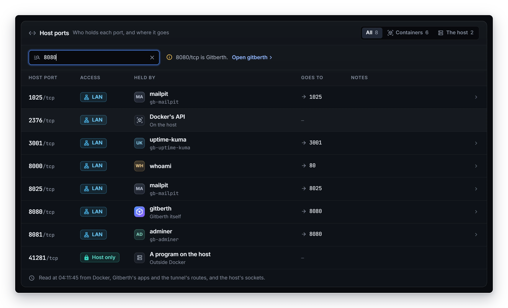

# Networking

Any container on the host can be reached straight from a PC on your LAN, at the host's address and a port. Nothing is installed or changed on the PC or the router, and there's no SSH tunnel: Gitberth uses Docker's own port bindings, so `docker ps`, Portainer and Compose show them like any other. This page shows how to choose who reaches each port, how to give a container an address of its own on your LAN, how containers reach each other by name, and how to find out who holds a host port.

## Who reaches a port: Access

Every port a container listens on has an **Access** setting, on the app's **Network** tab:

| Access | Published on | Who reaches it | Example address |
|---|---|---|---|
| **LAN** | Every address of the host | Every device on your LAN, at the host's LAN address and the host port | `192.168.50.10:5432` |
| **Host only** | `127.0.0.1` | Programs on the host itself, such as the Cloudflare tunnel. The LAN doesn't. | `127.0.0.1:5432` |
| **Internal** | Not published | Containers on the same Docker network, by name | `postgres:5432` |

A port that Docker binds to one particular address of the host shows as **LAN (… only)** with that address.

New apps publish their ports on the LAN. When the host has an IPv6 address the internet can reach (or Gitberth can't read the host's network), Gitberth publishes LAN ports on IPv4 only, so a port never ends up reachable from the internet by accident.

### Host ports

The host port is the port devices use on the host's address. Gitberth offers the container's own port when it's free, else the next free one above it. Looking for the next one, it skips 22 (SSH), 2375 and 2376 (Docker's API), 8080 (Gitberth) and the host's random range (the ports Linux hands out for outgoing connections, usually 32768–60999).

Every host port field checks the port as you type. The line under it says **Free**, or who holds the port, and offers **Use** with a free port when it's taken.

### The LAN address of this host

Every LAN address and connection string Gitberth shows uses one address for the host. Gitberth takes the first of these that's set:

1. **LAN address of this host** in **Settings › Network**. It can be an IP or a name your PC resolves.
2. `GITBERTH_PUBLIC_HOST` in Gitberth's `.env` file (see [Configuration](../reference/configuration.md)).
3. The address Gitberth detects on the host's default route.
4. The address your browser used to open Gitberth.

When the saved address isn't one of the host's any more, **Settings › Network** says so and offers the detected one with **Use it**.

## Publish a port on the LAN

Do this for a database or tool whose port is **Internal** and that you want to reach from a PC, for example `postgres` from a database client.

1. Open the app's page and click the **Network** tab.
   The **How postgres is reached** diagram shows every way in. When the LAN path is off, it has a **Publish on LAN** button: it picks the port (a database's own, else the lowest TCP one) and a free host port, and opens the change dialog of step 4.
2. In the **Ports** card, set the port's **Access** to **LAN**.
3. Check the **Host port**. If the line under it says the port is taken, click **Use** with the free port it offers.
   The bar at the bottom of the page counts your unsaved changes and says what applying does.
4. Click **Review and apply**.
   The change dialog lists what changes, what's kept, and the impact: how long the app is offline (about 5 seconds for a database, 3 for anything else) and who notices.

   

5. Click **Recreate postgres**.
   The dialog shows each step as it runs. You can close it: the change carries on, and the **Ports** card shows how it went. When it's done, the port's address shows in the **Address** column, for example `192.168.50.10:5432`, with a copy button.

For a database Gitberth recognizes (Postgres, MySQL and MariaDB, MongoDB, Redis, RabbitMQ), **Connect** on the app's page gives the host, port, user, password, database and URL, from the LAN or from other containers. If the database isn't published, its **LAN** tab offers **Publish on LAN**.

### What happens when you apply

Docker can't change the ports of an existing container, so Gitberth recreates it:

- **What stays:** its name, its image (the one it runs, not pulled again), command, environment, volumes (anonymous ones too), networks with its names and fixed IPs, restart policy, limits, health check and hostname.
- **What changes:** its container ID, start time, restart count and the log so far. Files it wrote outside its volumes are lost, and the dialog names them.
- **If it fails:** the new container has to stay up (or report healthy), publish every port, and answer at its LAN address if it answered before. If it doesn't, the old container comes back as it was.

A stopped container is recreated stopped. [How deploys and changes work](../concepts/how-deploys-work.md#a-settings-change-on-any-other-app) has the steps in order.

### Git apps and Compose containers

- **A Git app's** ports are part of its settings. **Apply** makes a change live with a deploy without a build, and **Save for next deploy** keeps it for the next deploy. Apps with a domain swap without downtime for domain visitors when they can.
- **A container Docker Compose manages** isn't recreated by Gitberth, because Compose would undo the change the next time it recreates the service. The **Ports** card builds the change all the same and gives the service's `ports:` lines for its Compose file, and the command that applies them, like `cd /opt/db && docker compose -p db -f /opt/db/docker-compose.yml up -d postgres`. For a stack Portainer keeps, it gives the lines to change in the stack in Portainer instead.
- **Gitberth's own ports** are set in its `docker-compose.yml`. See [Configuration](../reference/configuration.md#port).

### Containers Gitberth won't recreate

Their **Ports** card says why in one line. They include Gitberth itself, a deploy's temporary containers, Gitberth's helper containers, containers that Swarm or Kubernetes run, ones started with `--rm`, and one another container depends on (it uses `--network container:…` with it, or `--link`s to it). A paused container has to be unpaused first, and one that keeps restarting has to be stopped first. Changing ports needs Docker 25 or later.

A container on the host's network has no ports to change: it listens on the host's addresses directly. You can note the ports it listens on with **Note a port**, so their addresses are listed. Nothing restarts.

## Change a host port, or take a port off the LAN

1. On the app's **Network** tab, in the **Ports** card, change the **Host port**, or set **Access** to **Host only** or **Internal**.
2. Click **Review and apply**, then **Recreate** in the dialog.

If a domain's tunnel route goes to a host port that would stop answering, the dialog names the domain that breaks.

## The web port

One port of an app is its web port, marked with the globe in the **Web** column of the **Ports** table. **Open**, the app's domains, its health URL and its scheduled jobs use it. Moving the marker restarts nothing: the bar says **Nothing restarts: the web port is Gitberth's own.** and its button is **Save**.

## Give a container its own LAN address

A container can also have an address of its own on your LAN, besides its ports on the host's address. It answers there on every port it listens on, and the address stays the same across restarts and recreates.

Own LAN addresses are off until you turn them on. Docker can't take an address from your router's DHCP, so Gitberth gives out addresses from a block you keep out of the router's DHCP range.

### Before you start

- Pick a block of addresses on the host's network that your router's DHCP never hands out, for example `192.168.50.224/28` (16 addresses). Change the router's DHCP range first if you need to.
- Gitberth has to run in a container: it tests addresses with a helper container.

### Turn on own LAN addresses

1. Go to **Settings › Own LAN addresses**.
   The section shows what Gitberth detected: the interface, the network and the router.
2. Type a block in **Block**, or click **Suggest a block** to have Gitberth find the highest /28 where no device answers.
   A block is a /24 to a /30, or a range of 4 to 256 addresses such as `192.168.50.224-192.168.50.239`. The line under the field says how many addresses it covers, or what's wrong with it.
3. Click **Test**.
   A helper tries every address of the block and the router. Each result shows as a line: **No device answers on …** and **The router answers from the block** mean the block is good.
4. Click **Turn on**.
   Gitberth makes the Docker network `gitberth-lan` on the host's network interface, runs the same test from it, and keeps it only when the test passes.

`gitberth-lan` is an ipvlan network: every address uses the host interface's own MAC address, so your router lists them all under one MAC.

### Give an app an address

1. Open the app's **Network** tab and scroll to **Own LAN address**.
2. Choose one:
   - **Off**: reached through the host's address and its host ports.
   - **Automatic**: the next free address of the block.
   - **Static**: an address you type, anywhere on the host's network. Gitberth checks that no device answers there first.
3. Click **Apply**.
   It's instant and restarts nothing. The line under the card says what Gitberth found when it checked the address, for example that the app answers on its port, or that nothing answers yet because it may listen on another port.

To take the address away, click **Remove…**, which asks first: devices using the address lose it. **Turn off…** in **Settings › Own LAN addresses** lists the containers that would lose their address, asks first, and removes `gitberth-lan`.

> **Note**
> The address has no name: devices use the address itself. Only devices on the host's network, or ones your router routes to it, get answers there. The host itself and the Cloudflare tunnel can't reach these addresses, so domains keep using host ports.

## Reach other containers by name

Every app Gitberth creates is on the Docker network `gitberth`, where other containers reach it by its network name, like `orders-api` for the app `orders-api`. A container started outside Gitberth joins it from its Network tab: with **Join gitberth** on the diagram when it's on no shared network, or by picking `gitberth` in **Join a network…** in the **Networks** card and clicking **Join**. Then apps reach it by its own name, like `postgres:5432`.

- Joining is instant and restarts nothing: the container's published ports and its way out stay where they are.
- Gitberth keeps it joined. When something else recreates the container (`docker run`, `docker compose up`, an image update), Gitberth joins it again as it starts.
- **Leave…** asks first, and says who loses the name.
- The **Networks** card on the Network tab joins and leaves other networks the same way, with an optional extra name.
- Builds of Git apps reach the containers on `gitberth` by name too, for example to run database migrations.

Docker's default `bridge` network gives no names: containers on it reach each other only by IP address, which changes when one is recreated.

## See who holds a host port

The **Network** page lists every host port in use and who holds it: apps, containers, Gitberth, tunnel routes, SSH, Docker's API and programs on the host. It reads them again every 15 seconds.

1. Click **Network** in the sidebar.
   The top shows the host's LAN address, how many host ports are in use (on the LAN and host only), Docker's networks and the Docker version.
2. Filter the **Host ports** list with **All**, **Containers** or **The host**.
   Each line shows the **Host port**, **Held by**, **Access**, **Goes to** (the container port) and notes such as **Stopped**, **Random**, **Saved, not live** or the domains that reach it. A run of ports held by containers with the same name prefix folds into one line.

### Check a port

Type a port in **Check a port**, like `5433` or `53/udp`. The answer says whether it's free, or who uses it, with a link to that container's page.

Answers look like `5433/tcp is free.`, `5432/tcp is used by postgres, port 5432.`, `22/tcp is SSH on the host.` or `8080/tcp is Gitberth.`. A free port in the host's random range says so, because any program may take it for a moment.

Below the ports, **Networks** lists Docker's networks with their driver, subnet and the containers on each. Open one to see each container's names there and its IP address.

## Related

- [Domains](domains.md)
- [App settings](../reference/app-settings.md)
- [How deploys and changes work](../concepts/how-deploys-work.md)
- [Gitberth's settings](../reference/gitberth-settings.md#network)
