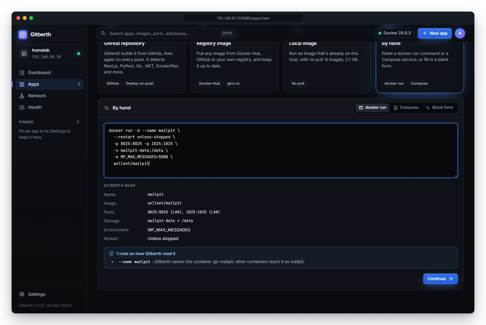
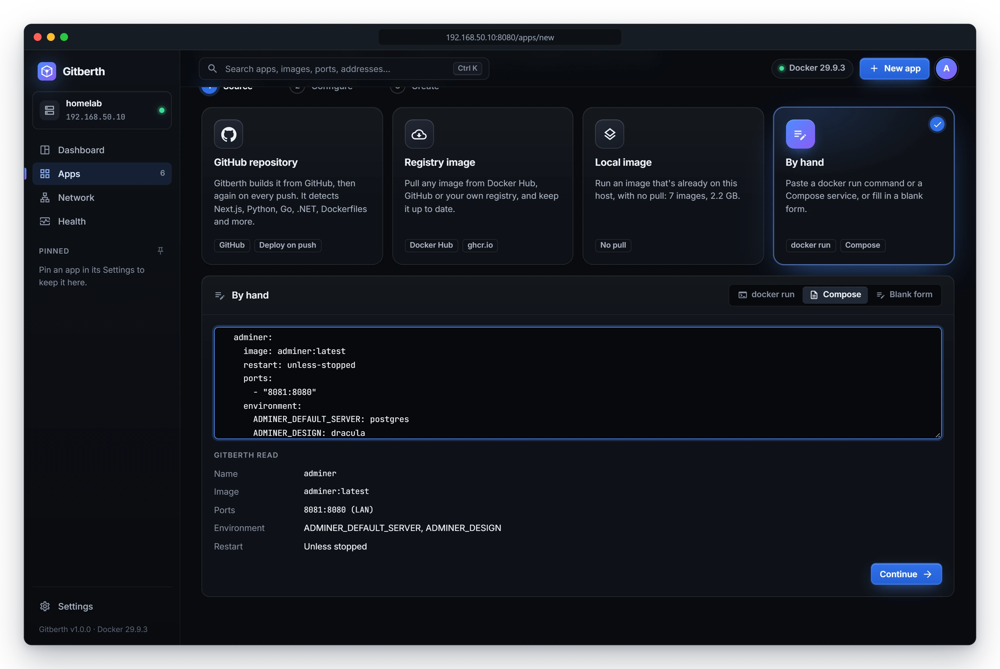

# Paste a docker run command or a Compose service

Most self-hosted projects tell you how to run them with a `docker run` command or a `docker-compose.yml`. Paste that into
Gitberth instead of running it in a shell: Gitberth reads it, shows you what it understood and what it left out, and
creates the app only when you say so. You can also start from a blank form with nothing but an image.

What you paste stays in the page while you work. Gitberth doesn't store it as text; it stores the app's settings.

## Paste a docker run command

1. Click **New app** in the top bar, then the **By hand** card. **docker run** is already selected. (The Apps page's
   **Paste docker run** button opens the same place.)
2. Paste the command into the box. For example:

   ```bash
   docker run -d --name mailpit \
     --restart unless-stopped \
     -p 8025:8025 -p 1025:1025 \
     -v mailpit-data:/data \
     -e MP_DATABASE=/data/mailpit.db \
     axllent/mailpit
   ```

   Gitberth reads it as you paste and shows **Gitberth read**: the **Name**, **Image**, **Command**, **Ports**,
   **Storage**, **Environment**, **Restart** and **Networks** it found. Ports are shown Docker's way round, with who can
   reach them: `8025:8025 (LAN)`, `127.0.0.1:5353:53/udp (Host only)`, `5432/tcp (Internal)`.

   

3. Read the groups under it, if there are any:
   - **N things to fix before it can be created**: errors. Fix them in the paste; **Continue** stays off until you do.
   - **Not carried over (N)**: options the app won't have, each with the reason.
   - **N notes on how Gitberth read it**: how Gitberth took something, such as the container's name.
4. Click **Continue**. The Configure step opens, filled in from the paste; check it as described in
   [Configure](run-a-registry-image.md#configure). An image that isn't on the host yet is read from its registry first,
   so the ports `-P` publishes, and the image's volumes and variables, are there before it's pulled.
5. Click **Review and create**, check the review, and click **Create and start**.

## Paste a Compose service

1. In **New app** › **By hand**, choose **Compose**.
2. Paste one service, or a whole `docker-compose.yml`. For example:

   ```yaml
   services:
     adminer:
       image: adminer:latest
       ports:
         - "8081:8080"
       restart: unless-stopped
   ```

3. If the file has more than one service, Gitberth says **N services: one app each. This one:** and lets you pick which
   one to read. Each service becomes its own app, so create them one at a time. Create a database before the app that
   uses it.

   

4. Check **Gitberth read** and the groups under it, then click **Continue**, **Review and create** and **Create and start**,
   as for `docker run`.

Values Compose would take from a project's `.env` file or your shell, like `${DB_PASSWORD}`, aren't there when you paste:
Gitberth asks you to fill them in. A `${VAR:-default}` uses its default.

## Start from a blank form

1. In **New app** › **By hand**, choose **Blank form**.
2. Type the **Image**: a registry reference such as `postgres:18` or `ghcr.io/you/website:1.4`, or an image built on this
   host.

   Gitberth says whether it's **On this host** (with its size and the ports it exposes), or **Not on this host: it's pulled
   when the app is created**.

3. Click **Continue**, then fill in the Configure step as described in [Configure](run-a-registry-image.md#configure).
   An image that isn't on the host yet is read from its registry first, as for a registry image, so its ports, volumes
   and health check are filled in before it's pulled.

Whichever way you start, the app's first **Updates** choice is **New apps from an image** in **Settings** › **Updates**
(see [Image updates](updates.md#update-choices)).

## What Gitberth keeps and what it doesn't

Every app Gitberth creates is on its shared network, `gitberth`, with a container named `gb-<name>`. A paste is read with
that in mind.

| In the paste | What Gitberth does |
|---|---|
| `--name` or `container_name:` (or the service's name) | Becomes the app's name. The container is `gb-<name>`, and other containers reach it as `<name>`. |
| `-p` / `ports:` | Kept. `127.0.0.1:` makes the port **Host only**. A port with no host port, or a range Docker would pick from, gets a free host port Gitberth suggests. `-P` publishes every port the image exposes. |
| `--expose` / `expose:` | Kept as **Internal** ports. |
| Named volumes and host folders | Kept. A host folder must be a full path on the host, such as `/srv/data`; a relative path or a Windows path is an error. |
| A volume with no name, such as `-v /data` | Gets one, `gb-<name>-data`, so its data survives the app being recreated. |
| A Compose volume such as `data:` | Becomes `gb-<name>-data`, not `<project>_data`. To use a volume Compose already made, give its full name. |
| `-e KEY=value` / `environment:` | Kept. `-e KEY` with no value is an error: give it a value. |
| `--env-file` / `env_file:` | Not carried over: paste the file's lines as variables instead. |
| `--restart` / `restart:` | Kept. Without one, the app gets **Unless stopped**, so it comes back after the host restarts. |
| `--network` / `networks:` | The default bridge, or the project's default network, becomes Gitberth's shared network. A named network is joined; if the host doesn't have it, Configure offers **Create it** or **Remove**. `host` and `none` are kept. |
| Health check, labels, logging, limits, devices, capabilities and the other run settings | Kept, and editable on Configure. Labels starting with `gitberth.` are refused. |
| `build:` without `image:` | Refused: build code with [Deploy an app from GitHub](deploy-from-github.md). With `image:` too, Gitberth runs the image and builds nothing. |
| `depends_on:`, `links:`, `--link` | Not carried over: create the other app first. On the shared network, apps reach each other by name. |
| `--rm` | Not carried over: Gitberth keeps its apps. |
| `scale:`, `deploy: replicas:`, `profiles:`, `extends:`, `secrets:`, `configs:` | Not carried over: one container per app, and Swarm settings don't apply. |
| Namespaces, runtimes, disk I/O limits, Windows-only options and the like | Not carried over, each with its reason. |
| An option or key Gitberth doesn't know | An error: remove it, or set it by hand after the app is created. |

A `docker create` command is read like `docker run`. A `docker compose` or `podman` command isn't: paste the service's YAML,
or the command with `docker`.

## Related

- [Run an image from a registry](run-a-registry-image.md), for the Configure and review steps
- [Manage apps](manage-apps.md)
- [Networking](networking.md)
- [App settings](../reference/app-settings.md)
