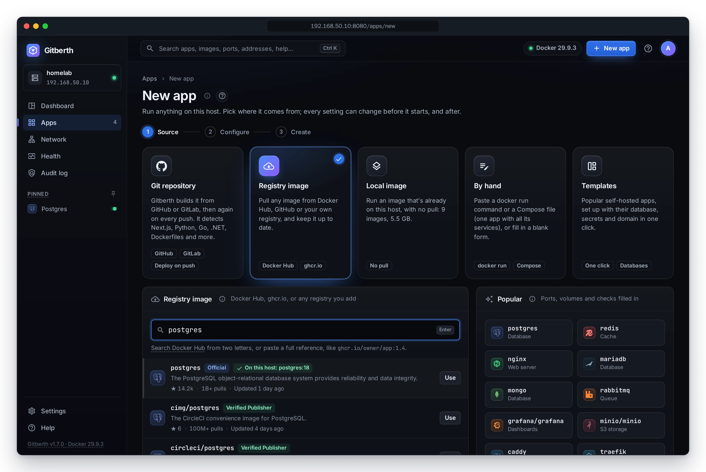
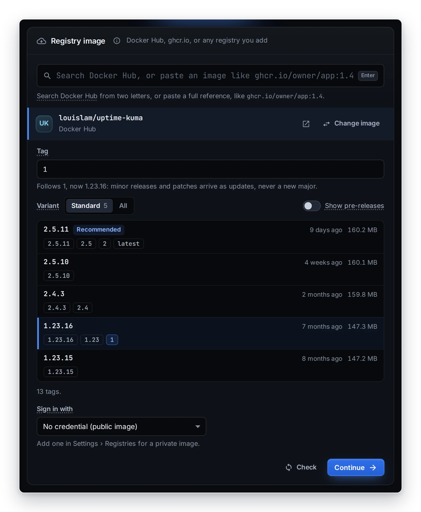
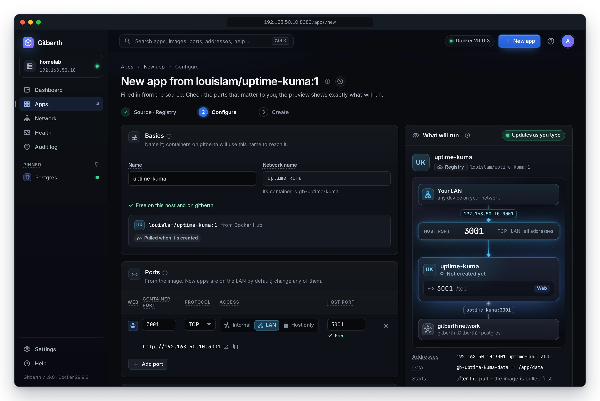
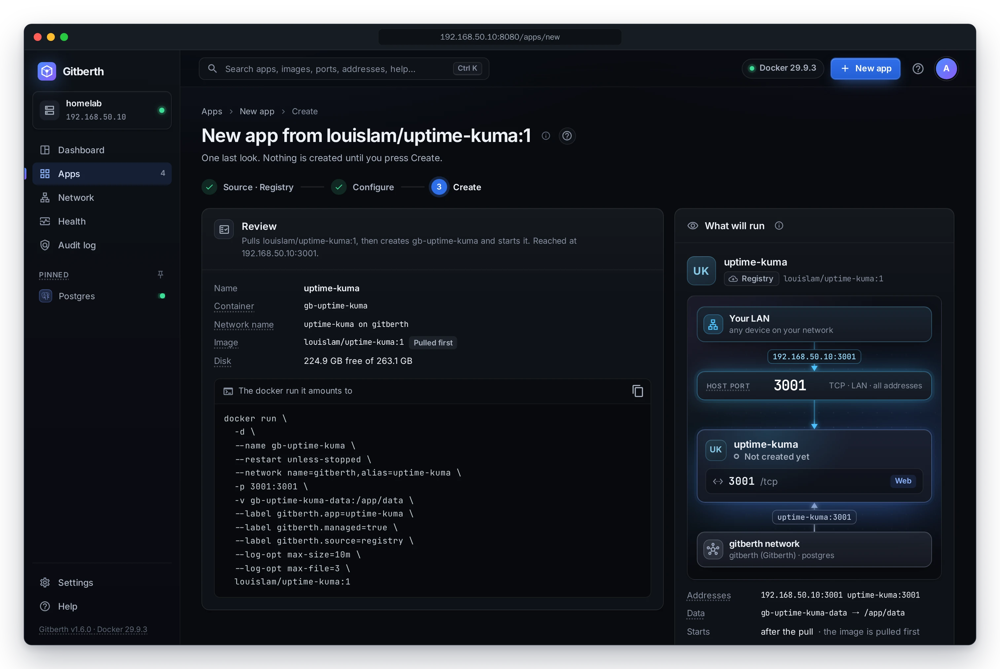

# Run an image from a registry

Run a ready-made image from Docker Hub, GitHub's registry (`ghcr.io`) or a private registry: a database, a monitoring
tool, an admin page. Gitberth reads the image to fill in its ports, volumes and settings, shows you exactly what will run,
and then pulls it, creates the container and starts it. Afterwards it can tell you when the image has a newer version.

The examples run `louislam/uptime-kuma:1`.

## Before you start

A private image needs a sign-in for its registry. Go to **Settings** › **Registries**, fill in **Registry** (such as
`ghcr.io`), **Username** and **Password or token**, and click **Verify and save**. Gitberth signs in once to check it, then
keeps it encrypted. For `ghcr.io`, use a GitHub token that can read packages. Public images need nothing.

## Pick the image

1. Click **New app** in the top bar. **Registry image** is already selected.
2. Find the image in one of three ways:
   - Type a name, such as `uptime-kuma`, into the search box. From two letters on, Gitberth searches Docker Hub as you
     type and lists up to 25 images, in Docker Hub's order. Each shows its badge (**Official** for Docker's own
     curated images, **Verified Publisher** for a company Docker has verified, **Sponsored OSS** for an open-source
     project Docker sponsors), its description, its stars (★), how many times it was pulled, and when it was last
     **Updated**. An image with no build for this host's processor says so, such as **No arm64 image**, and an image
     that's already on this host says **On this host**.
   - Type or paste a full reference: any registry, a port, a tag or a digest, such as `ghcr.io/you/website:1.4`,
     `registry.example.com:5000/team/api` or `redis@sha256:…`. It's listed first, marked **as typed**, and isn't
     searched for: text with a colon, an `@`, or a registry's address before its first `/` never is.
   - Click one of the **Popular** images: `postgres`, `redis`, `nginx`, `mariadb`, `mongo`, `rabbitmq`, `grafana`,
     `minio`, `caddy`, `traefik`, `prometheus` or `uptime-kuma`.
3. Click **Use** on the image you want. From the keyboard: **↓** and **↑** move through the results, **Enter** picks
   the highlighted one (the first, until you move), **Esc** clears the results and then the box, and **Tab** reaches
   the **Use** buttons.

   

   The list folds to the image you picked. **Change image** brings the results back (a **Popular** image empties the
   search box instead); for a Docker Hub image, the arrow beside it opens its page on Docker Hub.
4. Choose the **Tag** in the list under it: see [Choose the tag](#choose-the-tag). Gitberth preselects one for you.
5. Check **Sign in with**. Gitberth picks a saved sign-in whose registry matches (**Automatic: …**), or uses
   **No credential (public image)**. You can choose another saved one.
6. Optionally click **Check**. Gitberth asks the registry for the image and says **Found**, with its platforms and
   digest, or that the image is on this host already, or that the registry refused the sign-in.
7. Click **Continue**.

### When Docker Hub doesn't answer

The search box shows one line under it instead of results, and everything else carries on: type the image's full name
(`nginx:1.27`, `ghcr.io/owner/app:1.4`), pick a **Popular** image, and **Continue**. Gitberth doesn't ask Docker Hub
again while the problem lasts.

- **Docker Hub can't be reached from this host, so there's no search.** Gitberth's own container can't reach
  `hub.docker.com` (no internet, DNS, a firewall). It asks again once a minute has passed.
- **Docker Hub asked Gitberth to wait before searching again.** Docker Hub's rate limit: the line counts down to when it
  may be asked again (**again in 40 s**), and Gitberth searches again by itself then.
- **Docker Hub's search didn't answer properly (HTTP 503).** Its full search and its basic one both failed.

When only the full search fails, the results come from Docker Hub's basic search, with the line **Docker Hub's full
search isn't answering: this is its basic one, with official images marked only.** Those rows have no other badges, no
**Updated** and no processor check. See [Troubleshooting](troubleshooting.md#docker-hub-search-and-tags).

## Choose the tag

Once you pick an image, its tags are listed under it, and the **Tag** field shows the one that will run. Under the
field, a line says what that tag follows, so what will arrive as an update:

- **Follows 1.31, now 1.31.2: patch releases arrive as updates.** A floating tag: it moves to each new patch release.
- **Pinned to 1.31.2: only rebuilds of it arrive as updates.** An exact version.
- **Follows latest, now 1.31.2: every release arrives as an update, majors included.** A channel such as `latest` or
  `stable`.
- **Pinned to one exact image: it never updates.** A digest (`sha256:…`).

The tags are ordered newest stable version first, by their version numbers rather than when they were pushed (an image
rebuilds every version it maintains at once). Each row shows:

- its exact tag, and when it was pushed and how big it is for this host (Docker Hub only);
- **Recommended**: the version `latest` points to, when it's a stable release this host can run, otherwise the newest
  stable version. The field starts on that version one part shorter: `1.31` for nginx's 1.31.2, `18` for postgres
  18.1. You get its patch releases as updates, and a new major version, which can change how an app stores its data,
  never arrives by itself. An image without version tags starts on `latest`; a tag you typed, or a **Popular**
  image's, is kept;
- **pre-release** for an alpha, a beta, a release candidate or a channel like `edge`. They're hidden until you switch
  on **Show pre-releases**;
- **On this host** when one of its tags is on this host already, and on an app's page **Running now** for the image the
  app runs;
- **No amd64 image** (or your host's processor) when it has no build this host can run. You can still choose it;
- its chips: the row's own tag, then the floating tags that point to the same image now, such as `1.31`, `1`, `latest`
  and `mainline`. Click a chip to follow that tag; click the row for its exact tag.

**Variant** picks which flavour is listed, such as **alpine** (smaller, on Alpine Linux) or `bookworm`. The first is
the one the image's `latest` uses; **Standard** is the plain one, and **All** lists every variant together. Under the
list, **Other tags** holds tags that name no version (`bookworm`, `nightly`), other numbering schemes such as dates, and
names Gitberth can't read as a version. On Docker Hub, Gitberth reads the newest few hundred tags; **Load older tags**
reads 100 more. Tags that are never an image you'd run are left out of the list: signatures and attestations
(`sha256-….sig`), commit and CI tags (`sha-4f9c2e1`, `pr-123`), one-processor copies (`amd64-latest`) and another
system's (`windowsservercore-…`).

Typing in the **Tag** field filters the list across every variant; **↓**, **↑** and **Enter** pick a row, **Tab**
reaches its chips, and **Esc** folds the list. Whatever you type is used as it is, a tag that isn't listed or a digest
too, and **Check** asks the registry for it. On Docker Hub, text that matches none of the tags read so far asks Docker
Hub for the tags with it in their name.

**Other registries.** For an image on `ghcr.io`, `quay.io` or a registry of your own, Gitberth reads the registry's own
tag list: anonymously, or with the sign-in saved for that registry in **Settings › Registries** (or the one chosen in
**Sign in with**). That sign-in goes only to that registry, and to the sign-in service its answer names, over HTTPS. A
registry's list has no dates, sizes or processors, so its tags are ordered by version alone, and a floating tag is
matched to the version it most likely names by its name: those chips are marked **≈**. A private image on Docker Hub is
listed the same way, from Docker Hub's registry, when a Docker Hub sign-in is saved. Docker Hub's search and its public
tags are always read anonymously.

When the tags can't be listed, a line says why (the registry wants a sign-in, can't be reached, asked Gitberth to wait,
or has no such image) and ends with **Type the tag instead.**: the field still takes any tag.

## Configure

The Configure step shows every setting the app will have, filled in from the image. On the right, **What will run** shows
the app as it will be: how it's reached, where its data lives, when it **Starts** (**when it's created** for an image
that's on the host, **after the pull** for one that isn't), and the `docker run` it amounts to. It follows every edit.

An image that isn't on the host yet is read from its registry first, without pulling it: Gitberth fetches its manifest and
configuration, signed in with the registry's saved sign-in if it has one, so its ports, volumes and health check are filled
in here as for an image that's on the host. Docker Hub counts that read as a pull against its rate limit. If the registry
can't be read within 6 seconds, or refuses, Basics says **… isn't on this host yet: once it's pulled, its ports and volumes
are filled in.** and they're added after the pull. What you see in Configure is what the app gets: a port you remove here
stays removed after the pull.

Check the parts that matter to you. Everything can change later, on the app's own tabs.

- **Basics**: the **Name**, and the **Network name** it gets: containers on Gitberth's shared network `gitberth` reach it
  by that name, and its container is `gb-<network name>`. If the name is taken, Gitberth adds `-2`. The line under it says
  whether the image is **Already on this host** or **Pulled when it's created**. Notes appear here too, such as a password
  Gitberth generated (see below).
- **Ports**: every port the image exposes, published on the LAN at a free host port. Change the **Access** or the **Host
  port** of any of them, mark the web port, or click **Add port**. See [Networking](networking.md).
- **Network**: **Network mode** is **Its networks** (the shared network plus any you tick), **The host's** or **None**.
  **Own LAN address (optional)** gives it an address of its own on your LAN.
- **Storage**: every folder the image declares as a volume gets a named volume, such as `gb-uptime-kuma-data`, so its data
  survives updates. **Add volume** and **Host folder** add more; each row is a **Volume**, a **Host folder** or **tmpfs**,
  and can be **Read-only**.
- **Environment**: the variables you set. The image's own are folded under **From the image (N)**; change one and it
  becomes the container's own. **Secret** masks a value wherever it's shown.
- **Command**: **Command**, **Entrypoint**, **Working directory** and **User**. Empty fields use the image's own.
- **Restart & resources**: **Restart** (**Unless stopped** by default), and the memory limit, CPU limit, shared memory, CPU
  priority and process limit.
- **Health check**: **Image default** (the image's own check), **Command** (one of your own), or **None**.
- **Labels**, **Logging** and **Advanced** (hostname, stop signal, capabilities, devices and the rest). **Advanced** is
  folded unless the source set something in it; click **Show all** to open it.

[App settings](../reference/app-settings.md) describes each field.

For `postgres`, `mysql` and `mariadb` images, Gitberth generates the root password the image needs to start
(`POSTGRES_PASSWORD`, `MYSQL_ROOT_PASSWORD` or `MARIADB_ROOT_PASSWORD`) and marks it secret. Change it under
**Environment** if you have one already.

## Review and create

1. Click **Review and create**. If a port needs changing, Gitberth says so and stays on Configure.
2. Read the review: the **Name**, the **Container**, its **Network name**, the **Image** (**Pulled first** or **On this
   host**), the free **Disk**, and **The docker run it amounts to**. Nothing has been created yet.

   

3. Click **Create and start**.

   Gitberth pulls the image if it needs to, creates the container, starts it and checks that it stays up. You can leave
   the page; it carries on. When it's done, the app's page opens.

To go back and edit, click **Change settings**, or **Back to the source** on Configure.

## If it doesn't start

If the container doesn't start or doesn't pass its checks, the page says why and what was left behind:

- **Nothing was left behind**: no container, no app record, and its host ports are free again. Click **Try again**, or
  **Edit the settings** first.
- **Gitberth kept it**: Docker wouldn't remove the container. Click **Open …** to see why, and remove it there.

**Its last output** shows what the container printed before it stopped.

## What happens next

- **Updates.** Gitberth checks the tag the app follows for a newer image. What it does then depends on the app's
  **Updates** choice in its **Settings** › **Image**. A new app gets the choice set in **Settings** › **Updates** ›
  **New apps from an image**, **Tell me** unless you changed it: a badge appears when there's a newer image. A database
  gets **Tell me** even when that setting is **Automatically**. An image pinned by digest has nothing to check, so it
  starts on **When I ask**. See [Image updates](updates.md).
- **Changes.** Change any setting on the app's tabs. Most changes recreate the container with the new settings; see
  [Manage apps](manage-apps.md#change-settings).

## Related

- [Image updates](updates.md)
- [App settings](../reference/app-settings.md)
- [Use an image that's already on the host](use-a-local-image.md)
- [Networking](networking.md)
