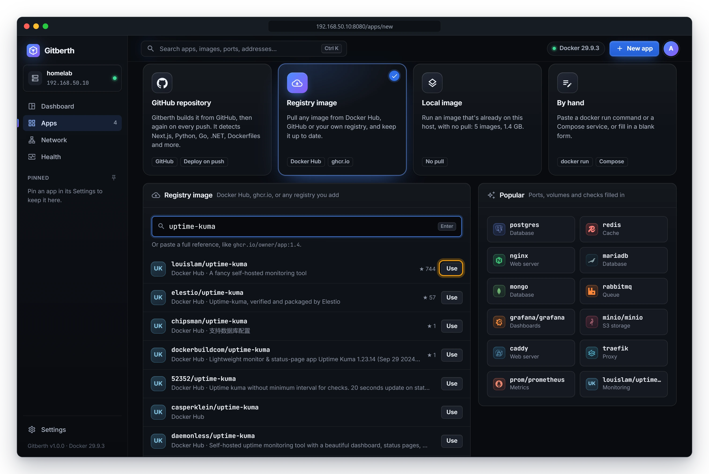
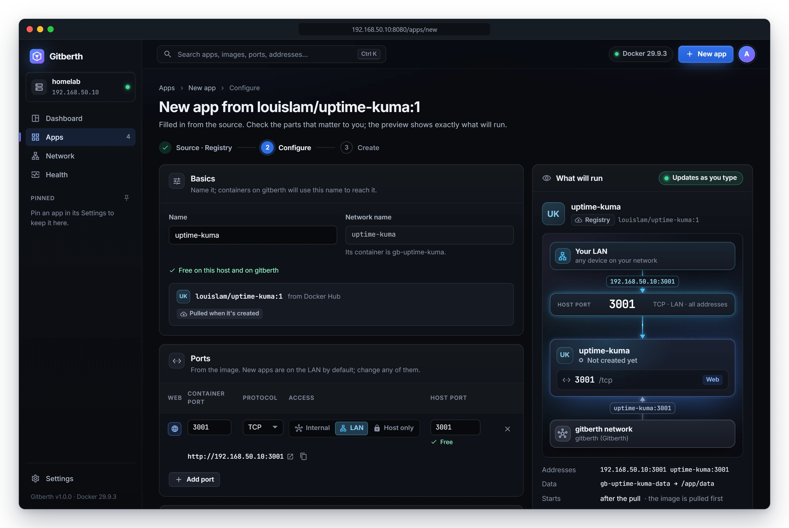
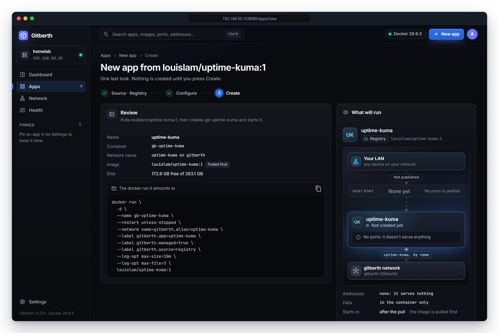

# Run an image from a registry

Run a ready-made image from Docker Hub, GitHub's registry (`ghcr.io`) or a private registry: a database, a monitoring
tool, an admin page. Gitberth reads the image to fill in its ports, volumes and settings, shows you exactly what will run,
and then pulls it, creates the container and starts it. Afterwards it can tell you when the image has a newer version.

The examples run `louislam/uptime-kuma:1`.

## Before you start

A private image needs a sign-in for its registry. Go to **Settings** › **Registries**, fill in **Registry** (such as
`ghcr.io`), **Username** and **Password or token**, and click **Verify and save**. Gitberth signs in once to check it, then
keeps it encrypted. For `ghcr.io`, use a GitHub token that can read packages. Public images need nothing.

## Pick the image

1. Click **New app** in the top bar. **Registry image** is already selected.
2. Find the image in one of three ways:
   - Type a name, such as `uptime-kuma`, into the search box. Gitberth searches Docker Hub as you type and lists what it
     finds, with its stars and whether it's an official image. An image that's already on this host says
     **On this host**.
   - Paste a full reference, such as `ghcr.io/you/website:1.4`. It's listed first, marked **as typed**.
   - Click one of the **Popular** images: `postgres`, `redis`, `nginx`, `mariadb`, `mongo`, `rabbitmq`, `grafana`,
     `minio`, `caddy`, `traefik`, `prometheus` or `uptime-kuma`.
3. Click **Use** on the image you want. Pressing **Enter** in the search box picks the first one.

   

4. Choose the **Tag**. It's `latest` unless you pick another; the image's tags are listed under the field. A digest
   such as `sha256:…` pins one exact image.
5. Check **Sign in with**. Gitberth picks a saved sign-in whose registry matches (**Automatic: …**), or uses
   **No credential (public image)**. You can choose another saved one.
6. Optionally click **Check**. Gitberth asks the registry for the image and says **Found**, with its platforms and
   digest, or that the image is on this host already, or that the registry refused the sign-in.
7. Click **Continue**.

## Configure

The Configure step shows every setting the app will have, filled in from the image. On the right, **What will run** shows
the app as it will be: how it's reached, where its data lives, when it **Starts** (**when it's created** for an image
that's on the host, **after the pull** for one that isn't), and the `docker run` it amounts to. It follows every edit.

An image that isn't on the host yet is read from its registry first, without pulling it: Gitberth fetches its manifest and
configuration, signed in with the registry's saved sign-in if it has one, so its ports, volumes and health check are filled
in here as for an image that's on the host. Docker Hub counts that read as a pull against its rate limit. If the registry
can't be read within 6 seconds, or refuses, Basics says **… isn't on this host yet: once it's pulled, its ports and volumes
are filled in.** and they're added after the pull. What you see in Configure is what the app gets: a port you remove here
stays removed after the pull.

Check the parts that matter to you. Everything can change later, on the app's own tabs.

- **Basics**: the **Name**, and the **Network name** it gets: containers on Gitberth's shared network `gitberth` reach it
  by that name, and its container is `gb-<network name>`. If the name is taken, Gitberth adds `-2`. The line under it says
  whether the image is **Already on this host** or **Pulled when it's created**. Notes appear here too, such as a password
  Gitberth generated (see below).
- **Ports**: every port the image exposes, published on the LAN at a free host port. Change the **Access** or the **Host
  port** of any of them, mark the web port, or click **Add port**. See [Networking](networking.md).
- **Network**: **Network mode** is **Its networks** (the shared network plus any you tick), **The host's** or **None**.
  **Own LAN address (optional)** gives it an address of its own on your LAN.
- **Storage**: every folder the image declares as a volume gets a named volume, such as `gb-uptime-kuma-data`, so its data
  survives updates. **Add volume** and **Host folder** add more; each row is a **Volume**, a **Host folder** or **tmpfs**,
  and can be **Read-only**.
- **Environment**: the variables you set. The image's own are folded under **From the image (N)**; change one and it
  becomes the container's own. **Secret** masks a value wherever it's shown.
- **Command**: **Command**, **Entrypoint**, **Working directory** and **User**. Empty fields use the image's own.
- **Restart & resources**: **Restart** (**Unless stopped** by default), and the memory limit, CPU limit, shared memory, CPU
  priority and process limit.
- **Health check**: **Image default** (the image's own check), **Command** (one of your own), or **None**.
- **Labels**, **Logging** and **Advanced** (hostname, stop signal, capabilities, devices and the rest). **Advanced** is
  folded unless the source set something in it; click **Show all** to open it.

[App settings](../reference/app-settings.md) describes each field.

For `postgres`, `mysql` and `mariadb` images, Gitberth generates the root password the image needs to start
(`POSTGRES_PASSWORD`, `MYSQL_ROOT_PASSWORD` or `MARIADB_ROOT_PASSWORD`) and marks it secret. Change it under
**Environment** if you have one already.

## Review and create

1. Click **Review and create**. If a port needs changing, Gitberth says so and stays on Configure.
2. Read the review: the **Name**, the **Container**, its **Network name**, the **Image** (**Pulled first** or **On this
   host**), the free **Disk**, and **The docker run it amounts to**. Nothing has been created yet.

   

3. Click **Create and start**.

   Gitberth pulls the image if it needs to, creates the container, starts it and checks that it stays up. You can leave
   the page; it carries on. When it's done, the app's page opens.

To go back and edit, click **Change settings**, or **Back to the source** on Configure.

## If it doesn't start

If the container doesn't start or doesn't pass its checks, the page says why and what was left behind:

- **Nothing was left behind**: no container, no app record, and its host ports are free again. Click **Try again**, or
  **Edit the settings** first.
- **Gitberth kept it**: Docker wouldn't remove the container. Click **Open …** to see why, and remove it there.

**Its last output** shows what the container printed before it stopped.

## What happens next

- **Updates.** Gitberth checks the tag the app follows for a newer image. What it does then depends on the app's
  **Updates** choice in its **Settings** › **Image**. A new app gets the choice set in **Settings** › **Updates** ›
  **New apps from an image**, **Tell me** unless you changed it: a badge appears when there's a newer image. A database
  gets **Tell me** even when that setting is **Automatically**. An image pinned by digest has nothing to check, so it
  starts on **When I ask**. See [Image updates](updates.md).
- **Changes.** Change any setting on the app's tabs. Most changes recreate the container with the new settings; see
  [Manage apps](manage-apps.md#change-settings).

## Related

- [Image updates](updates.md)
- [App settings](../reference/app-settings.md)
- [Use an image that's already on the host](use-a-local-image.md)
- [Networking](networking.md)
