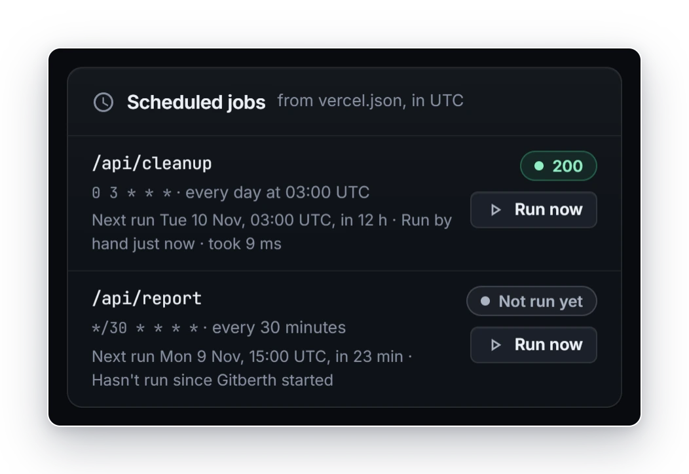
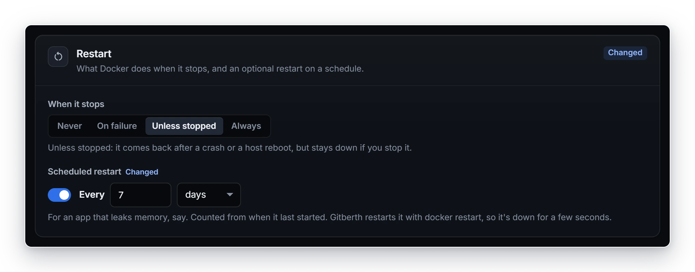

# Scheduled jobs and restarts

Gitberth can do two things on a schedule. **Scheduled jobs** call a path of a Git app at set times, the way Vercel runs
the `crons` in a project's `vercel.json`, so an app's jobs keep running after it moves off Vercel. **Scheduled restarts**
restart any container every so often, for apps that leak memory or otherwise do better with a fresh start now and then.

## Scheduled jobs

### Add jobs to an app

Scheduled jobs come from the `crons` list in the app's `vercel.json`. There's nothing to set up in Gitberth.

1. In the app's folder in the repository, add or edit `vercel.json`:

   ```json
   {
     "crons": [
       { "path": "/api/cleanup", "schedule": "0 3 * * *" },
       { "path": "/api/digest", "schedule": "*/15 * * * *" }
     ]
   }
   ```

   For an app in a sub-folder, Gitberth reads the folder's own `vercel.json`, or the repository root's when its
   `rootDirectory` points at the app's folder.

2. Commit and push. The next deploy reads the jobs while it builds the image, and the deploy log lists them under
   **Cron jobs from vercel.json**. An entry Gitberth can't use is left out, and the log says why.

The jobs travel with the image, so a rollback runs the jobs of the image it goes back to. An image built before Gitberth
read crons has none: deploy again to pick them up.

### See and run them

The app's **Overview** tab shows a **Scheduled jobs** card when the app has any. Each job shows its path, its schedule
(with what it means, such as "every day at 03:00 UTC"), when it runs next, and how its last run went: its HTTP status,
**Failed**, **Skipped**, **Not called** or **Not run yet**.



Click **Run now** to run a job right away. The result appears as a message and on the card.

The card keeps the last 10 runs of each job in memory, so the history starts over when Gitberth restarts.

### Schedules

A schedule has five fields, always in UTC: minute, hour, day of the month, month and day of the week.

- Each field takes `*`, numbers, ranges (`1-5`), lists (`1,3`) and steps (`*/5`, `1-10/2`).
- Days of the week go from 0 (Sunday) to 6 (Saturday); 7 is Sunday too.
- Names like `MON` or `JAN` aren't supported: use numbers.
- Either the day of the month or the day of the week must be `*`.
- A job's `path` must start with `/`. Up to 100 jobs are read from one `vercel.json`.

### How a job runs

In each minute its schedule matches, Gitberth makes a `GET` request to the job's path on the app's running container, at
its web port. The request carries:

- `User-Agent: vercel-cron/1.0`
- `x-vercel-cron-schedule: <schedule>`
- `Authorization: Bearer <CRON_SECRET>`, when the app has a `CRON_SECRET` variable. Gitberth reads it from the running
  container itself.

As on Vercel, a failed run isn't retried, a redirect ends the run, and runs that came due while Gitberth was down aren't
caught up. Unlike Vercel, a run that comes due while the same job's previous run is still going is skipped, and shown as
**Skipped**. Gitberth waits 5 minutes for an answer.

Jobs run only while the app is running, and they go to its web port, so the app needs one. When it doesn't have one, or is
stopped, the card says so. Mark the web port on the app's **Network** tab; see [Networking](networking.md).

## Scheduled restarts

Any container on the host can be restarted on a schedule: every so many minutes, hours or days, or never, which is the
default. That includes containers Gitberth didn't start, such as a database or `cloudflared`.

### Set a scheduled restart

On the app's page:

1. Open the **Settings** tab and go to **Restart**.
2. Under **Scheduled restart**, turn the switch on, so it reads **Every**.
3. Type how many, and pick **minutes**, **hours** or **days**.
4. Click **Apply** in the bar at the bottom. It's saved at once and nothing restarts.



Or, on the **Health** page, click the restart button in the container's row (it says **No scheduled restart** or
**Restarts every …**), pick **Every N minutes**, **Every N hours**, **Every N days** or **Never**, type how many, and click
**Save**.

The dialog, and the help under **Scheduled restart** on the **Settings** tab, say what a restart does to that container:
a Git app is recreated with a deploy's checks, and anything else gets `docker restart`, so it's down for a few seconds.
[When a restart happens](#when-a-restart-happens) has the details.

The shortest schedule is every 5 minutes, the longest every 365 days. The app's header shows the schedule under
**Scheduled restart**. To stop it, turn the switch off again, or pick **Never**.

### When a restart happens

A container is restarted once it has been up for its interval, counted from when it last started. A deploy, an update or
a restart by hand starts the count again. Gitberth checks every minute.

- **Git apps** are recreated from their current image, like applying settings, so they go through a deploy's checks. A new
  container that doesn't start leaves the old one running, and an app with a domain restarts
  [without downtime](deploys-and-rollbacks.md#downtime) where it can. Each restart shows on the **Activity** tab as a
  deploy started by **Scheduled restart**.

  While the app has saved settings that aren't live yet, its container is restarted as it is, with `docker restart`, so a
  schedule never applies changes you haven't.

- **Every other container** gets `docker restart`, so it's down for a few seconds. Restarting `cloudflared` briefly takes
  every domain offline, and restarting a database drops its connections. Restarting Gitberth's own container interrupts a
  deploy that's running, which is then tried again.

A stopped container isn't started, an app in the middle of a deploy waits, and so does a container Gitberth is changing.

## Related

- [Deploys and rollbacks](deploys-and-rollbacks.md)
- [Health and monitoring](health-and-monitoring.md)
- [App settings](../reference/app-settings.md#restart)
- [Environment variables](environment-variables.md)
