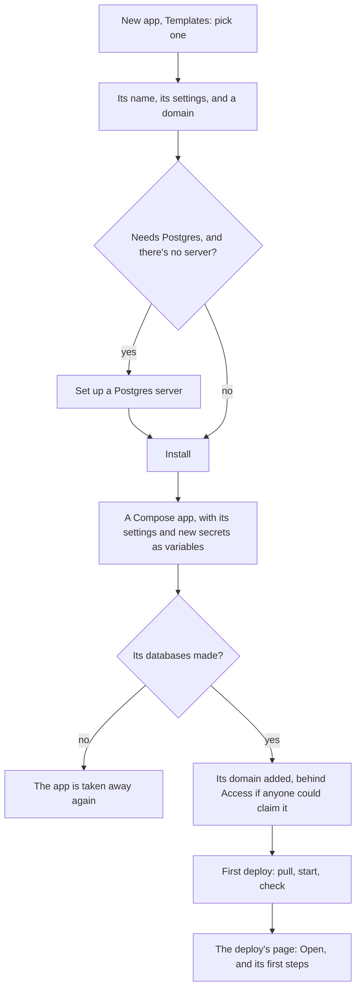
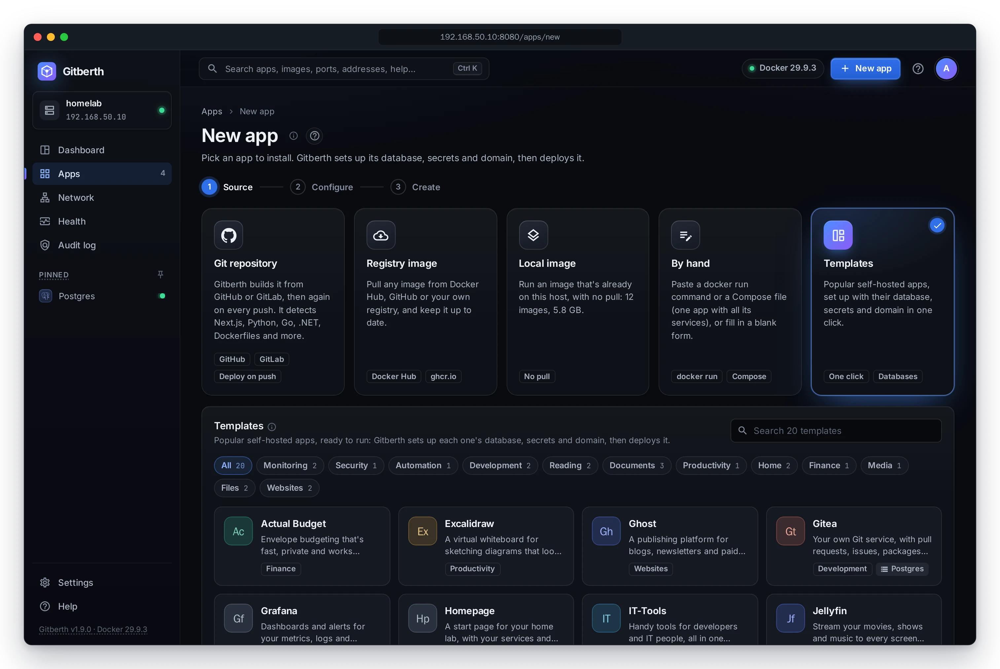
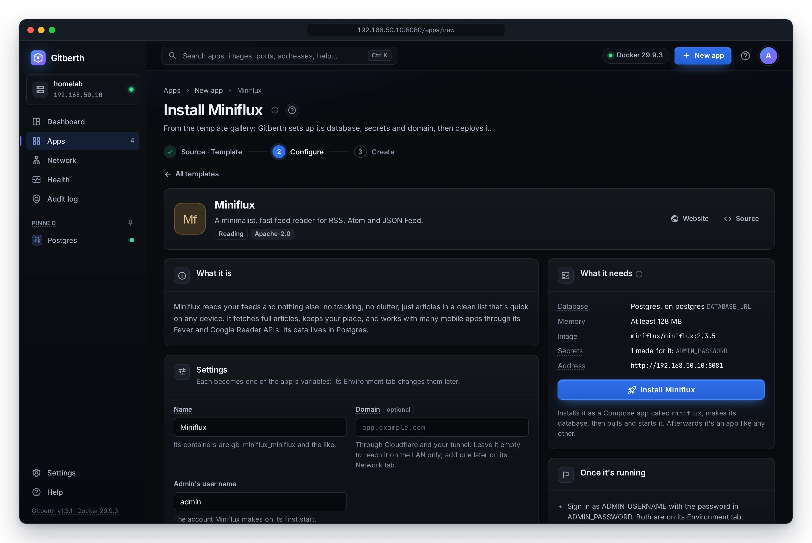
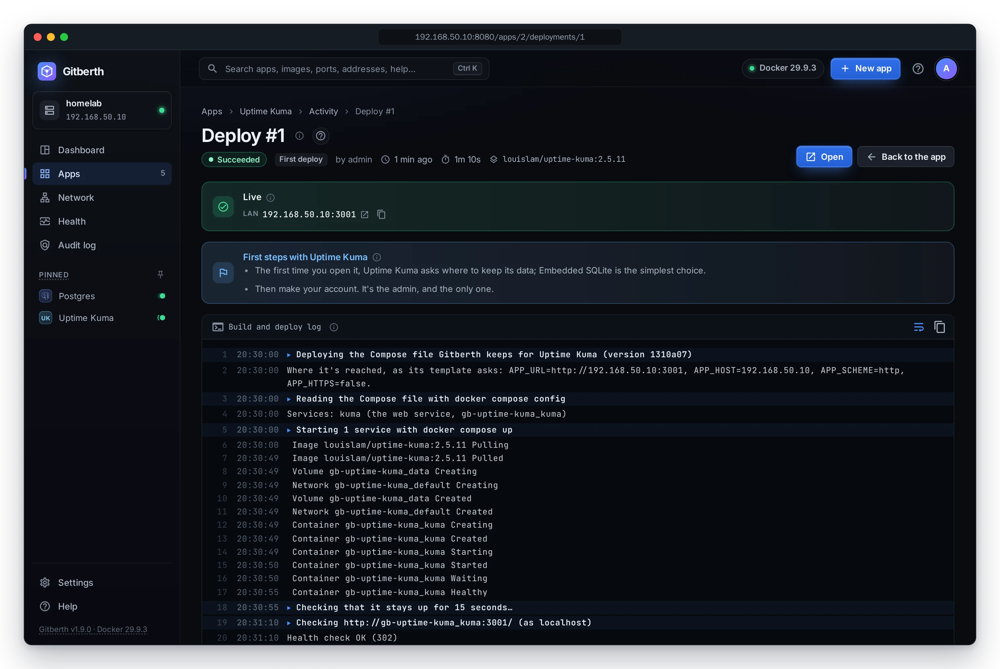

# App templates

Templates are popular self-hosted apps, ready to run: pick one in **New app › Templates**, and Gitberth sets it up with
its database, secrets and domain, then deploys it, like the one-click apps of other platforms. Afterwards it's an app like
any other: a [Compose app](compose-apps.md) whose settings, variables, services, domains and uptime you change on its page.

## What's in the gallery

| Template | What it is | Needs | Its first sign-in |
|---|---|---|---|
| Actual Budget | Envelope budgeting that's fast, private and works offline | | Its first visitor sets its password |
| Excalidraw | A whiteboard for sketches and diagrams that look hand-drawn | | No accounts |
| Ghost | Blogs, newsletters and paid memberships | A MySQL of its own | Its first visitor makes the owner |
| Gitea | Your own Git service, with pull requests, issues, packages and CI | Postgres | Its first visitor installs it |
| Grafana | Dashboards and alerts for your metrics and logs | | A generated admin password |
| Homepage | A start page for your home lab, with your services' status | | No accounts |
| IT-Tools | Handy tools for developers and IT people | | No accounts |
| Jellyfin | Stream your movies, shows and music | | Its first visitor makes the admin |
| Linkding | A bookmark manager with tags and a browser extension | | A generated admin password |
| Mealie | Recipes, meal plans and shopping lists | | A default admin, changed at first sign-in |
| Memos | Quick notes in a timeline, in Markdown | | Its first account is the admin |
| Miniflux | A minimalist feed reader | Postgres | A generated admin password |
| n8n | Workflow automation with AI steps and code | Postgres | Its first visitor makes the owner |
| Nextcloud | Files, calendars, contacts and much more | Postgres and Redis | A generated admin password |
| Paperless-ngx | Scan your paper, and find any document in seconds | Postgres and Redis | A generated admin password |
| Stirling-PDF | Edit, merge, split, convert and sign PDFs | | A generated admin password |
| Syncthing | Keep folders in sync between your devices | | Open until you set a password |
| Uptime Kuma | Watch your sites and services | | Its first visitor makes the admin |
| Vaultwarden | A password manager server for the Bitwarden apps | | No sign-ups: you invite yourself with a generated admin token |
| WordPress | The website and blog builder | A MariaDB of its own | Its first visitor installs it |

Every template runs images pinned to the exact version Gitberth tested it with (Excalidraw publishes only `latest`, so
it runs that), and Gitberth's own tests install, start and check each one.

## Install one

1. Open **New app** and choose **Templates**. Search by name or what it does (**Search 20 templates**), or pick a
   category.
2. Click a template. Its page has **Website** and **Source** links, **What it is**, and **What it needs**: its
   **Database**, at least how much **Memory**, its **Images**, the **Secrets** Gitberth makes for it, and the
   **Address** it gets. **Once it's running** lists its first steps. **All templates** goes back to the gallery.
3. Check its **Settings**: **Name** (the template's, or **Uptime Kuma 2** when that's taken), and whatever the template
   asks, such as an admin's user name or a time zone. With [domains](domains.md) turned on, give it a **Domain** too, or
   leave it empty to reach it on your network only.
4. Click **Install** and the template's name, such as **Install Uptime Kuma**. What stops it shows in a **Not installed
   yet** box.

Gitberth then opens the app's first deploy, with its log as it pulls and starts. Once it's up, the page offers **Open**
and **First steps with …**, such as "the first account you make is the admin".

> **Note**
> A template that needs Postgres gets its database from a Postgres server (see [Databases](databases.md#postgres-servers)).
> When there's none yet, the template's page says **It needs a Postgres server**: **Set up a Postgres server** makes one
> for every app's databases, as **Settings › Databases** does, and Install is ready once it's there. When there are
> several Gitberth can use and none is chosen for new databases, it says **Choose its Postgres server**: make one the
> default in **Settings › Databases**, then come back.

An [AI agent](ai-agents.md) with an Admin token installs templates the same way: `list_templates` lists them with their
inputs, `create_postgres_server` sets up the Postgres server when one is needed, and `create_app` with `source: template`
installs one, with the same checks as this page.

## What it needs

A template's page sums up, under **What it needs**, what installing it makes or uses:

| Line | What it says |
|---|---|
| **Database** | **Postgres, on postgres** (the server its database will go on) or **A Redis of its own**, each with the variable that gets its connection string, like `DATABASE_URL`. **None** when it needs none, or **None: it runs its own** when its Compose file has its database as a service of its own, as Ghost's and WordPress's do. |
| **Memory** | The least memory it needs to run, like **At least 512 MB**. |
| **Image** or **Images** | The images it runs, at the version Gitberth tested. |
| **Secrets** | How many passwords and keys Gitberth makes for it at install, and their names, like **2 made for it**. They're kept as secret variables. |
| **Address** | Where it will be reached: `https://` and the **Domain** you gave, or this host's LAN address and the free host port its web service gets, like `http://192.168.50.10:3001`. |

What stops the install shows under it:

- **It needs a Postgres server**: none Gitberth can use is there yet. **Set up a Postgres server** makes one for every
  app's databases, from `postgres:18`, reached only by your apps, with a generated password kept secret (see
  [Create a Postgres server](databases.md#create-a-postgres-server)). **Install** is ready once it's up.
- **Choose its Postgres server**: Gitberth can use several, and none is the default for new databases. Make one the default
  in **Settings › Databases**, then come back.
- A problem with the **Name**, the **Domain** or one of its settings shows under that field. Anything else shows in a
  **Not installed yet** box, such as data an earlier install of the same name left behind.

The line under **Install** says what it will do: install it as a Compose app with the name shown, make its database, then
pull and start it.

## A domain at install

A template's domain is checked before anything is made: one that's another app's, GitHub's webhook host or the status
page's is refused under the field, as on the Network tab.

Some apps can be taken over by whoever opens them first: their first visitor makes the admin account, or they sign in
with a password everyone knows until it's changed (the last column above says which). Such a template never goes on the
internet open:

- With [protection](domains.md) ready (Cloudflare Access, in **Settings › Domains › Protection**), its domain is put
  behind Cloudflare Access before its first deploy. Only the people listed there get in. Sign in, set the app up, then
  turn **Protected** off on its **Network** tab. Its first steps say so.
- Without it, the domain is refused at install: add it on the Network tab once you've signed in.

The other templates make their admin's password (or Vaultwarden's admin token) at install, so their domain is added as
it is.

## What Install does

| Step | What happens |
|---|---|
| The app | An inline Compose app from the template's Compose file, its web service's port on your LAN at a free host port. The app's page shows **Template: Miniflux**, which links back to the template. Two installs never get the same host port or name. |
| Its name | The template's, or the first free variant. A name whose volumes an earlier install left behind (deleted without them) counts as taken, since its new secrets wouldn't open that data; a name you type for such a slug is refused, naming the volumes. |
| Its settings | Each input becomes one of the app's variables, which its **Environment** tab changes later. |
| Its secrets | Passwords and keys the template needs are generated (letters and digits, from a secure random source) and kept as **secret** variables: masked on every page and in every log, and shown only when you click **Show** on the Environment tab. |
| Its database | A Postgres database and a role of its own on the default server, or a Redis of its own, made before anything starts, exactly as **Settings › Databases** adds one. Gitberth sets its connection string (`DATABASE_URL`, `REDIS_URL`) and the same in parts for apps that want them one by one (`DATABASE_URL_HOST`, `_PORT`, `_NAME`, `_USER`, `_PASSWORD`). |
| Its domain | Added and routed as on the Network tab (see [A domain at install](#a-domain-at-install)). |
| Its first deploy | Pulls its images and starts its services, then checks that they stay up and that its web service answers its health path. |

A database that can't be made stops the install, and the app is taken away again, so nothing half-made is left. Every
install is in the [audit log](audit-log.md) as **Created … from the template …**, with its variables' names, never their
values.

## Where it's reached

Each deploy of a template's app tells it where it's reached, for the templates whose file asks (most do: Grafana's root
URL, Miniflux's and Mealie's base URL, Nextcloud's protocol, n8n's webhook address…):

| Variable | Value |
|---|---|
| `APP_URL` | `https://` and its main domain; without one, `http://` and its LAN address on its web port's host port |
| `APP_HOST` | Its main domain, or this host's LAN address |
| `APP_SCHEME` | `https` with a domain, else `http` |
| `APP_HTTPS` | `true` with a domain, else `false` |

They aren't stored with the app: a domain added or taken off later, or a new host port, marks the app **Saved, not live
yet**, and **Apply now** (a deploy without a build) gives it the new address. Its **Environment** tab lists them under
**Set by Gitberth: where it's reached**; a variable of the same name of your own there wins.

Two apps store their address at their first start, so a later domain needs a step of yours: WordPress keeps the address
you install it from as the site's, and Nextcloud answers only at the addresses it was installed for (add another with its
`occ config:system:set trusted_domains` command). Their first steps say so.

## After it's installed

An installed app is a Compose app like any other:

- Its **Settings** tab shows its Compose file, which you can change (say, a folder of yours for Jellyfin's media).
- Its **Environment** tab has its variables, and what Gitberth sets: its databases' connection strings (and their parts)
  and where it's reached.
- Its **Services** card, domains, [uptime checks](uptime-and-status-page.md), down page and notifications work as for any
  app. **Deploy** pulls its images again.
- Removing it offers to delete its volumes and its database's data too.

## Related

- [Compose apps](compose-apps.md)
- [Databases](databases.md)
- [Environment variables](environment-variables.md)
- [Domains](domains.md)
- [AI agents and the API](ai-agents.md)
