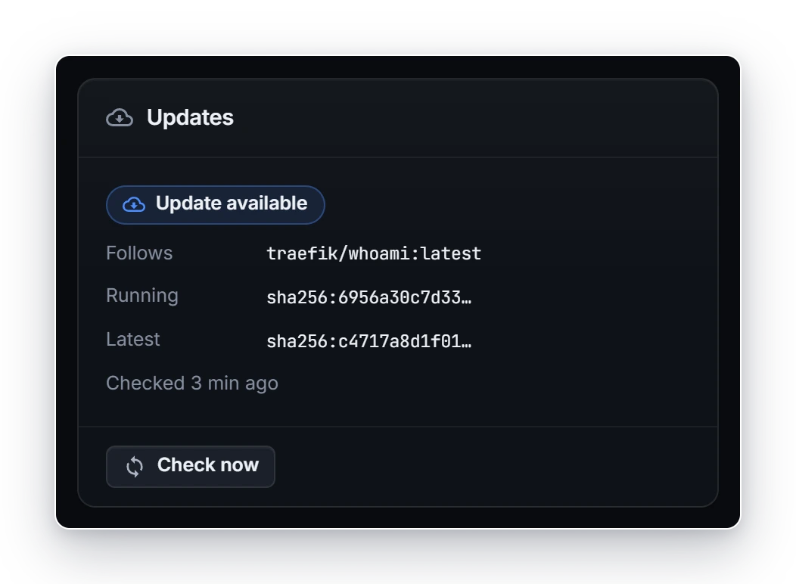
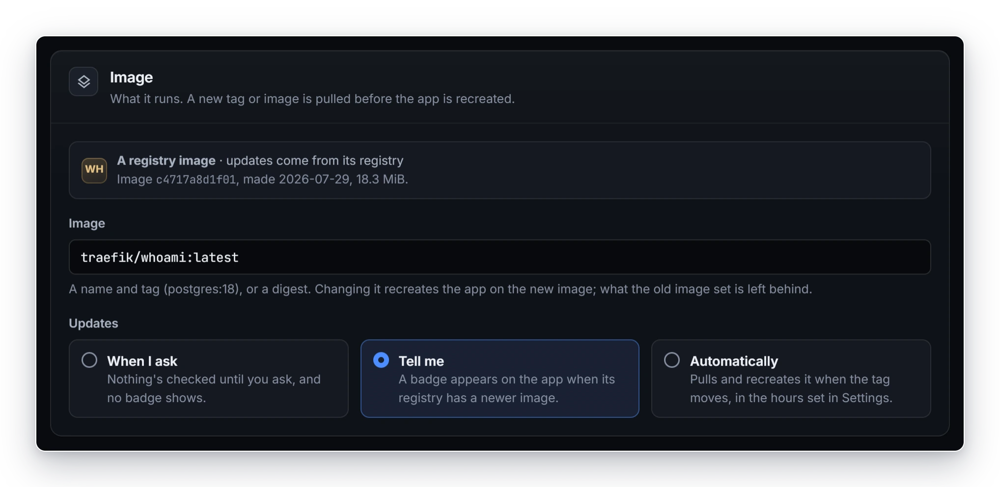
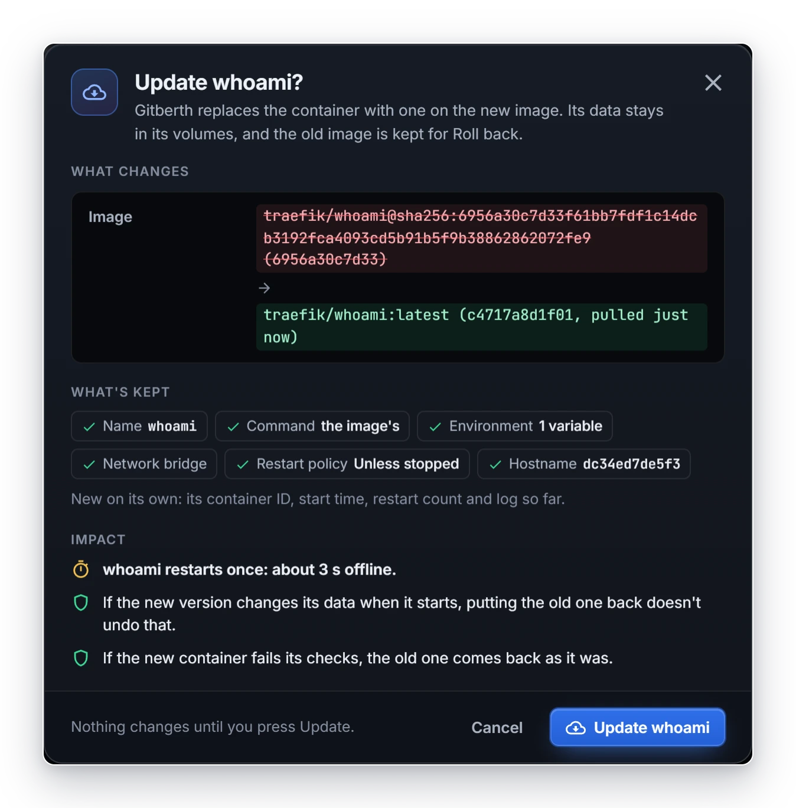
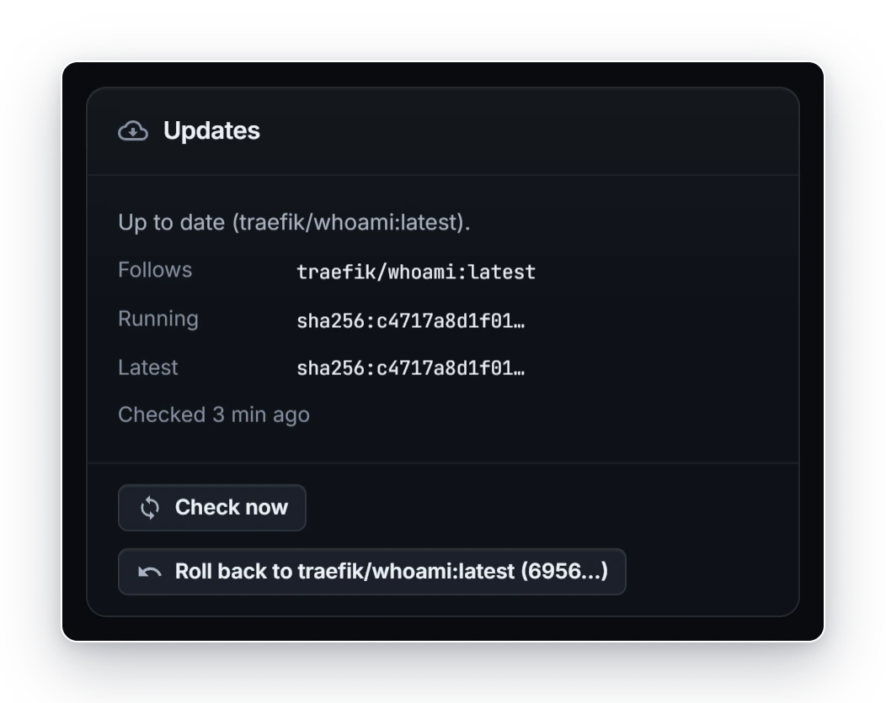

# Image updates

Apps that run an image, rather than being built from Git, can be checked for a newer image and updated from their page, or updated by Gitberth on its own at night. This page covers how checks work, the update choices, updating an app, what happens when an update fails, and how to roll an update back. A Git app updates when it deploys a new commit instead (see [Deploys and rollbacks](deploys-and-rollbacks.md)).

## What counts as newer

- **An image from a registry:** a newer image under the tag the app follows, for example a new `traefik/whoami:latest` on Docker Hub. Gitberth compares digests, so a rebuilt tag counts even when its name doesn't change.
- **An image no registry is known to have** (one built on the host, or one Gitberth hasn't seen in a registry yet): a newer image under its tag on this host.
- **An image pinned by digest** (`name@sha256:…`) has nothing to check: its card says **Pinned to a digest: nothing to check.**

Gitberth's own builds are never looked up in a registry.

## How checks work

Every 6 hours by default, Gitberth asks the registry about each image it knows a registry has: one it pulled, or one a check found there. That's one request per image, however many apps use it. The first check runs 2 minutes after Gitberth starts. Set how often in **Settings › Updates** (1 to 168 hours).

Apps set to **When I ask** are left out of these checks. Gitberth asks about their image only when you click **Check for update** on their page.

An image Gitberth hasn't seen in a registry, such as a container started outside Gitberth, is only compared with its tag on this host until you click **Check for update** on its page. If that check finds it in a registry, it's checked on the schedule from then on.

- A registry that has no such image means it's only on this host: **Only on this host: no registry has it.** Gitberth leaves it alone for a week.
- A private image needs a sign-in in **Settings › Registries** (see [Gitberth's settings](../reference/gitberth-settings.md#registries)). A refused sign-in shows **Can't check: sign-in failed.** and is tried again after 24 hours.

## See which apps have an update

- An app's **Overview** tab has an **Updates** card for any app that runs an image, except Gitberth itself. It shows **Update available**, or a line like **Up to date (traefik/whoami:latest).** It also shows the tag the app **Follows**, the digest it's **Running**, the **Latest** one the registry has, and when it was last checked. **Check now** asks the registry right away. The card shows the new answer as soon as a check, an update or a rollback is done.

  

- The app's header has **Update** when there's an update, else **Check for update**. Its **More** menu (⋯) has **Check for update** too (**Check for a newer build** for an image Gitberth built).
- The **Apps** list tags each app that has one with **Update**, and its **Updates** filter shows only those.
- The dashboard's **Updates** tile counts them.

An app set to **When I ask** gets no **Update** tag in the Apps list, isn't counted by the **Updates** filter or the dashboard's tile, and isn't checked on the schedule, even when another app on the same image was checked. Its card says **Set to When I ask: Gitberth checks it only when you press Check now, and shows no badge for it.** **Check for update** on its page still asks the registry, and the page shows the answer, with **Update** in the header when there's a newer image.

When the tag an app follows names another image on the host than the one its container runs (it was pulled or built again, or you rolled the app back), Gitberth still shows the app's image by that tag, such as `traefik/whoami:latest`, in the app's header, the Apps list, search, and the Network and Health pages, not as a digest. The **Container** card on the **Overview** adds **the tag has moved on**; point at it to see what that means.

## Update choices

Each app has an **Updates** choice in its **Settings › Image** section:

| Choice | What Gitberth does |
|---|---|
| **When I ask** | Nothing's checked until you ask, and no badge shows. **Check for update** on the app's page asks, and you update it with **Update**. |
| **Tell me** | Checks on the schedule. A badge appears on the app when there's a newer image, and you update it with **Update**. |
| **Automatically** | Checks on the schedule, and updates the app by itself in the hours set in **Settings › Updates**. |

The choice a new app gets is **New apps from an image** in **Settings › Updates**, which starts as **Tell me**. It applies to every new app that runs an image: from a registry, a local image, a pasted `docker run` or Compose service, or the blank form. Two exceptions:

- **An image pinned by digest or by ID** gets **When I ask**, since it can't update.
- **A database** gets **Tell me** when the setting is **Automatically**.

**Automatically** is never used for:

- **A database.** The choice is greyed out with **Never for a database.**, because a new version can change its data files.
- **Gitberth itself.** Update it as in [Updating Gitberth](updating-gitberth.md).
- **A container that Compose, Swarm or Kubernetes looks after.** Those only tell you.

## Update an app

1. Open the app's page. When an update is available, the header has **Update**.
2. Click **Update**.
   Gitberth pulls the new image first. Then the change dialog opens, titled **Update whoami?**, with what changes, what's kept and the impact.

   

3. Click **Update whoami**.
   The dialog shows each step as it runs. You can close it: the update carries on.
4. When it's done, the dialog says **whoami is updated**.

Gitberth recreates the container on the new image the same way it applies any setting that needs a recreate: the new container is created first, the old one stops, the names swap, and the new one has to pass its checks before the old one is removed. The app's data stays in its volumes. [How deploys and changes work](../concepts/how-deploys-work.md#an-image-update) has the steps.

If there's nothing to update, Gitberth says why instead of opening the dialog, for example **It's up to date: whoami runs the image traefik/whoami:latest names.**, or that the tag moved again while it was pulled.

## Automatic updates

Automatic updates run only between the times set in **Automatic updates run between** in **Settings › Updates**, 03:00 to 05:00 by default. The times are in Gitberth's time zone, the `TZ` in its `.env` file, and the help under the field names it. A window can run past midnight, like 23:00 to 01:00.

During the window, Gitberth looks every 15 minutes for apps set to **Automatically** that have an update, and updates each one as you would with **Update**. An app in the middle of another change waits for the next look.

## When an update fails

The new container has to stay up for 15 seconds, or report healthy when it has a health check, answer its health URL if it has one, and answer on the LAN where the old one did. If it doesn't:

- **The old container comes back as it was.** The dialog says **Not applied: whoami runs as before**, with **The original container is back as it was.** Click **Its last output** to see what the new container printed before it stopped.
- **An automatic update that fails** is put back the same way, the app's choice goes back to **Tell me**, and its **Activity** tab says **Automatic update to … failed and was rolled back: … Updates are back to Tell me until you choose Automatically again.** Choose **Automatically** again once you've looked into it.
- **If Gitberth restarts in the middle of an update**, it finishes or undoes the change when it starts again. When it can't tell which, the app's page shows **A change is waiting for you**, with **Keep the new one** and **Put the original back**.

The image the app ran before an update stays on the host, for **Roll back**. The image before that is removed once no container uses it and no other app keeps it for its own **Roll back**.

## Roll back an update

After an update, you can put the app back on the image it ran before. Nothing is pulled: that image is still on the host.

1. Open the app's page. The **Updates** card on the **Overview** tab has **Roll back to** and the image, like **Roll back to traefik/whoami:latest (6956…)**. The **More** menu (⋯) has the same item.

   

2. Click it. The change dialog opens, titled **Roll back whoami?**, with what changes, what's kept and the impact.
3. Click **Roll back whoami**.
   The dialog shows each step as it runs, and says **whoami is back on its previous image** when it's done.

A rollback recreates the container the same way an update does, with the same checks, and the app's data stays in its volumes. If the older image fails the checks, the container the app ran comes back.

- **Roll back** shows only while the image the app ran before its last update is still on the host, and the container isn't running it already. Point at the card's button to see what it does.
- **After a rollback** there's nothing earlier to go back to, so **Roll back** goes. The newer image is still the tag's, so **Update** offers it again.
- **An app set to Automatically** goes back to **Tell me** after a rollback, so the next window doesn't update it again. Its **Activity** tab says **Automatic updates paused after a roll back: updates are back to Tell me until you choose Automatically again.**

For a Git app, roll back to an earlier deploy on its **Activity** tab instead (see [Deploys and rollbacks](deploys-and-rollbacks.md)).

## Go back to an older version

**Roll back** goes back one update. To run an older version than that, or one that was never on the host, change the tag the app follows:

1. Open the app's **Settings** tab and go to the **Image** section.
2. In **Image**, type the older version's tag, for example `traefik/whoami:v1.10`.
3. If the bar at the bottom says the image isn't on this host yet, click **Pull it**.
4. Click **Review and apply**, then **Recreate whoami** in the change dialog.

The app now follows the tag you typed. To stop an app moving forward by itself, set its **Updates** choice to **When I ask** or **Tell me**, or give it a tag that names one version rather than `latest`.

## Related

- [Run a registry image](run-a-registry-image.md)
- [Gitberth's settings](../reference/gitberth-settings.md#updates)
- [How deploys and changes work](../concepts/how-deploys-work.md#an-image-update)
- [Troubleshooting](troubleshooting.md#image-updates)
