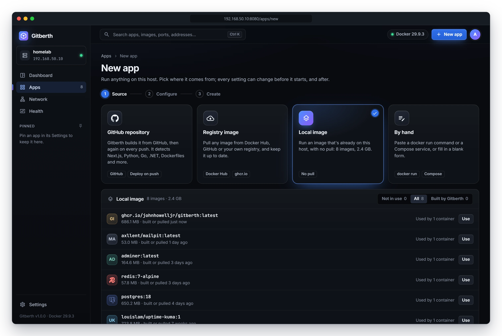

# Use an image that's already on the host

Run an image that's already in Docker on this host: one you built there with `docker build`, loaded with `docker load`,
or pulled some time ago. Nothing is pulled. Use this for your own tools that aren't in a registry, such as a backup agent
you build on the host.

The examples use `backup-agent:1.0`, an image built on the host.

## Before you start

The image must have a tag, such as `backup-agent:1.0`. Images without one aren't listed. To give one a tag, run
`docker tag <image ID> backup-agent:1.0` on the host.

## Steps

1. Click **New app** in the top bar.
2. Click the **Local image** card. It says how many images the host has and how much space they take.
3. Choose which images to show:
   - **Not in use** (the default): images no container uses, leaving out the ones Gitberth built for its Git apps.
   - **All**: every tagged image.
   - **Built by Gitberth**: the images Gitberth built from your repositories.

   Each row shows the image's name and tag, its size, when it was built or pulled, its other tags, and how many
   containers use it. Click **Show N more** at the bottom for the rest.

   

4. Click **Use** by the image you want.

   Gitberth opens the Configure step, filled in from the image: its ports, its volumes, its environment and its command.
   The image line says **local image** and **Already on this host**.

5. Check the settings. The Configure step works the same as for a registry image; see
   [Configure](run-a-registry-image.md#configure).
6. Click **Review and create**, check the review, and click **Create and start**.

   Gitberth creates the container from the image, starts it and checks that it stays up. The app's page opens when it's
   done. If it doesn't start, see [If it doesn't start](run-a-registry-image.md#if-it-doesnt-start).

## What happens next

- **The app is listed as Local image** under **Source** on the Apps list.
- **Updates are newer builds of its tag.** When no registry is known to have the image, its updates are newer builds of
  its tag on this host. Build `backup-agent:1.0` again on the host, and, depending on the app's **Updates** choice in
  **Settings** › **Image**, Gitberth shows a badge, recreates the app on the new build, or, with **When I ask**, waits
  for you to check. The app keeps showing `backup-agent:1.0` as its image, and its **Container** card adds **the tag has
  moved on**. See [Image updates](updates.md).
- **Its first Updates choice** is **New apps from an image** in **Settings** › **Updates**, as for any new app that runs
  an image.
- **An image Gitberth built for a Git app** can be run this way too, but the new app doesn't follow the repository. To deploy
  from the repository, use [Deploy an app from GitHub](deploy-from-github.md).

## Related

- [Run an image from a registry](run-a-registry-image.md)
- [Paste a docker run command or a Compose service](paste-docker-run-or-compose.md)
- [Image updates](updates.md)
- [Manage apps](manage-apps.md)
