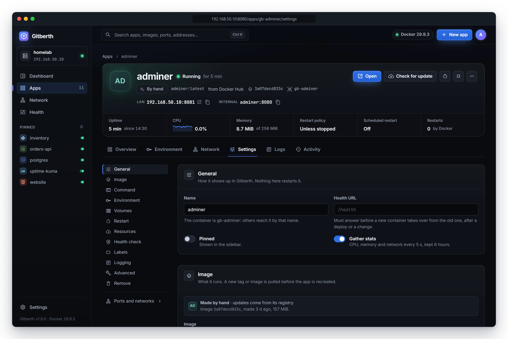
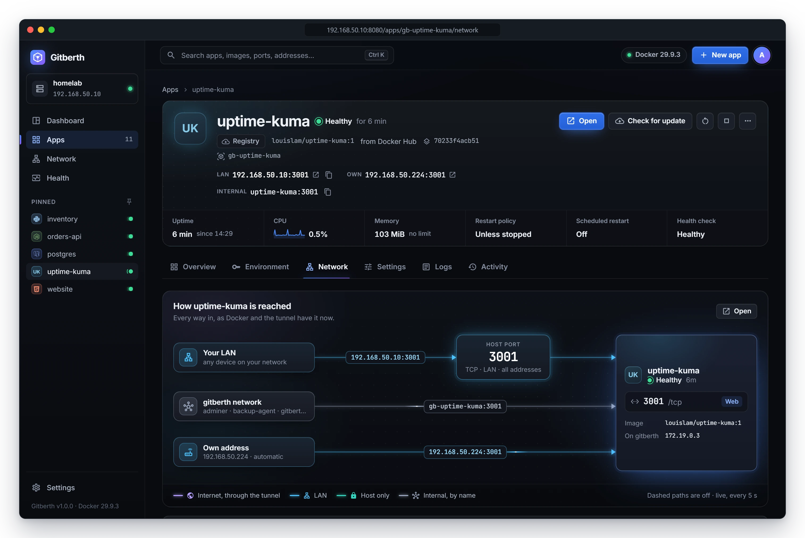
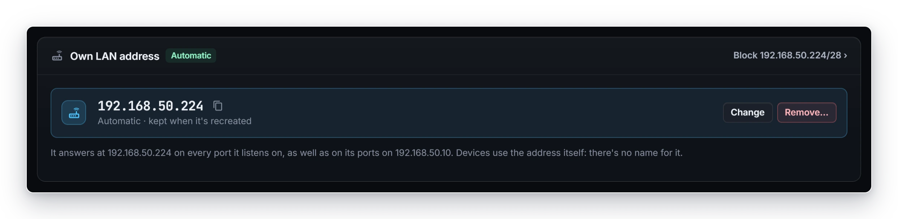

# App settings

Every setting on an app's **Settings**, **Environment** and **Network** tabs, field by field, in the order the page shows
them. Each entry says what the setting does, its default, and when you'd change it. To learn how to edit and apply
settings, see [Change settings](../guides/manage-apps.md#change-settings).

## How changes apply

Nothing changes until you apply it with the bar at the bottom of the page. The **Applies** column below says what
applying does:

| Applies | Meaning |
|---|---|
| At once | Gitberth's own data. Saved when you apply; nothing restarts. |
| Live | Changed on the running container with `docker update`. No restart. |
| Recreate | The container is recreated with the new setting. For a Git app, a deploy without a build does it. |
| Build | Git apps: saved, and the next deploy builds the app with it. |

A container that Docker Compose made takes **Live** changes in place; anything else gives you the lines for its Compose
file. Gitberth's own container shows its settings, and every change gives the lines for its Compose file.

## Settings tab

The list on the left jumps to each section, with a dot by any section that has unsaved changes. **Environment** opens the
Environment tab, and **Ports and networks** opens the Network tab.

### General

How the app shows up in Gitberth. Nothing here restarts it.

| Field | What it does | Default | Applies |
|---|---|---|---|
| **Name** | What Gitberth calls the app everywhere. The container keeps its own name, so other containers still reach it by it. | The name it was created with, or the container's name | At once |
| **Health URL** | A path, starting with `/`, that a new container must answer (with a status below 400) before it takes over from the old one, after a deploy or a change. Shown for Git apps and apps with a web port. Set it when "it started" isn't enough to know the app works. | None | At once |
| **Pinned** | Shows the app in the sidebar and on the dashboard. | Off | At once |
| **Gather stats** | Reads its CPU, memory and network every 5 seconds and keeps 6 hours, for the Health page and the Overview charts. Turn it off for a container you don't care about. | On | At once |
| **Notifications** | Whether [notifications](../guides/notifications.md) tell about this app: its deploys, crashes and health check. Off leaves it out, wherever Settings › Notifications sends them. | On | At once |

### Source

Git apps only: where the code comes from and how it's built. The section names the repository and what Gitberth last
detected. The app's image is built from the repository, so it has no **Image** field.

| Field | What it does | Default | Applies |
|---|---|---|---|
| **Branch** | The branch Gitberth builds and watches. | The branch you picked when you added the app | Build |
| **Subfolder** | The app's folder in the repository. Leave it empty for the repository's root. | Empty | Build |
| **Deploy on push** | A new commit on the branch deploys by itself. Turn it off to deploy only with **Deploy**. | On | At once |
| **Vercel's variables** | Sets `VERCEL_URL`, `VERCEL_GIT_COMMIT_SHA` and the rest. See [Variables Gitberth sets](../guides/environment-variables.md#variables-gitberth-sets-like-vercel). | On | Build |
| **Build** | **Detect automatically** generates the Dockerfile on every deploy (or uses the repository's own). **Custom Dockerfile** uses the one you write here. | **Detect automatically** | Build |
| **Dockerfile** | With **Custom Dockerfile**: your Dockerfile. Keep the `# gitberth:build-args` and `# gitberth:volumes` lines; Gitberth fills them in. | The generated one | Build |
| **Project to run** | .NET only: which project of the solution runs, such as `src/MyApp/MyApp.csproj`. | The one Gitberth picked | Build |

### Previews

Git apps only: a preview of each pull request, or branch, as an app of its own. Saved on its own with **Save previews**;
nothing here restarts the app. See [Preview deployments](../guides/previews.md).

| Field | What it does | Default | Applies |
|---|---|---|---|
| **Previews** | **Off**, **Pull requests**, or **Pull requests and branches** (a branch once it gets a new commit). Turning them off removes the previews, after asking. | **Off** | At once |
| **At most running** | How many previews run at once (1 to 20). More wait, and start when one goes. | 3 | At once |
| **Remove after (days without a new commit)** | A preview with no new commit for this long is removed (1 to 365). | 7 | At once |
| **Also pull requests from forks** | Previews pull requests from other people's copies of the repo. Their code is built and run on this server, without added capabilities, security options or GPUs (no preview gets the host's devices or privileged mode). Turning it off removes their previews. | Off | At once |
| **Protect previews' domains** | Visitors sign in through Cloudflare Access before they reach a preview's domain. | On | At once |

### Image

Apps that run an image: what it runs. The section says where the image came from, its ID, age and size, and where its
updates come from.

| Field | What it does | Default | Applies |
|---|---|---|---|
| **Image** | A name and tag, such as `postgres:18`, or a digest. Changing it pulls the new image first, then recreates the app on it; what the old image set is left behind. If the image isn't on the host, **Pull it** appears in the bar. | The image it was created from | Recreate |
| **Updates** | **When I ask**: nothing's checked until you ask, and no badge shows. **Tell me**: a badge appears on the app when its registry has a newer image. **Automatically**: Gitberth pulls and recreates it when the tag moves, in the hours set in **Settings** › **Updates**. For an image no registry is known to have, the lines speak of a newer build of its tag on this host instead. Never automatic for a database. See [Image updates](../guides/updates.md). | For an app Gitberth created, **New apps from an image** in **Settings** › **Updates** (**Tell me** unless changed); **When I ask** for an image pinned by digest or ID; never **Automatically** for a database | At once |

### Command

Leave a field empty to use the image's own value, which shows greyed.

| Field | What it does | Default | Applies |
|---|---|---|---|
| **Entrypoint** | The program the container runs. | The image's | Recreate |
| **Command** | The arguments it runs with, or the command when the image has no entrypoint. A secret in it, such as `cloudflared`'s `--token`, is shown masked; edit around it and it's kept. | The image's | Recreate |
| **Working directory** | The folder it starts in. | The image's | Recreate |
| **User** | The user it runs as. | The image's, else `root` | Recreate |

### Volumes

Storage that outlives the container. Recreating never deletes a volume.

| Field | What it does | Default | Applies |
|---|---|---|---|
| **Volume or folder** | A named volume, a folder on the host (a full path such as `/srv/data`), or a temporary one in memory. An unnamed volume Docker made shows as **anonymous** and keeps its data. | None | Recreate |
| **Path in the container** | Where it's mounted, such as `/data`. | | Recreate |
| **read and write** / **read-only** | Click to switch. | **read and write** | Recreate |

**Named volume**, **Host folder** and **Temporary (tmpfs)** add a row. Add a volume for any data that must stay: without
one, what the app writes goes when the container is recreated.

A Git app's named volume is called `gb-<app>-<name>`, so one app's name can spell another's: `test-data` on `orb` and
`data` on `orb-test` are both `gb-orb-test-data`. Gitberth refuses to save a named volume whose name another app has
already, or that one of the app's [previews](../guides/previews.md) would then share with another app.

### Restart

| Field | What it does | Default | Applies |
|---|---|---|---|
| **When it stops** | **Never**: it stays down after a crash or a host reboot until you start it. **On failure**: it comes back after a crash, but not after a reboot or if you stop it. **Unless stopped**: it comes back after a crash or a host reboot, but stays down if you stop it. **Always**: like **Unless stopped**, and it also comes back after you stop it, once Docker restarts. | **Unless stopped** for an app Gitberth created | Live |
| **Tries before it gives up** | With **On failure**: how many times Docker restarts it. 0 tries for ever. | 0 | Live |
| **Scheduled restart** | **Off**, or **Every** so many **minutes**, **hours** or **days**, counted from when it last started. From 5 minutes to 365 days. The help under it says what a restart does to this app: a Git app is recreated with a deploy's checks, anything else gets `docker restart`. See [Scheduled restarts](../guides/scheduled-jobs-and-restarts.md#scheduled-restarts). | Off | At once |

### Resources

Limits stop one app from starving the others.

| Field | What it does | Default | Applies |
|---|---|---|---|
| **Memory limit** | The most memory it may use, in **MiB** or **GiB**, at least 6 MiB. Empty for no limit. A Java app sizes its heap from it. | No limit | Live |
| **CPU limit** | How many of the host's CPUs it may use, such as `0.5` or `2`; the field says **of N CPUs**. Empty: it may use every core. | No limit | Live |
| **Shared memory** | The size of `/dev/shm`, in MiB. Databases and browsers use it. | Docker's 64 MiB | Recreate |
| **CPU priority** | **Low**, **Normal** or **High**. Only matters when the host is busy. | **Normal** | Live |
| **Process limit** | How many processes it may run. Empty for no limit. | No limit | Live |

### Health check

Docker runs the check inside the container and marks it healthy or not. Gitberth waits for healthy after a change or a
deploy, and the Health page marks when it starts failing.

| Field | What it does | Default | Applies |
|---|---|---|---|
| **Check** | **Image default** (the image's own `HEALTHCHECK`, if it has one), **Command** (one of your own), or **None**. | **Image default** | Recreate |
| **Command** | With **Command**: run by the shell inside the container; it passes when it exits with 0. For example `curl -fsS http://localhost:3000/health \|\| exit 1`. | | Recreate |
| **Every** | Seconds between checks. | 30 | Recreate |
| **Timeout** | Seconds a check may take. | 30 | Recreate |
| **Retries** | Failed checks in a row before it's unhealthy. | 3 | Recreate |
| **Grace period** | Seconds after it starts during which failures don't count. | 0 | Recreate |

### Labels

Notes on the container that other tools read, such as Traefik, Watchtower or Homepage. Each label is a row with its value;
**Add label** adds one. Labels starting with `gitberth.` are Gitberth's own, and `com.docker.compose.` ones are Compose's:
both are shown locked. The image's own labels are listed underneath, read-only. Applies: Recreate.

### Logging

Where the container's output goes. The **Logs** tab reads it either way.

| Field | What it does | Default | Applies |
|---|---|---|---|
| **Driver** | **The host's default**, `json-file`, `local`, `journald`, `syslog` or `none`. | **The host's default** | Recreate |
| **Options** | `key=value`, one per line, such as `max-size=10m` and `max-file=3` for `json-file`. | None | Recreate |

### Advanced

Everything else Docker can set. Most apps never need these. Every field here applies with a recreate.

| Field | What it does | Default |
|---|---|---|
| **Hostname** | The container's host name. | Docker's own |
| **Stop signal** | The signal Docker sends to stop it. | The image's, else `SIGTERM` |
| **Stop timeout** | Seconds Docker waits after the stop signal before it kills the container. | 10 |
| **Network mode** | **Its networks**, **The host's** (it uses the host's network directly, with no ports of its own) or **None**. A Git app always runs on its networks. | **Its networks** |
| **Init process** | Runs a small init process that reaps zombie processes and passes on signals. | Off |
| **Privileged** | Gives the container full access to the host's devices. A [preview](../guides/previews.md) never gets it, nor the app's **Devices**. | Off |
| **Read-only root** | Makes the container's own files read-only; only volumes are writable. | Off |
| **Terminal (TTY)** | Gives it a terminal. | Off |
| **Capabilities added** / **Capabilities dropped** | Linux capabilities, such as `NET_ADMIN`. | None |
| **DNS servers** | DNS servers it uses instead of the host's. | The host's |
| **GPUs** | `all`, a number, or `device=0,1`. | None |
| **Extra hosts** | `host:ip`, one per line, added to its `/etc/hosts`, such as `homelab:192.168.50.10`. | None |
| **Devices** | `host path:container path`, one per line, such as `/dev/dri:/dev/dri`. | None |
| **Ulimits** | `name=soft:hard`, one per line, such as `nofile=65536:65536`. | None |
| **Security options** | One per line, such as `no-new-privileges`. | None |
| **Sysctls** | `key=value`, one per line, such as `net.core.somaxconn=1024`. | None |

### Remove

**Remove …** removes the app. A Git app's container goes with its deploy history; its images and volumes go only if you
tick them. Any other app's volumes stay unless you tick them. See [Remove an app](../guides/manage-apps.md#remove-an-app).
Gitberth's own container has no **Remove** section.

## Environment tab

The app's environment variables. See [Environment variables](../guides/environment-variables.md) for how to use them.

| Part | What it does | Applies |
|---|---|---|
| **Name** / **Value** | Each variable the container gets. Change a value in place; a new row takes a name too. | Recreate |
| **Secret** (lock) | Masks the value wherever it's shown. Always on for names and values that look secret. | At once |
| **Build time** (wrench) | Git apps: passes the variable to the image build too. | Build |
| **All deploys** / **Production** / **Previews** | Git apps: which deploys get the variable. One name can have a value for each; a **Production** or **Previews** one wins over **All deploys**. See [Environments](../guides/previews.md#environments). | Recreate (production) or the previews' next deploy |
| **N from the image** | The image's own variables, folded. Edit one to make it the app's own. | Recreate |
| **Add variable**, **Paste .env** | Add one variable, or several from `.env` lines. | Recreate |
| **Stored in GitHub** | Git apps: the repository's GitHub variables. **Save to GitHub** and delete act on GitHub at once; the app gets them with its next deploy. | Next deploy |
| **Set by Gitberth, like on Vercel** | Git apps: the variables Gitberth adds, read-only. Turned off with **Vercel's variables** in **Source**. | |

## Network tab

How the app is reached. The diagram at the top, **How … is reached**, draws every way in, as Docker and the tunnel have it
now. [Networking](../guides/networking.md) and [Domains](../guides/domains.md) explain these in depth.

### Ports

| Column | What it does | Default |
|---|---|---|
| **Web** | Marks the web port: the one **Open**, domains, the health URL and scheduled jobs use. Moving it restarts nothing. | The first web port Gitberth found |
| **Container port** | The port the app listens on inside the container. | From the image, the paste, or detection |
| **Protocol** | **TCP** or **UDP**. | **TCP** |
| **Access** | **Internal**: not published; containers on its networks reach it by name. **LAN**: every device on your network, at this host's address and the host port. **Host only**: programs on the host itself (`127.0.0.1`), like the Cloudflare tunnel. | **LAN** for a new app |
| **Host port** | The port on the host. It says as you type whether the port is free, and who has it if not. | The container port when it's free, else the next free one above it |
| **Address** | The address this gives, with a copy button. | |

**Add port** adds a row. The bar at the bottom applies a change: **Save** when nothing restarts, **Apply** for a Git app
(a deploy without a build), or **Review and apply** for any other app (a recreate, through the change dialog). A Git app
also offers **Save for next deploy**. A container Compose manages gets the lines for its Compose file instead.

### Domains

The app's domains, through the Cloudflare tunnel, once domains are turned on in **Settings** › **Domains (Cloudflare)**.
Type a domain such as `app.example.com` and click **Add domain** (or **Add domain and publish** when the web port is
**Internal**). Each domain shows **Live** or **Not working**, with **Make main**, **Serve every path**, **Point it here** or
**Fix** when they apply, and a button to remove it. See [Domains](../guides/domains.md).

### Networks

The Docker networks the container is on, with the names other containers use to reach it there, its IP address, and
who else is on each. **Join a network…** with an optional extra name, then **Join**, adds one; it's instant and restarts
nothing. **Leave…** asks first. See [Networking](../guides/networking.md).

### Own LAN address

An address of the app's own on your LAN, once own LAN addresses are turned on in **Settings** › **Own LAN addresses**.
Choose **Off**, **Automatic** (the next free address of the block) or **Static** (one you type), and click **Apply**. It's
instant and restarts nothing. **Change** and **Remove…** change it later. See [Networking](../guides/networking.md).

## Related

- [Manage apps](../guides/manage-apps.md)
- [Environment variables](../guides/environment-variables.md)
- [Networking](../guides/networking.md)
- [Gitberth's settings](gitberth-settings.md)
