# Gitberth's settings

The **Settings** page holds the settings for Gitberth as a whole: GitHub, GitLab and registry access, notifications, image updates, domains, uptime checks and the status page, keeping apps running, the network, deploys, Docker's disk, apps' databases, saving and restoring backups, the admin password, tokens for AI agents and the API, the audit log, and what this installation runs on. Open it from **Settings** at the bottom of the sidebar, or from the account menu (**A**) at the top right. Each app has its own settings on its page instead; see [App settings](app-settings.md).

The list on the left jumps to each section: **GitHub access**, **GitHub integration**, **GitLab**, **Notifications**, **Registries**, **Updates**, **Domains** (the **Domains (Cloudflare)** section), **Uptime and status page**, **Keep apps running**, **Network**, **Own LAN addresses**, **Deploys**, **Disk**, **Databases**, **Save and restore**, **Admin password**, **AI agents and API**, **Audit log** and **System**. Each section saves on its own, and every change is recorded in the [audit log](../guides/audit-log.md).

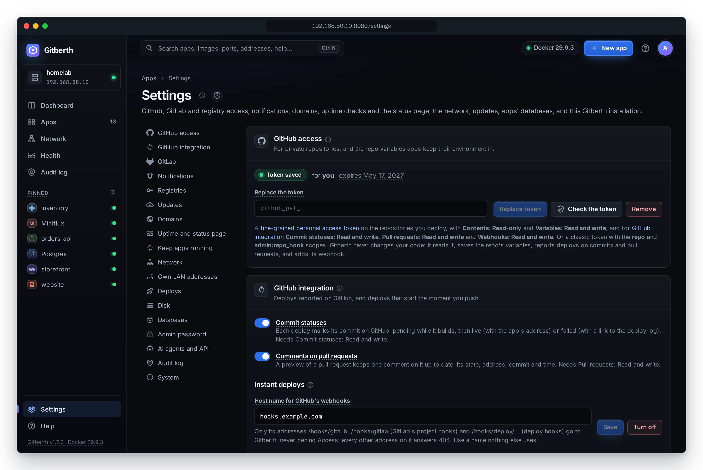

Gitberth's own process settings, such as the data folder and the Docker address, are environment variables instead: see [Configuration](configuration.md).

## GitHub access

For private repositories, and the repo variables apps keep their environment in.

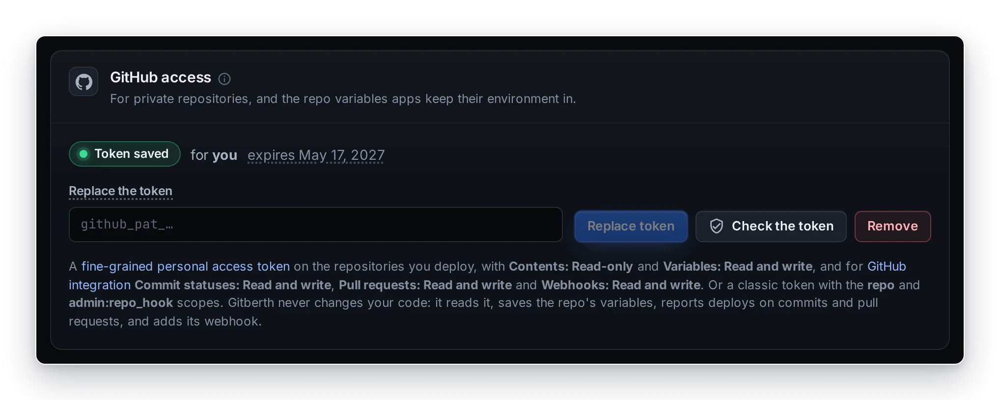

| Field or button | What it does |
|---|---|
| **Token** (**Replace the token** once one is saved) | A GitHub personal access token. A fine-grained token needs **Contents: Read-only** and **Variables: Read and write** on the repositories you deploy, and for [GitHub integration](#github-integration) **Commit statuses: Read and write**, **Pull requests: Read and write** and **Webhooks: Read and write**; a classic token needs the **repo** and **admin:repo_hook** scopes. Gitberth never changes your code. |
| **Save token** / **Replace token** | Asks GitHub who owns the token, then saves it encrypted. An invalid or expired token isn't saved. |
| **Check the token** | Asks GitHub now whether it takes the saved token, whose it is and when it expires: "GitHub took the token: it's …'s, and it expires on Dec 1, 2026.", "GitHub refused the token: it has expired or was revoked. Save a new one." or "Couldn't ask GitHub: …. Nothing changed." |
| **Remove** | Forgets the token. Private repos can't be cloned until you add one again. |

Once saved, the section shows **Token saved**, the GitHub account it belongs to, and when it expires. In its last 3 weeks the expiry is highlighted with **renew it soon**, and once it has passed it says **expired** in red; its tip says when Gitberth last checked the token. Without a token it shows **No token** and **Private repositories can't be cloned yet.** Public repos need no token.

Gitberth checks the token with GitHub every 6 hours, and at once when GitHub turns it away. A banner at the top of the section (and on the dashboard) says when the token expires within 3 weeks, a week or a day, when it has expired, and when GitHub refused it: see [Tokens and sign-ins](../guides/troubleshooting.md#tokens-and-sign-ins).

Default: no token. Saving a token makes Gitberth check every repo again right away, and try again whatever GitHub refused the last token. See [Deploy from GitHub](../guides/deploy-from-github.md) for how to create one.

## GitHub integration

Deploys reported on GitHub, and deploys that start the moment you push. See [GitHub integration](../guides/github-integration.md).

| Field or button | What it does | Default |
|---|---|---|
| **Commit statuses** | Each deploy that builds a commit marks it on GitHub: pending while it builds, then live (linking to the app) or failed (linking to the deploy log). A commit that was skipped gets success, saying why. One status per app, named **Gitberth: &lt;app&gt;**, and **Gitberth preview: &lt;app&gt;** for its previews. Needs **Commit statuses: Read and write**. | On |
| **Comments on pull requests** | A preview of a pull request keeps one comment on it up to date: its state, address, commit and time. Needs **Pull requests: Read and write**. | On |
| **Host name for GitHub's webhooks** | Instant deploys, shown while domains are on: a host name nothing else uses, like `hooks.example.com`. Only its addresses `/hooks/github`, `/hooks/gitlab` ([GitLab's project hooks](#gitlab)) and `/hooks/deploy/<token>` ([deploy hooks](../guides/deploy-hooks.md)) go to Gitberth through the tunnel, never behind Access; every other address answers 404. **Turn on** routes it and adds the DNS record; **Save** moves it to another name; **Turn off** asks first, then takes its route out. | None: Gitberth checks every 30 seconds, and deploy hooks work on your network only |
| **Payload URL**, **Content type**, **Secret**, **Events** | What GitHub's webhook needs, to add it by hand when the token can't (no **Webhooks: Read and write**). **Show** reveals the secret; the copy buttons copy. | |

When GitHub refuses one of these on a repo, a banner says which permission is missing (for example **Commit statuses aren't set on you/website**) and Gitberth stops asking on that repo for an hour, or until a token is saved again; the banner goes with the hour, and comes back if GitHub refuses again. Other repos carry on. A token GitHub refuses outright stops it everywhere (**Commit statuses aren't set: GitHub refused the token**). A list under the webhook values says, per repo, **Webhook added**, **Webhook set up** or why not. With domains off, the section says instant deploys need them.

## GitLab

Projects on gitlab.com or your own GitLab: private ones, their CI/CD variables, merge request previews, statuses and instant deploys. See [GitLab](../guides/gitlab-integration.md).

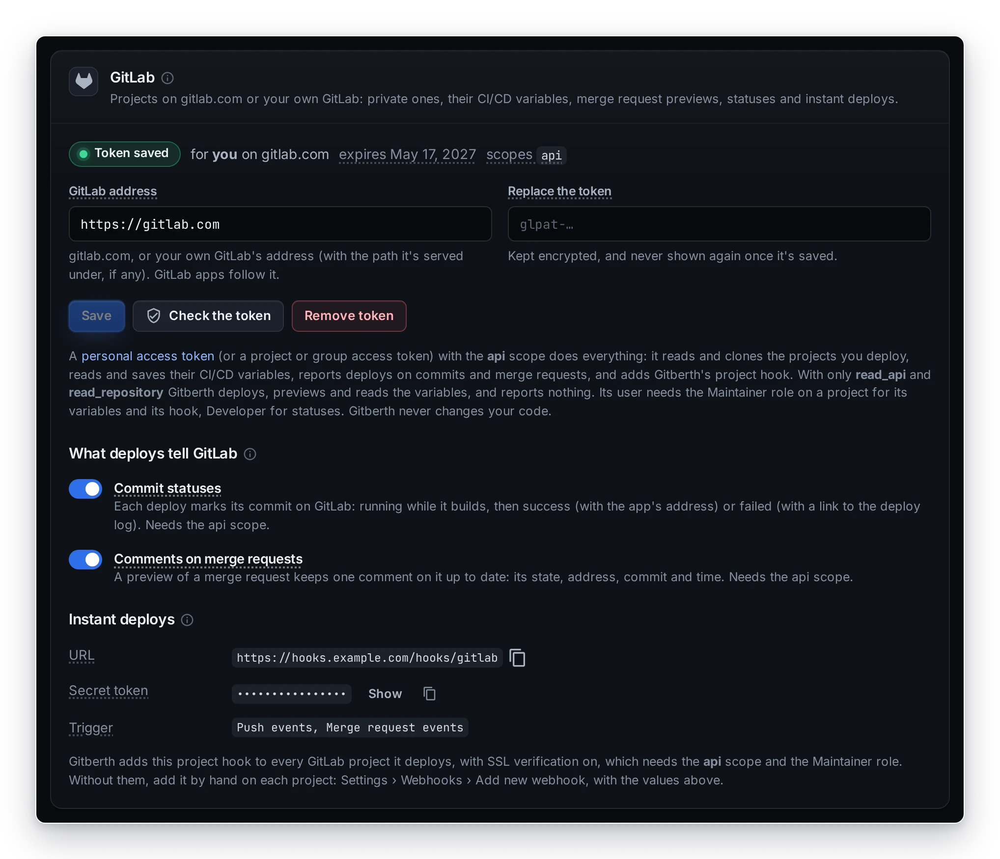

The switches **Commit statuses** and **Comments on merge requests** sit under **What deploys tell GitLab**, and the hook's
values under **Instant deploys**.

| Field or button | What it does | Default |
|---|---|---|
| **GitLab address** | gitlab.com, or your own GitLab's address, with the path it's served under if it has one (`https://gitlab.example.com`, or `http://192.168.50.10:8929/gitlab` for one on this host). GitLab apps follow it: a project is kept by its path, never with the address. | `https://gitlab.com` |
| **Token** (**Replace the token** once one is saved) | A personal, project or group access token. **api** does everything; **read_api** and **read_repository** alone deploy, preview and read the variables, and report nothing. Kept encrypted, never shown again. | None: public projects only |
| **Save** / **Save token** / **Replace token** | Saves the address and, when one is typed, the token, once GitLab took it (it's asked who the token is and which scopes it has). A token GitLab refuses isn't saved. | |
| **Check the token** | Asks GitLab again who the token is, its scopes and when it expires. A token GitLab refuses gets its banner at once. | |
| **Remove token** | Asks first, then forgets the token. Project hooks Gitberth added stay on GitLab. | |
| **Commit statuses** | Each deploy that builds a commit marks it on GitLab: running while it builds, then success (linking to the app) or failed (linking to the deploy log); canceled when it was. Named **Gitberth: &lt;app&gt;** and **Gitberth preview: &lt;app&gt;**. Needs **api**. | On |
| **Comments on merge requests** | A preview of a merge request keeps one comment on it up to date: its state, address, commit and time. Needs **api**. | On |
| **URL**, **Secret token**, **Trigger** | Shown while there's a host name for webhooks (**GitHub integration › Instant deploys**): what GitLab's project hook needs, to add it by hand when the token can't (no **api**, or no Maintainer role). **Show** reveals the secret token; the copy buttons copy. | |

Once saved, the section shows **Token saved**, whose it is, on which GitLab, when it expires (**renew it soon** in its last 3 weeks, **expired** after) and its scopes, and a banner naming each scope it lacks and what for. As for GitHub's, a banner says when the token expires within 3 weeks, a week or a day, when it has expired, and when GitLab refused it ([Tokens and sign-ins](../guides/troubleshooting.md#tokens-and-sign-ins)). When GitLab refuses something on a project, a banner says so (for example **Commit statuses aren't set on you/website**) and Gitberth stops asking on that project for an hour, or until a token is saved again; a token GitLab refuses outright stops it everywhere. A list under the hook's values says, per project, **Webhook added**, **Webhook set up** or why not.

## Notifications

Failed deploys, crashes, failing health checks, apps that go down, tokens about to expire and a disk getting full, by email, Discord, Slack, ntfy or a webhook. See [Notifications](../guides/notifications.md).

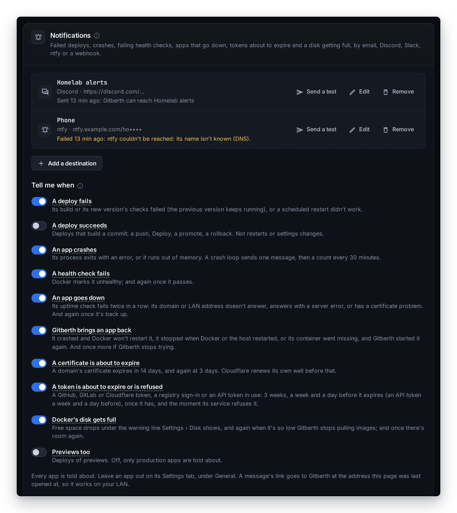

The events are switches under **Tell me when**. With no destination the section says **Nothing is sent yet**.

| Field or button | What it does | Default |
|---|---|---|
| **Add a destination** | Opens a dialog for one place messages go (**Send to** picks the kind; **Name** is what the list calls it): **Email** (mail server, port, **STARTTLS** or **None**, user name and password, **From**, **To**), **Discord** or **Slack** (the channel's webhook URL), **ntfy** (the topic's URL, and an access token for a topic that needs one) or **Webhook** (a URL, and a bearer token if it wants one). **Add and send a test** saves it encrypted and sends a test. Up to 10. | None: nothing is sent |
| **Send a test** | Sends a test to that destination now. | |
| **Edit** | The same dialog. A secret field (a webhook URL, a token, the password) left empty keeps the saved one; saved secrets are never shown again. | |
| **Remove** | Asks first, then forgets the destination and its secrets. | |
| **A deploy fails** | A failed build, a new version that didn't pass its checks, a scheduled restart that didn't work. | On |
| **A deploy succeeds** | Deploys that build a commit; not restarts, settings changes or starts. | Off |
| **An app crashes** | An error exit or running out of memory, of any container. A crash loop sends one message, then a count every 30 minutes. | On |
| **A health check fails** | Docker marks an app unhealthy, and again once it passes. | On |
| **An app goes down** | Its [uptime check](../guides/uptime-and-status-page.md) fails twice in a row, and again once it's back up. | On |
| **Gitberth brings an app back** | An app meant to run stopped by itself and Gitberth started it again (see [Keep apps running](#keep-apps-running)): once it runs again, once more if Gitberth stops trying after 4 tries, and if its try every 6 hours after that brings it back. | On |
| **A certificate is about to expire** | A domain's certificate expires within 14 days, and again within 3. | On |
| **A token is about to expire or is refused** | A GitHub, GitLab or Cloudflare token, a registry sign-in or an API token in use: 3 weeks, a week and a day before it expires (an API token a week and a day before), once it has, and the moment its service refuses it. | On |
| **Docker's disk gets full** | Free space drops under the warning line (see [Disk](#disk)), again when it's so low Gitberth stops pulling images, and once there's room again. | On |
| **Previews too** | Deploys of previews as well. | Off |

Each destination's row shows where it goes without its secret (`https://discord.com/…`), and how its last message went: **Sent 2 min ago** or **Failed 2 min ago** with the reason. An app's own **Notifications** switch (its Settings tab, **General**) leaves it out; the line under the switches counts the apps left out.

## Registries

Sign-ins for private images, used to pull them and to check them for updates. Public images need none.

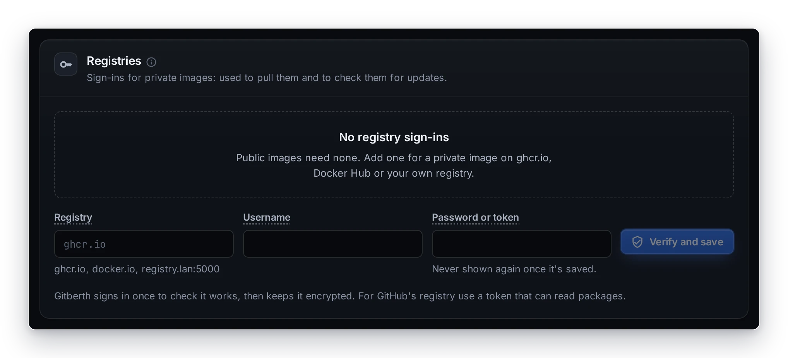

| Field or button | What it does |
|---|---|
| **Registry** | The registry's address, like `ghcr.io`, `docker.io` or a registry on your LAN with its port. Docker Hub's other names count as `docker.io`. |
| **Username** | The user name it signs in with. |
| **Password or token** | Never shown again once it's saved. For GitHub's registry, use a token that can read packages. |
| **Verify and save** | Signs in once through Docker to check it works, then saves it encrypted. For a registry that already has a sign-in, the new one replaces it once it's verified. If the registry refuses, the **Not saved** banner says why and nothing is saved. |
| **Remove** | Asks first. Apps on that registry's private images can't be pulled or checked for updates until you add a sign-in again. Nothing that runs changes. |

Each saved sign-in shows its registry, user name, when it was added, and **signed in …** with when it was last verified (or **saved**). When Gitberth can't read its saved password any more, for example because its keys were lost, it says **needs its password again: enter it below**: type the registry, user name and password again and click **Verify and save**. When the registry turned the sign-in away in an update check, and again when Gitberth signed in with it at once, it says **refused on …: enter its password again**, with a banner at the top of the section and on the dashboard; entering it again takes them away. A registry never says when a sign-in expires, so only its refusal is told. There's one sign-in per registry. Default: none.

**New app** also uses a registry's sign-in to read an image's ports, volumes and health check before it's pulled.

## Updates

How often images are checked for a newer version, and when apps may update on their own. See [Image updates](../guides/updates.md).

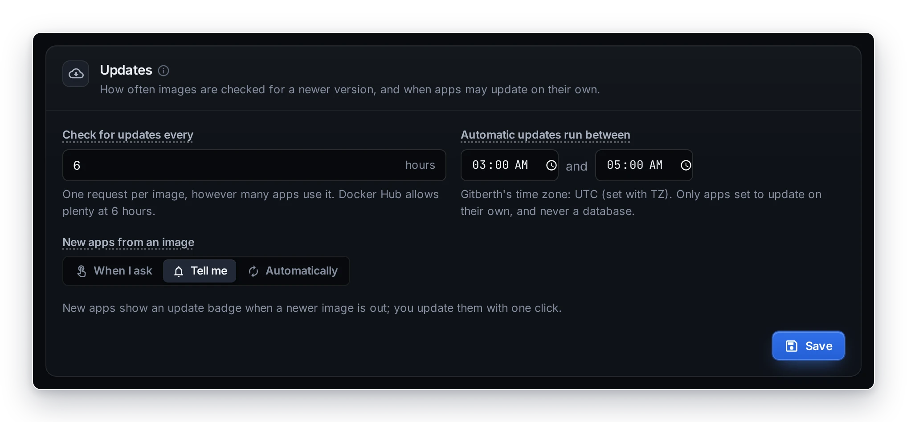

| Field | What it does | Default | When to change it |
|---|---|---|---|
| **Check for updates every** | How many hours apart Gitberth asks a registry about each image, 1 to 168. One request per image, however many apps use it. Apps set to **When I ask** aren't checked. | 6 hours | Shorter to hear of updates sooner; longer to send fewer requests. |
| **Automatic updates run between** | The hours in which apps set to **Automatically** update. A window can run past midnight. The times are in Gitberth's time zone, the `TZ` in its `.env`; the help under the field names it, like **Gitberth's time zone: UTC (set with TZ). Only apps set to update on their own, and never a database.** | 03:00 and 05:00 | To update at a time when nobody uses the apps. |
| **New apps from an image** | The **Updates** choice a new app gets, from a registry, a local image, a pasted `docker run` or Compose service, or the blank form: **When I ask**, **Tell me** or **Automatically**. The line under it says what that means. An image pinned by digest or ID gets **When I ask**, since it can't update, and a database gets **Tell me** instead of **Automatically**. Databases, Gitberth itself and Compose containers never update by themselves. | **Tell me** | Each app's own choice is in its **Settings › Image**. |

Click **Save** to save the section. It refuses an interval outside 1 to 168 hours ("Every 1 to 168 hours."), and a window that starts and ends at the same time ("Give the window some length.").

## Domains (Cloudflare)

Optional: apps on their own domains through the Cloudflare Tunnel on the host. See [Domains](../guides/domains.md).

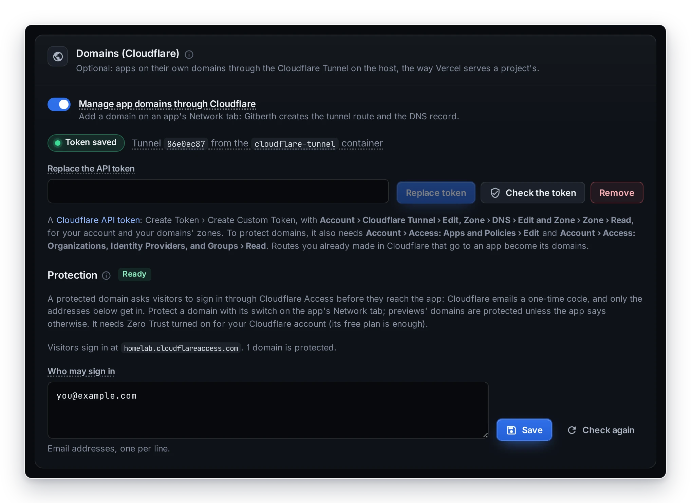

| Field or button | What it does |
|---|---|
| **Manage app domains through Cloudflare** | Off by default. Off, Gitberth doesn't contact Cloudflare or read your tunnel's settings, and your tunnel and DNS stay exactly as you set them. Turned on with a token saved, Gitberth routes every app's domains right away. |
| **Cloudflare API token** (**Replace the API token** once one is saved) | A custom Cloudflare API token with **Account › Cloudflare Tunnel › Edit, Zone › DNS › Edit and Zone › Zone › Read**, for your account and your domains' zones, and **Account › Access: Apps and Policies › Edit** plus **Account › Access: Organizations, Identity Providers, and Groups › Read** to protect domains. |
| **Save token** / **Replace token** | Finds the cloudflared container on the host, checks the token against its tunnel, saves it encrypted, and routes the domains. Routes you already made in Cloudflare that go to an app become its domains. |
| **Check the token** | Asks Cloudflare now whether it takes the saved token, and when it expires: "Cloudflare took the token, and it expires on Dec 1, 2026." (or "and it doesn't expire."), "Cloudflare refused the token: it has expired, or was disabled or deleted. Save a new one." or "Couldn't ask Cloudflare: …. Nothing changed." |
| **Remove** | Forgets the token. Routes already in your tunnel stay as they are. |
| **Who may sign in** (under **Protection**, once a token is saved) | The email addresses that may sign in to protected domains through Cloudflare Access, one per line. **Save** updates every protected domain's Access application. It refuses an address that isn't one, and an empty list while a domain is protected. Default: nobody. |
| **Check again** | Asks Cloudflare again whether protection is ready. |

With domains on, the section shows **Token saved** or **No token**, when a token with an end date expires (**token expires Dec 1, 2026**, with **renew it soon** in its last 3 weeks), and the tunnel Gitberth uses, like **Tunnel 1a2b3c4d from the cloudflared container**, or why it can't use one. Notes under the help text say what the last sync did, and what needs attention. With domains off and a token saved, it shows **Token saved** with **Not used while domains are off.**

While domains are on, Gitberth checks the token with Cloudflare every 6 hours, and at once when Cloudflare turns it away. A banner at the top of the section (and on the dashboard) says when the token expires within 3 weeks, a week or a day, when it has expired, and **Cloudflare refused Gitberth's API token** when it did: domains can't be added, moved or removed until a new token is saved, though the routes already in the tunnel keep working. See [Tokens and sign-ins](../guides/troubleshooting.md#tokens-and-sign-ins).

**Protection** is tagged **Ready** (with where visitors sign in, like **Visitors sign in at homelab.cloudflareaccess.com.**, and how many domains are protected) or **Not set up**, with a **Protection isn't ready** banner saying what's missing. A domain is protected with its **Protected** switch on the app's Network tab; see [Protect a domain](../guides/domains.md#protect-a-domain).

## Uptime and status page

How often every app is checked from outside, and the public status page. See
[Uptime checks, the status page and the down page](../guides/uptime-and-status-page.md).

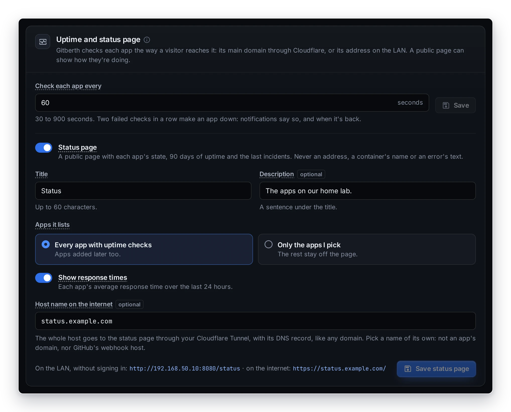

| Field or button | What it does | Default |
|---|---|---|
| **Check each app every** | How many seconds apart each app is checked, 30 to 900. Two failed checks in a row make an app down. **Save** saves it. | 60 seconds |
| **Status page** | A public page with each listed app's state, 90 days of uptime and the last 14 days' incidents. On your network at `/status` and `/status.json` without signing in; while it's off both answer 404. | Off |
| **Title** | The page's title, up to 60 characters. | **Status** |
| **Description** | A sentence under the title, up to 280 characters. | None |
| **Apps it lists** | **Every app with uptime checks** (apps added later too), or **Only the apps I pick**, from the list under it. | Every app with uptime checks |
| **Show response times** | Each app's average response time over the last 24 hours. | Off |
| **Host name on the internet** | Needs domains: a host name nothing else uses, like `status.example.com`. The tunnel sends the whole host to the status page, with its DNS record like any domain, and nothing else of Gitberth's answers there. Not an app's domain, nor GitHub's webhook host. Emptied, its route and the DNS record Gitberth added go. | None |
| **Save status page** | Saves the status page's settings. The line next to it links the page on your network and on the internet, or says **Off: /status answers 404.** | |

Every change is recorded in the audit log.

## Keep apps running

Apps that stop by themselves, and containers that go missing, are started again: an app that's meant to run but crashed
and that its restart policy doesn't start, stopped when Docker or the host restarted, or lost its container. An app you
stopped, in Gitberth or with `docker stop`, stays stopped. See
[When an app stops by itself](../guides/health-and-monitoring.md#when-an-app-stops-by-itself).

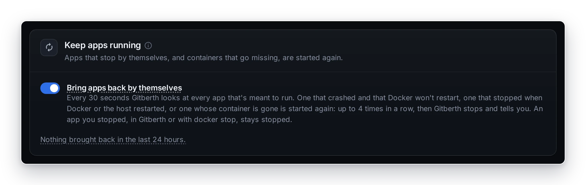

| Field or button | What it does | Default |
|---|---|---|
| **Bring apps back by themselves** | Every 30 seconds Gitberth looks at every app that's meant to run and brings back one that stopped by itself: up to 4 tries in a row (at once, then 1, 5 and 15 minutes after the try before), then it tells you and only tries every 6 hours. Off, every stopped app is left as it is. Saved at once. | On |
| **Gitberth stopped bringing these back** | Shown only when there are some: each app it gave up on, why, and when. **Start** starts it as its own Start button does; its tries count from the first again. | |
| The line under them | How many times Gitberth brought an app back in the last 24 hours, and which apps, like **Brought back 3 times in the last 24 hours: orders-api and website.** | |

Every change of the switch is recorded in the audit log.

## Network

How devices on your LAN reach containers. See [Networking](../guides/networking.md).

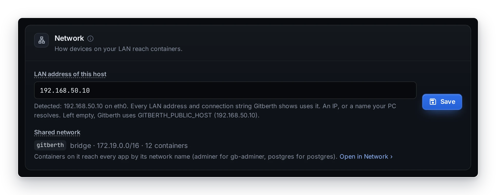

| Field | What it does | Default | When to change it |
|---|---|---|---|
| **LAN address of this host** | The address every LAN address and connection string Gitberth shows uses: an IP, or a name your PC resolves. The help under it shows the address Gitberth detected and the interface it's on. | Empty: Gitberth uses `GITBERTH_PUBLIC_HOST` if it's set, else the detected address, else the address your browser used. | When the detected address is the wrong one, or you'd rather use a name. |

Click **Save** to save it. When the saved address isn't one of the host's any more, a banner says so, shows the detected address, and **Use it** saves that one instead.

**Shared network** shows the Docker network every app is on (`gitberth` by default), its driver, subnet and how many containers are on it, with **Open in Network ›**.

## Own LAN addresses

Lets a container have an address of its own on your LAN, from a block you keep out of the router's DHCP range. Off by default; the tag next to the title says **On** or **Off**. See [Give a container its own LAN address](../guides/networking.md#give-a-container-its-own-lan-address).

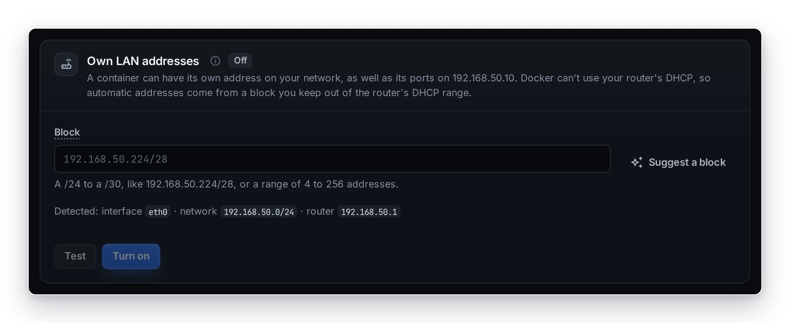

While it's off:

| Field or button | What it does |
|---|---|
| **Block** | The addresses Gitberth gives out: a /24 to a /30 like `192.168.50.224/28`, or a range of 4 to 256 addresses. The line under it says what the block covers, or what's wrong with it. |
| **Suggest a block** | Fills in the highest /28 of the host's network where no device answers. |
| **Test** | A helper tries every address of the block and the router, and lists what it found. Nothing is kept. |
| **Turn on** | Makes the Docker network `gitberth-lan` on the host's interface, tests the block from it, and keeps it only when the test passes. |

The section also shows what Gitberth detected: the interface, the network and the router. If Gitberth can't set this up, a **Gitberth can't set this up yet** banner says why.

While it's on, the section shows the **Block**, the **Containers** that have an address (each links to its app), and **Turn off…**, which lists the containers that would lose their address and asks first.

## Deploys

How often Gitberth looks for new commits. Docker's build cache is under [Disk](#disk).

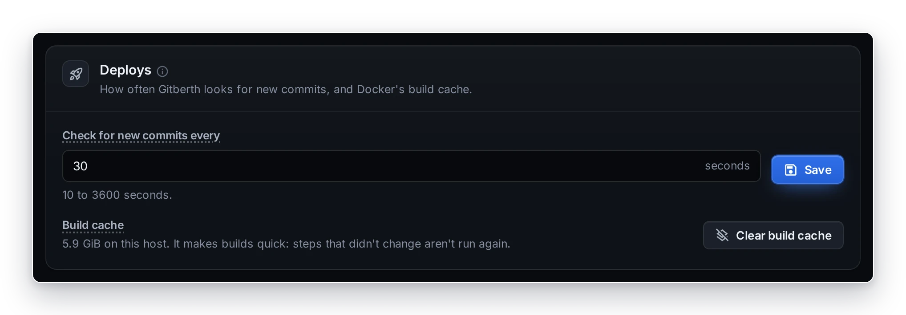

| Field | What it does | Default | When to change it |
|---|---|---|---|
| **Check for new commits every** | How many seconds apart Gitberth runs one `git ls-remote` per repo, 10 to 3600. | 30 seconds | Longer for fewer requests to GitHub; each app also has its own **Deploy on push** switch. |

Click **Save** to save it. Gitberth checks right away with the new interval.

## Disk

Docker's disk: how full it is, what takes the room, and what Gitberth cleans up by itself so that it doesn't fill up. See
[Docker's disk is filling up](../guides/troubleshooting.md#dockers-disk-is-filling-up).

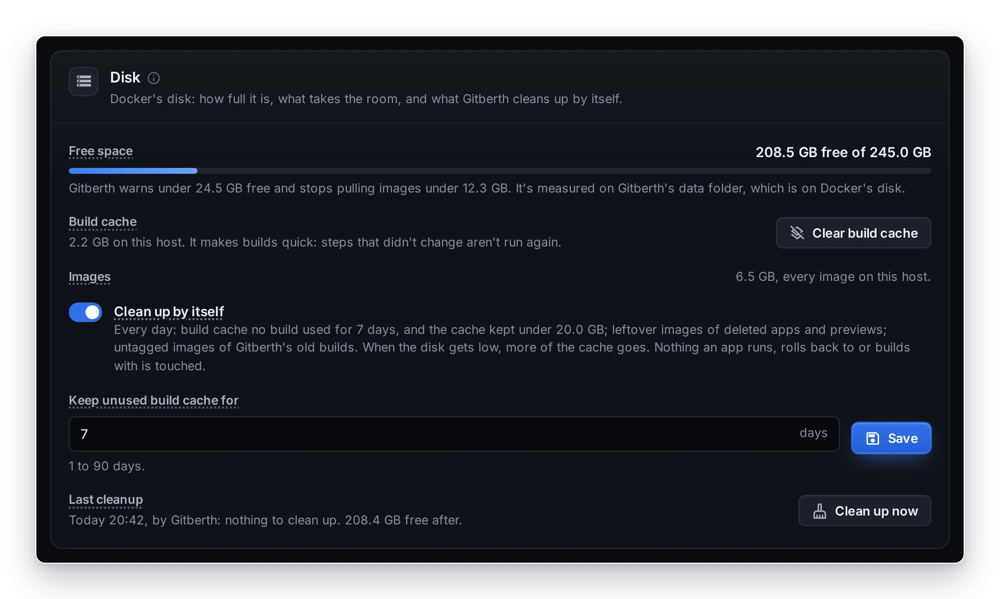

| Field or button | What it does | Default |
|---|---|---|
| **Free space** | What's free of the disk's size, like **41.2 GB free of 64.0 GB**, with a bar, and **Getting low** or **Almost full**. The line under it says where the two lines are on this disk: "Gitberth warns under 15.0 GB free and stops pulling images under 5.0 GB." It's measured on Gitberth's data folder, which is on Docker's disk. | |
| **Build cache** | How much room Docker's build cache takes on the host, such as **1.2 GB on this host**, and how much of it no build used for the days below: what the next cleanup removes. The cache keeps each step of every app's builds, so a step whose files didn't change isn't run again and builds are quick. Once a Railpack build has run, a line under it says what [Railpack's builds](railpack.md#which-builder-runs-it) take in their own cache: **Railpack's builds (gitberth-buildkit): 1.2 GB**. | |
| **Clear build cache** | Asks first, then deletes all of the build cache, Railpack's too: gitberth-buildkit and its volume go, and the next Railpack build makes them again. Nothing that runs changes, but the next build of each app runs every step again, so it takes longer. Afterwards Gitberth says how much it freed, like **Cleared the build cache: 3.4 GB freed, Railpack's own cache included. The next builds take longer, since every step runs again.** While a build or a cleanup runs, it's refused, and says which: clear it once that's done. To build one app without the cache instead, use **Deploy without the build cache**; see [Deploys and rollbacks](../guides/deploys-and-rollbacks.md#without-the-build-cache). | |
| **Images** | What every image on the host takes, each layer counted once. Not shown on Docker engines older than 23 (API 1.42). | |
| **Clean up by itself** | Once a day Gitberth removes the build cache no build used for the days below, keeps the cache under a tenth of the disk (2 to 20 GB), removes the untagged images of its own old builds and the images of deleted apps it was asked to remove, and each app's images beyond the ones it keeps for **Roll back**. When the disk is getting low it also removes the build cache no build used for a day; when it's almost full, all the build cache no build is using. It never removes an image an app runs, names, rolls back to or a container uses, nor anything a build uses: it holds builds off while it runs, and a deploy that gets to its build waits for it. A cleanup Docker fails or refuses is tried again a few minutes later. Railpack's cache too: while gitberth-buildkit runs, the cleanup removes what no Railpack build used for the days below, and once no app uses Railpack, it removes gitberth-buildkit and its volume. Off, it only warns. | On |
| **Keep unused build cache for** | How many days the build cache a build hasn't used is kept, 1 to 90. **Save** saves it. | 7 days |
| **Last cleanup** | When the disk was last cleaned up and by whom, what it freed, and what was free after it, like **Today 04:12, by Gitberth: 2.1 GB freed (build cache 2.0 GB, 3 images). 41.2 GB free after.** | |
| **Clean up now** | Runs the daily cleanup now, as you, and says what it freed: **Cleaned up: 2.1 GB freed.** or **Nothing to clean up.** When Docker fails or refuses it, it says what Docker said. Refused while a build runs or the build cache is being cleared, and while another cleanup does. | |
| **Images of deleted apps** | Shown only when there are some: each deleted app's images still on the host, with how many and about how much room they take. **Kept when the app was deleted** when it was deleted with **Also delete its images** unticked; **Waiting to be removed: a container uses it** when its deletion asked for them to go, and Gitberth removes them once nothing uses them. An image another app names (an app made from a local image, say) isn't listed: it's that app's. | |
| **Remove these images** | Asks first, listing them, then removes the images it listed: an app deleted meanwhile keeps its own until they're listed and asked about too. One a container still uses stays, and Gitberth removes it once nothing does. | |

Every change of the switch or the days, and every cleanup that removed something, is recorded in the
[audit log](../guides/audit-log.md).

## Databases

The Postgres servers apps' databases go on. Each app adds its own on its Settings tab › **Databases**: a database and a
role of its own, or a Redis. See [Databases](../guides/databases.md).

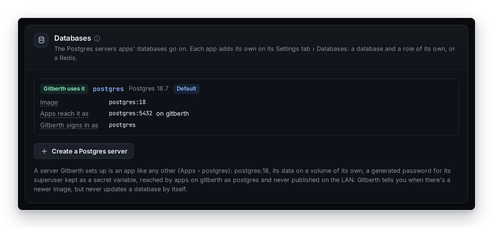

| Field or button | What it does | Default |
|---|---|---|
| The servers | Every container of a Postgres image on the host: **Gitberth uses it**, or **Not usable** with why (it isn't running, it isn't on Gitberth's network, or Gitberth can't sign in to it as its superuser inside its container). Each shows its **Image** and version, how **Apps reach it as** (`postgres:5432` on `gitberth`), and who **Gitberth signs in as**. With none, the section says **No Postgres server yet**. | |
| **Default** / **Make it the default** | The server new databases go on. An app can still pick another when it adds a database. With several and none chosen, a **Choose where new databases go** box asks you to. | The only server Gitberth can use, when there's one |
| **Create a Postgres server** | Pulls `postgres:18` and makes an app of it: container `postgres` (or the first free name after it), reached by that name on Gitberth's network and published nowhere, its data on a volume of its own, a generated superuser password kept as a secret variable, updates that only tell. It becomes the default unless one was chosen. | |

Choosing the default and setting up a server are recorded in the audit log.

## Save and restore

One file with everything this host runs, compressed and encrypted with a passphrase, to bring it all back here or on
another machine. See [Back up and restore](../guides/backups-and-restore.md).

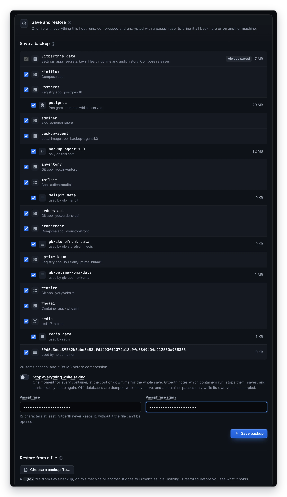

Under **Save a backup**:

| Field or button | What it does | Default |
|---|---|---|
| The list | Everything that can be saved, each with its size on this host (**measuring…** while Docker measures a volume): **Gitberth's data** (always saved), each app with its volumes and databases under it, database servers (dumped while they serve), other containers such as cloudflared, and images only this host has. Unticking an app unticks what's under it; ticking a volume ticks its app. The line under it sums up what's chosen, like **6 items chosen: about 1.2 GB before compression.** | Everything ticked but caches and samples |
| **Stop everything while saving** | Stops every running container (Gitberth aside) for the whole save, then starts exactly those again: one moment for all of them, at the cost of downtime. The list is written down first, so a restart of Gitberth in the middle still starts them again. Off, databases are dumped while they serve, and a container is paused only while its own volume is copied. | Off |
| **Passphrase** and **Passphrase again** | The passphrase the file is encrypted with, twice: at least 12 characters. Gitberth never keeps it: without it, the file can't be opened. | |
| **Save backup** | The browser downloads `gitberth-backup-<date>.gbak` while Gitberth makes it. The line under it says what's being saved and how much is written, then **Saved 6 items: 1.1 GB, compressed and encrypted.**, or **The save failed: …** with why. | |

Under **Restore from a file**, offered in any Gitberth (while a restore runs, it says so instead):

| Field or button | What it does |
|---|---|
| **Choose a backup file…** | Uploads a `.gbak` file, with its progress and **Cancel**. Upload it from Gitberth's LAN address: through a Cloudflare domain an upload stops at 100 MB. |
| **Its passphrase** and **Open the file** | Opens the file and lists what it holds, restoring nothing: where and when it was saved, by which Gitberth, and each app and container with what's under it. A wrong passphrase says **This passphrase doesn't open the file.**; a damaged file, one that isn't a backup, or one from a newer Gitberth says so in a banner. |
| The list's boxes | One per app and container in the file: tick what comes back. Its volumes, databases and images come with it. Under one that isn't here, **Comes back as it was**; under one that's here, **Replace it** or **Restore as a copy named** with a free name you can change. A line under a row says what's worth knowing here, such as a host port that's taken. See [Bring back one app](../guides/backups-and-restore.md#bring-back-one-app). |
| **Restore the picked items** | Asks first (type `restore` when one replaces what's here), then opens the **Restoring** page: its steps and live log. There's no restart, and nothing else here changes. |
| **Restore everything…** | Only on a Gitberth with no apps yet, with the warnings for this host. Asks you to type `restore`, then brings back all of it and opens the **Restoring** page. Gitberth restarts on the saved data partway through; afterwards you sign in with the admin password of the machine the backup was saved on. A warning in red keeps it off until it's dealt with. |
| **Remove the file** | Deletes the uploaded file without restoring it. |

While this Gitberth has no apps, the dashboard says **Moving from another machine? Restore a backup.**, and while a
restore runs, **A restore is running** with a link to its page.

## Admin password

The section says **Sign in as admin. Use at least 10 characters. Changing it signs every other browser out.**

| Field | What it does |
|---|---|
| **Current password** | The password you sign in with now. |
| **New password** and **New password again** | The new one, twice. |

Click **Change password**. Every other browser that's signed in goes to the sign-in page: on its next request, or within a minute for a page that's left open. The browser you changed it in stays signed in and says **Password changed. Every other browser is signed out.** See [Security](../concepts/security.md#sign-in-and-the-lockout).

## AI agents and API

Tokens for AI agents (over MCP, at `/mcp`) and scripts (the HTTP API, at `/api/v1`), which use them instead of signing in. See [AI agents and the API](../guides/ai-agents.md).

| Field or button | What it does | Default |
|---|---|---|
| **Name** | What will use the token, like `Claude Code`. The audit log names the token for everything it does. Up to 50 characters, and no two tokens in use share one. | |
| **Expires** | **30 days**, **90 days**, **1 year** or **Never**. An expired token stops working by itself, and its expiry is recorded in the audit log. | 90 days |
| **Access** | **Read** (sees everything, changes nothing), **Operate** (Read, plus deploy, restart, start, stop, roll back, cancel, promote, updates, cron jobs and previews on or off) or **Admin** (full control of this host, like signing in: it can create apps whose containers reach the whole host, so treat it like the admin password). | Read |
| **Create token** | Makes it and shows it once (`gbt_` and 43 characters), with a copy button and the setup for **Claude Code**, **VS Code**, **Cursor**, **Claude Desktop**, **Other MCP clients** and the **HTTP API (curl)**. Gitberth keeps only its SHA-256 and its first characters. | |
| **Revoke** | Ends the token at once: every request with it gets 401. It stays in the list, marked **Revoked**. | |

The fields are under **Create a token**. Each token in the list shows its name, access, first characters (`gbt_AbCd1234…`), when it was **Created**, when and from which address it was **Last used**, and when it **Expires** (or **Expired**), with **expires in 5 days** (or **tomorrow**, **today**) by its name in its last week. A token something used in the last 30 days is also warned about with a banner, here and on the dashboard, a week and a day before it expires and once it has (see [When a token expires](../guides/ai-agents.md#when-a-token-expires)). The section also shows the **MCP server**'s and the **HTTP API**'s addresses, with copy buttons, and where the OpenAPI description is (`/api/v1/openapi.json`).

No tool makes, lists or revokes tokens, changes the admin password, or turns off the audit log's recording of changes made outside Gitberth. That's a promise about the tools: for a Read or Operate token it's the whole story, but an Admin token can create an app whose container reaches the whole host, and from there those too. Making and revoking a token, and its expiry, are recorded in the audit log, by name and access, never the token.

## Audit log

Every change to this Gitberth and its apps, who made it and how it ended, in a file of its own. See [Audit log](../guides/audit-log.md).

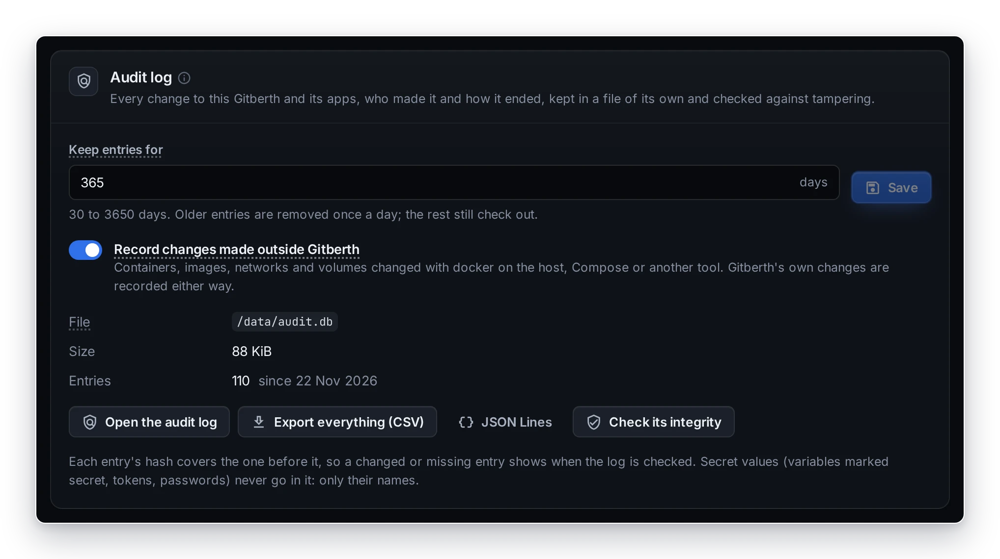

| Field or button | What it does | Default |
|---|---|---|
| **Keep entries for** | How many days entries are kept, 30 to 3650. Older ones are removed once a day, and the rest still check out. | 365 days |
| **Record changes made outside Gitberth** | Containers, images, networks and volumes changed with `docker` on the host, Compose or another tool, each recorded as Docker's. Gitberth's own changes are recorded either way. | On |
| **Save** | Saves both. The change is itself an entry in the log, made off or on. It refuses a number of days outside the limits ("Keep entries for 30 to 3650 days."). | |
| **Open the audit log** | The **Audit log** page, where entries are searched, filtered and opened. | |
| **Export everything (CSV)**, **JSON Lines** | Downloads every entry in the log. | |
| **Check its integrity** | Walks the chain of hashes and says **The audit log is intact**, or which entry was changed. | |

The section also shows the log's **File** (`/data/audit.db`), its **Size**, and how many **Entries** it holds and since when.

## System

What this Gitberth installation is talking to. Nothing here can be changed.

| Line | What it shows |
|---|---|
| **Docker engine** | The engine's version and the docker CLI's, or **Not reachable** with the reason. |
| **git** | The version of git Gitberth uses, or **Not found**. |
| **Railpack** | The version of Railpack in this image, and the state of gitberth-buildkit, where its builds run: `0.43.0 · builds in gitberth-buildkit (running)`, `(stopped until a build needs it)` or `(made on the first Railpack build)`. **Not in this image** for an image built without it. See [Railpack builds](railpack.md#which-builder-runs-it). |
| **Data folder** | Where Gitberth keeps its data inside its container, `/data` in the published image. |
| **Version** | Gitberth's version, and the commit a published image was built from, like `1.8.0 (3f9c2ab)`. |

## Related

- [Configuration](configuration.md)
- [App settings](app-settings.md)
- [Tools for AI agents and the HTTP API](api.md)
- [Security](../concepts/security.md)
