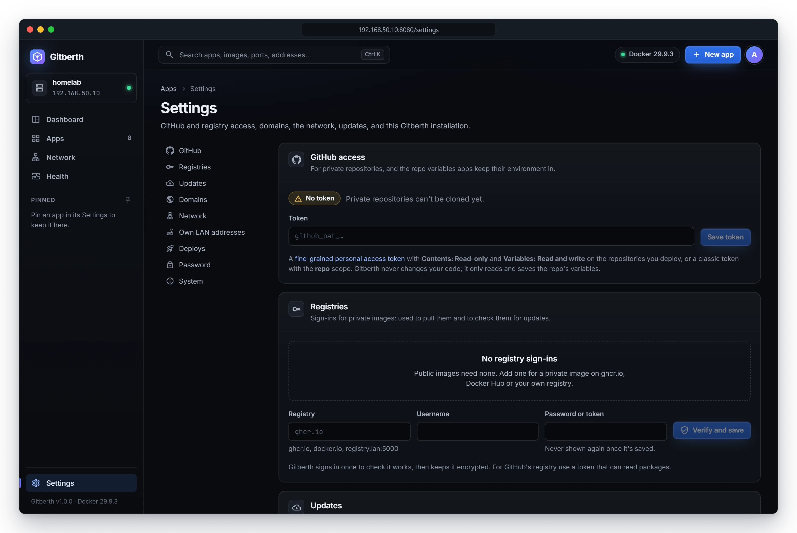
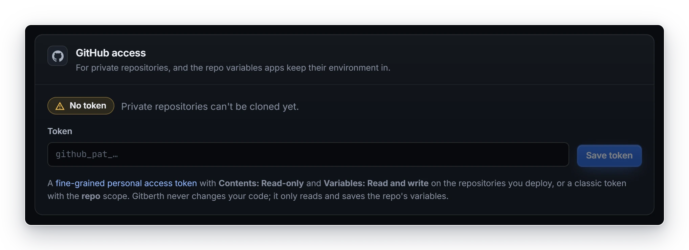
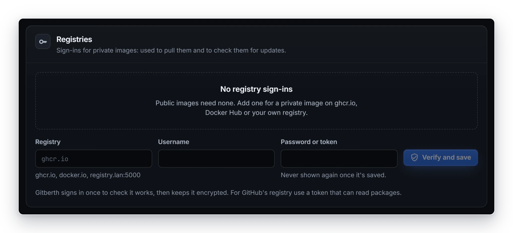
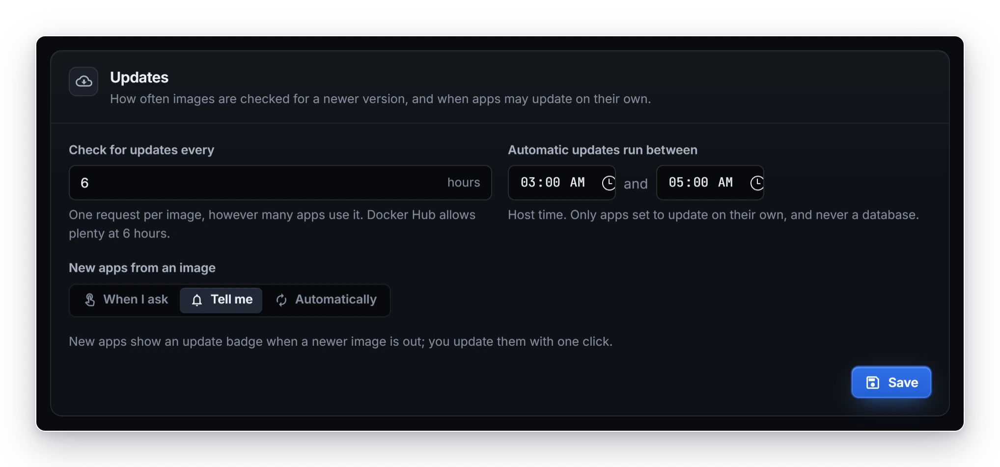
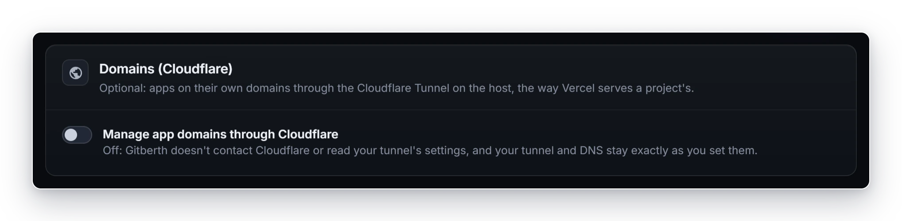
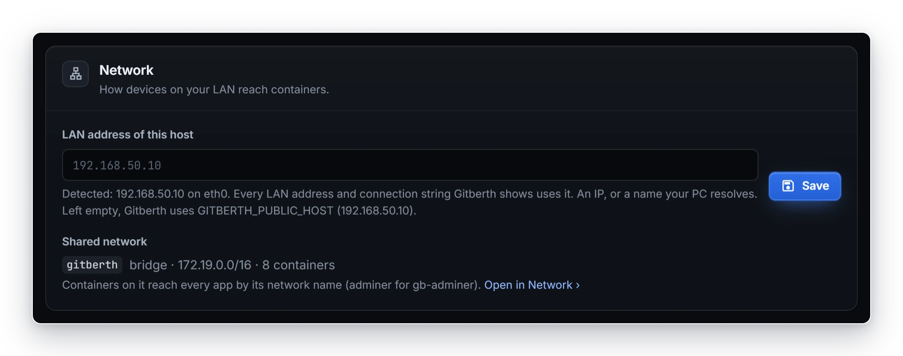
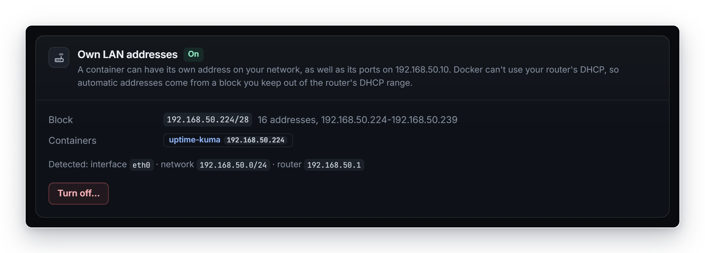
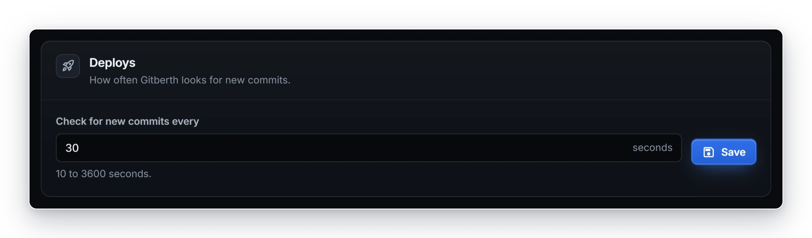

# Gitberth's settings

The **Settings** page holds the settings for Gitberth as a whole: GitHub and registry access, notifications, image updates, domains, the network, deploys, the admin password, and what this installation runs on. Open it from **Settings** at the bottom of the sidebar, or from the account menu (**A**) at the top right. Each app has its own settings on its page instead; see [App settings](app-settings.md).

The list on the left jumps to each section: **GitHub access**, **GitHub integration**, **Notifications**, **Registries**, **Updates**, **Domains** (the **Domains (Cloudflare)** section), **Network**, **Own LAN addresses**, **Deploys**, **Admin password** and **System**. Each section saves on its own.

Gitberth's own process settings, such as the data folder and the Docker address, are environment variables instead: see [Configuration](configuration.md).

## GitHub access

For private repositories, and the repo variables apps keep their environment in.

| Field or button | What it does |
|---|---|
| **Token** (**Replace the token** once one is saved) | A GitHub personal access token. A fine-grained token needs **Contents: Read-only** and **Variables: Read and write** on the repositories you deploy, and for [GitHub integration](#github-integration) **Commit statuses: Read and write**, **Pull requests: Read and write** and **Webhooks: Read and write**; a classic token needs the **repo** and **admin:repo_hook** scopes. Gitberth never changes your code. |
| **Save token** / **Replace token** | Asks GitHub who owns the token, then saves it encrypted. An invalid or expired token isn't saved. |
| **Remove** | Forgets the token. Private repos can't be cloned until you add one again. |

Once saved, the section shows **Token saved**, the GitHub account it belongs to, and when it expires. In its last 14 days the expiry is highlighted with **renew it soon**. Without a token it shows **No token** and **Private repositories can't be cloned yet.** Public repos need no token.

Default: no token. Saving a token makes Gitberth check every repo again right away, and try again whatever GitHub refused the last token. See [Deploy from GitHub](../guides/deploy-from-github.md) for how to create one.

## GitHub integration

Deploys reported on GitHub, and deploys that start the moment you push. See [GitHub integration](../guides/github-integration.md).

| Field or button | What it does | Default |
|---|---|---|
| **Commit statuses** | Each deploy that builds a commit marks it on GitHub: pending while it builds, then live (linking to the app) or failed (linking to the deploy log). A commit that was skipped gets success, saying why. One status per app, named **Gitberth: <app>**, and **Gitberth preview: <app>** for its previews. Needs **Commit statuses: Read and write**. | On |
| **Comments on pull requests** | A preview of a pull request keeps one comment on it up to date: its state, address, commit and time. Needs **Pull requests: Read and write**. | On |
| **Host name for GitHub's webhooks** | Instant deploys, shown while domains are on: a host name nothing else uses, like `hooks.example.com`. Only its addresses `/hooks/github` and `/hooks/deploy/<token>` ([deploy hooks](../guides/deploy-hooks.md)) go to Gitberth through the tunnel, never behind Access; every other address answers 404. **Turn on** routes it and adds the DNS record; **Save** moves it to another name; **Turn off** asks first, then takes its route out. | None: Gitberth checks every 30 seconds, and deploy hooks work on your network only |
| **Payload URL**, **Content type**, **Secret**, **Events** | What GitHub's webhook needs, to add it by hand when the token can't (no **Webhooks: Read and write**). **Show** reveals the secret; the copy buttons copy. | |

When GitHub refuses one of these on a repo, a banner says which permission is missing (for example **Commit statuses aren't set on acme/web**) and Gitberth stops asking on that repo for an hour, or until a token is saved again; the banner goes with the hour, and comes back if GitHub refuses again. Other repos carry on. A token GitHub refuses outright stops it everywhere (**Commit statuses aren't set: GitHub refused the token**). A list under the webhook values says, per repo, **Webhook added**, **Webhook set up** or why not. With domains off, the section says instant deploys need them.

## Notifications

Failed deploys, crashes and failing health checks, by email, Discord, Slack, ntfy or a webhook. See [Notifications](../guides/notifications.md).

| Field or button | What it does | Default |
|---|---|---|
| **Add a destination** | Opens a dialog for one place messages go: **Email** (mail server, port, **STARTTLS** or **None**, user name and password, **From**, **To**), **Discord** or **Slack** (the channel's webhook URL), **ntfy** (the topic's URL, and an access token for a topic that needs one) or **Webhook** (a URL, and a bearer token if it wants one). **Add and send a test** saves it encrypted and sends a test. Up to 10. | None: nothing is sent |
| **Send a test** | Sends a test to that destination now. | |
| **Edit** | The same dialog. A secret field (a webhook URL, a token, the password) left empty keeps the saved one; saved secrets are never shown again. | |
| **Remove** | Asks first, then forgets the destination and its secrets. | |
| **A deploy fails** | A failed build, a new version that didn't pass its checks, a scheduled restart that didn't work. | On |
| **A deploy succeeds** | Deploys that build a commit; not restarts, settings changes or starts. | Off |
| **An app crashes** | An error exit or running out of memory, of any container. A crash loop sends one message, then a count every 30 minutes. | On |
| **A health check fails** | Docker marks an app unhealthy, and again once it passes. | On |
| **Previews too** | Deploys of previews as well. | Off |

Each destination's row shows where it goes without its secret (`https://discord.com/…`), and how its last message went: **Sent 2 min ago** or **Failed 2 min ago** with the reason. An app's own **Notifications** switch (its Settings tab, **General**) leaves it out; the line under the switches counts the apps left out.

## Registries

Sign-ins for private images, used to pull them and to check them for updates. Public images need none.

| Field or button | What it does |
|---|---|
| **Registry** | The registry's address, like `ghcr.io`, `docker.io` or a registry on your LAN with its port. Docker Hub's other names count as `docker.io`. |
| **Username** | The user name it signs in with. |
| **Password or token** | Never shown again once it's saved. For GitHub's registry, use a token that can read packages. |
| **Verify and save** | Signs in once through Docker to check it works, then saves it encrypted. For a registry that already has a sign-in, the new one replaces it once it's verified. If the registry refuses, the **Not saved** banner says why and nothing is saved. |
| **Remove** | Asks first. Apps on that registry's private images can't be pulled or checked for updates until you add a sign-in again. Nothing that runs changes. |

Each saved sign-in shows its registry, user name, when it was added, and **signed in …** with when it was last verified (or **saved**). When Gitberth can't read its saved password any more, for example because its keys were lost, it says **needs its password again: enter it below**: type the registry, user name and password again and click **Verify and save**. There's one sign-in per registry. Default: none.

**New app** also uses a registry's sign-in to read an image's ports, volumes and health check before it's pulled.

## Updates

How often images are checked for a newer version, and when apps may update on their own. See [Image updates](../guides/updates.md).

| Field | What it does | Default | When to change it |
|---|---|---|---|
| **Check for updates every** | How many hours apart Gitberth asks a registry about each image, 1 to 168. One request per image, however many apps use it. Apps set to **When I ask** aren't checked. | 6 hours | Shorter to hear of updates sooner; longer to send fewer requests. |
| **Automatic updates run between** | The hours in which apps set to **Automatically** update. A window can run past midnight. The times are in Gitberth's time zone, the `TZ` in its `.env`; the help under the field names it, like **Gitberth's time zone: UTC (set with TZ). Only apps set to update on their own, and never a database.** | 03:00 and 05:00 | To update at a time when nobody uses the apps. |
| **New apps from an image** | The **Updates** choice a new app gets, from a registry, a local image, a pasted `docker run` or Compose service, or the blank form: **When I ask**, **Tell me** or **Automatically**. The line under it says what that means. An image pinned by digest or ID gets **When I ask**, since it can't update, and a database gets **Tell me** instead of **Automatically**. Databases, Gitberth itself and Compose containers never update by themselves. | **Tell me** | Each app's own choice is in its **Settings › Image**. |

Click **Save** to save the section. It refuses an interval outside 1 to 168 hours ("Every 1 to 168 hours."), and a window that starts and ends at the same time ("Give the window some length.").

## Domains (Cloudflare)

Optional: apps on their own domains through the Cloudflare Tunnel on the host. See [Domains](../guides/domains.md).

| Field or button | What it does |
|---|---|
| **Manage app domains through Cloudflare** | Off by default. Off, Gitberth doesn't contact Cloudflare or read your tunnel's settings, and your tunnel and DNS stay exactly as you set them. Turned on with a token saved, Gitberth routes every app's domains right away. |
| **Cloudflare API token** (**Replace the API token** once one is saved) | A custom Cloudflare API token with **Account › Cloudflare Tunnel › Edit, Zone › DNS › Edit and Zone › Zone › Read**, for your account and your domains' zones, and **Account › Access: Apps and Policies › Edit** plus **Account › Access: Organizations, Identity Providers, and Groups › Read** to protect domains. |
| **Save token** / **Replace token** | Finds the cloudflared container on the host, checks the token against its tunnel, saves it encrypted, and routes the domains. Routes you already made in Cloudflare that go to an app become its domains. |
| **Remove** | Forgets the token. Routes already in your tunnel stay as they are. |
| **Who may sign in** (under **Protection**, once a token is saved) | The email addresses that may sign in to protected domains through Cloudflare Access, one per line. **Save** updates every protected domain's Access application. It refuses an address that isn't one, and an empty list while a domain is protected. Default: nobody. |
| **Check again** | Asks Cloudflare again whether protection is ready. |

With domains on, the section shows **Token saved** or **No token**, and the tunnel Gitberth uses, like **Tunnel 1a2b3c4d from the cloudflared container**, or why it can't use one. Notes under the help text say what the last sync did, and what needs attention. With domains off and a token saved, it shows **Token saved** with **Not used while domains are off.**

**Protection** is tagged **Ready** (with where visitors sign in, like **Visitors sign in at acme.cloudflareaccess.com.**, and how many domains are protected) or **Not set up**, with a **Protection isn't ready** banner saying what's missing. A domain is protected with its **Protected** switch on the app's Network tab; see [Protect a domain](../guides/domains.md#protect-a-domain).

## Network

How devices on your LAN reach containers. See [Networking](../guides/networking.md).

| Field | What it does | Default | When to change it |
|---|---|---|---|
| **LAN address of this host** | The address every LAN address and connection string Gitberth shows uses: an IP, or a name your PC resolves. The help under it shows the address Gitberth detected and the interface it's on. | Empty: Gitberth uses `GITBERTH_PUBLIC_HOST` if it's set, else the detected address, else the address your browser used. | When the detected address is the wrong one, or you'd rather use a name. |

Click **Save** to save it. When the saved address isn't one of the host's any more, a banner says so, shows the detected address, and **Use it** saves that one instead.

**Shared network** shows the Docker network every app is on (`gitberth` by default), its driver, subnet and how many containers are on it, with **Open in Network ›**.

## Own LAN addresses

Lets a container have an address of its own on your LAN, from a block you keep out of the router's DHCP range. Off by default; the tag next to the title says **On** or **Off**. See [Give a container its own LAN address](../guides/networking.md#give-a-container-its-own-lan-address).

While it's off:

| Field or button | What it does |
|---|---|
| **Block** | The addresses Gitberth gives out: a /24 to a /30 like `192.168.50.224/28`, or a range of 4 to 256 addresses. The line under it says what the block covers, or what's wrong with it. |
| **Suggest a block** | Fills in the highest /28 of the host's network where no device answers. |
| **Test** | A helper tries every address of the block and the router, and lists what it found. Nothing is kept. |
| **Turn on** | Makes the Docker network `gitberth-lan` on the host's interface, tests the block from it, and keeps it only when the test passes. |

The section also shows what Gitberth detected: the interface, the network and the router. If Gitberth can't set this up, a **Gitberth can't set this up yet** banner says why.

While it's on, the section shows the **Block**, the **Containers** that have an address (each links to its app), and **Turn off…**, which lists the containers that would lose their address and asks first.

## Deploys

How often Gitberth looks for new commits, and Docker's build cache.

| Field | What it does | Default | When to change it |
|---|---|---|---|
| **Check for new commits every** | How many seconds apart Gitberth runs one `git ls-remote` per repo, 10 to 3600. | 30 seconds | Longer for fewer requests to GitHub; each app also has its own **Deploy on push** switch. |

Click **Save** to save it. Gitberth checks right away with the new interval.

**Build cache** shows how much room Docker's build cache takes on the host, such as **1.2 GiB on this host**. The cache
keeps each step of every app's builds, so a step whose files didn't change isn't run again and builds are quick.

**Clear build cache** asks first, then deletes all of it. Nothing that runs changes, but the next build of each app runs
every step again, so it takes longer. Afterwards Gitberth says how much it freed. While a build runs, it's refused:
clear it once the build is done. To build one app without the cache instead, use **Deploy without the build cache**; see
[Deploys and rollbacks](../guides/deploys-and-rollbacks.md#without-the-build-cache).

## Admin password

The section says **Sign in as admin. Use at least 10 characters. Changing it signs every other browser out.**

| Field | What it does |
|---|---|
| **Current password** | The password you sign in with now. |
| **New password** and **New password again** | The new one, twice. |

Click **Change password**. Every other browser that's signed in goes to the sign-in page: on its next request, or within a minute for a page that's left open. The browser you changed it in stays signed in and says **Password changed. Every other browser is signed out.** See [Security](../concepts/security.md#sign-in-and-the-lockout).

## System

What this Gitberth installation is talking to. Nothing here can be changed.

| Line | What it shows |
|---|---|
| **Docker engine** | The engine's version and the docker CLI's, or **Not reachable** with the reason. |
| **git** | The version of git Gitberth uses, or **Not found**. |
| **Data folder** | Where Gitberth keeps its data inside its container, `/data` in the published image. |
| **Version** | Gitberth's version, and the commit a published image was built from, like `1.0.0 (3f9c2ab)`. |

## Related

- [Configuration](configuration.md)
- [App settings](app-settings.md)
- [Security](../concepts/security.md)
