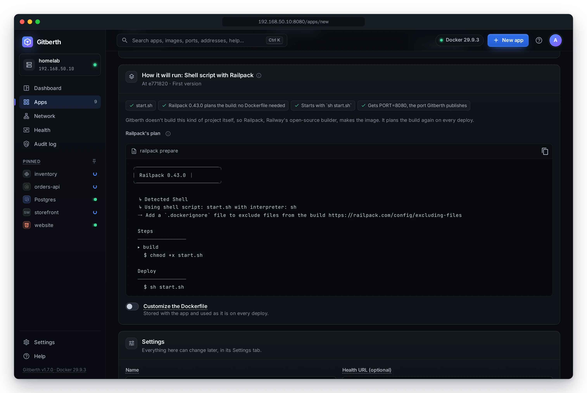

# Railpack builds

[Railpack](https://railpack.com) is Railway's open-source builder. Gitberth uses it for the projects it doesn't know how
to build itself, such as an Elixir app or a shell script, and for any app whose **Build** is set to **Railpack**. This
page says when Gitberth uses it, how it runs it, and what you can set.

## When Gitberth uses Railpack

- **When Gitberth finds nothing it knows.** An app on **Detect automatically** whose folder has no Dockerfile and
  nothing Gitberth builds itself (see [How Gitberth builds](build-detection.md)) is built by Railpack. The deploy log
  says **Gitberth doesn't know this kind of project, so Railpack builds it**. A repo with a Dockerfile still builds with
  its Dockerfile.
- **When the app's Build is Railpack.** Turn on **Build with Railpack** when you add the app, or set **Build** to
  **Railpack** in its **Settings** › **Source**. Railpack then builds every deploy, whatever Gitberth would detect, and
  the repo's Dockerfile isn't used. The log says **Building with Railpack, as the app's settings say**.
- **A repo with a `railpack.json`.** That file tells Railpack how to build the app, so New app turns **Build with
  Railpack** on by itself when the app's folder has one and no Dockerfile. An app you already have doesn't change
  builder when a `railpack.json` appears: set its **Build** yourself.

Railpack isn't tried when Gitberth knows what the project is but can't build it, such as a .NET Framework project or a
`package.json` it can't read: the deploy says why, as before. An app whose deploys failed before because Gitberth
couldn't work out how to build it tries Railpack on its next deploy, and Gitberth builds a failed commit again after
each update, so such an app comes up by itself.

When Railpack can't work out how to build the project either, the deploy fails with **Neither Gitberth nor Railpack
could work out how to build this project.** Nothing is built, and the running container isn't touched. New app shows
Railpack's reason, **Railpack couldn't work out how to build it either: …**, and turns on **Customize the Dockerfile**
with a starter.

## What Railpack adds

These are projects Gitberth doesn't build itself:

| The folder has | Railpack builds |
|---|---|
| `mix.exs` | Elixir, Phoenix included, as a release (`mix release`) |
| `gleam.toml` | Gleam, exported as an Erlang shipment |
| `CMakeLists.txt` or `meson.build` | C or C++, with CMake or Meson and Ninja |
| `build.zig` | Zig, with `zig build` |
| `start.sh` | A shell script, started with `sh start.sh` (or the shell its first line names) |
| `Staticfile` | A static site served by Caddy, with the file's `root` and `index_fallback` |

- **Procfile.** In a Railpack build, a `Procfile` gives the start command: its `web` line, else `worker`, else the first.
- **The languages Gitberth knows** (Node.js, Python, Go, Rust, Ruby, PHP, Java, .NET, Deno and static sites) build the
  way Railway builds them when an app's **Build** is **Railpack**, with Railway's handling of frameworks and monorepos,
  such as Nx, Turborepo, Laravel and Django.
- **Which one it picks.** Railpack takes the first that matches, in this order: PHP, Go, Java, Rust, Ruby, Elixir,
  Python, Deno, .NET, Node.js, Gleam, C/C++, Zig, Staticfile, shell script.

What each language needs, and what it can be told, is in [Railpack's documentation](https://railpack.com), language by
language. Elixir and Gleam need Erlang, which Railpack compiles from source, so their first build takes a long time (see
[Limits](#limits)).

## How Gitberth runs it

1. **The plan.** `railpack prepare` reads the app's folder and writes a build plan: the steps to run and the command that
   starts the app. It runs in a throwaway container of Gitberth's own image, with no Docker socket, none of Gitberth's
   data, a read-only file system and no capabilities, on Gitberth's network so it can look tools' versions up online.
   The repo's `railpack.json`, `mise.toml` and `.tool-versions` are read there, never inside Gitberth. Planning takes
   about a second, and Gitberth stops it after 5 minutes.
2. **Gitberth's edits.** Gitberth keeps the clone's `.git` folder out of the image, and has each step that uses
   build-time values take all of them. That keeps an extra, unpinned image out of the build.
3. **The build** runs in **gitberth-buildkit**, Gitberth's own BuildKit container (see
   [Which builder runs it](#which-builder-runs-it)), one build at a time across all apps, like any build. Railpack's
   builder makes the image from the plan, on Railpack's Debian images, and Gitberth loads it into Docker.
4. **Labels and PORT.** A second, quick build adds Gitberth's labels to the image, plus `gitberth.builder=railpack`
   and the Railpack version, and sets `PORT` (see [Ports](#ports)). It adds no layer. The log says **Adding Gitberth's
   labels to the image, and PORT=8080**. The image is `gitberth/<app>:<commit>`, as for any build.
5. **The swap and the checks** are the same as for any deploy. See
   [Deploys and rollbacks](../guides/deploys-and-rollbacks.md).

- **Steady tool versions.** Railpack picks a tool's version when it plans, such as the newest Node.js 22. A normal
  deploy keeps the versions the running image was built with (they're in its `gitberth.railpack.packages` label), so a
  redeploy doesn't move Node.js 22.11.0 to 22.12.0 by itself. The log says **Keeping the tool versions the running
  image was built with: …**. **Deploy without the build cache** looks them up again, and so does a build after the
  running image was removed.
- **The plan in each deploy's log.** The log shows Railpack's plan as Railpack prints it, then the build's steps. The
  plan Gitberth built with is kept next to the deploy's log, as `logs/deploy-<number>.railpack.json` in Gitberth's
  volume, and goes when the app is deleted.
- **New app** shows the same plan under **Railpack's plan**, with what Railpack found and how the app starts.

## Settings

### railpack.json

The repo's `railpack.json`, in the app's folder, is Railpack's config file. It can set the provider, the tools and
their versions, the steps, the start command and more: see [Railpack's config file](https://railpack.com/config/file).
A broken one fails the plan with **Railpack couldn't read the repo's railpack.json: …**.

### RAILPACK_ variables

A variable whose name starts with `RAILPACK_` configures Railpack's build. It's always a build-time variable: its
**Build time** switch is on and can't be turned off, and changing it marks the app for a rebuild. The main ones:

| Variable | What it does |
|---|---|
| `RAILPACK_BUILD_CMD` | The build command, in place of Railpack's |
| `RAILPACK_INSTALL_CMD` | The install command, in place of Railpack's |
| `RAILPACK_START_CMD` | The command that starts the app |
| `RAILPACK_PACKAGES` | More tools to install, space-separated, like `node@22 python@3.13` |
| `RAILPACK_BUILD_APT_PACKAGES`, `RAILPACK_DEPLOY_APT_PACKAGES` | Debian packages for the build, or for the image |
| `RAILPACK_NODE_VERSION`, `RAILPACK_PYTHON_VERSION`, `RAILPACK_GO_VERSION` and the like | A language's version |
| `RAILPACK_DISABLE_CACHES` | Cache folders to leave out, space-separated, or `*` for all |

[Railpack's list](https://railpack.com/config/environment-variables) has the rest.

**A `RAILPACK_` variable can't be secret.** Railpack writes its settings into the build plan, and the start command
into the image, where anyone who can use Docker on the host reads them. So its **Secret** lock is off and can't be
turned on, and Gitberth doesn't save one that's marked secret or holds a password, such as `--api-key=…` or a URL with
a password in it: **RAILPACK_START_CMD can't be secret: Railpack writes its settings into the build plan and the image,
so keep the secret in a variable of its own and write $NAME in the command.**

- **Name the secret instead.** Keep it in a variable of its own, and write `$NAME` in the setting, such as
  `RAILPACK_START_CMD=./server --api-key $API_KEY`. The start command runs through a shell, where the container's
  variables are, and every build step gets the build-time variables, so a build command can use one that's **Build
  time** too.
- **One that's secret anyway**, such as a GitLab variable masked there, isn't passed to Railpack at all, neither to plan
  nor to build. The deploy log says which, and how to fix it.

### Folder and start command

- **Subfolder** is Railpack's root directory: Railpack plans and builds that folder alone, so files outside it aren't
  seen. A monorepo that shares code between apps builds from the repository's root, with Railpack's own settings, such
  as `RAILPACK_NX_APP`, picking the app.
- **Command**, in the app's **Settings**, replaces Railpack's start command when the container starts.
- Which start command wins, the first of these that's set: the app's **Command**; `deploy.startCommand` in
  `railpack.json`; `RAILPACK_START_CMD`; what Railpack finds. In Railpack 0.43.0 `railpack.json` wins over
  `RAILPACK_START_CMD`, though Railpack's page on Procfiles says the opposite.
- When nothing gives a start command, the plan fails with **Railpack found a … project but no command that starts it.
  Set one in the app's Settings › Command, or as deploy.startCommand in the repo's railpack.json.**

## Ports

- **PORT is the web port.** A Railpack app gets `PORT`, set to its web container port: in the image, and again when its
  container is created, so changing the port needs no rebuild. The log says **The app gets PORT=8080, the port Gitberth
  sends visitors to.** A `PORT` you set on the app wins. An app with no web port gets none.
- **8080 for a new app.** An app Railpack builds because Gitberth found nothing it knows gets container port 8080. An
  app with **Build with Railpack** on keeps the port Gitberth detected, and an app switched to Railpack keeps its port.
- **The app should listen on `$PORT`**, on every interface (`0.0.0.0`). Railpack's own start commands do (Python, Ruby,
  .NET, and Caddy for static sites and PHP), and so do apps written for Railway.
- **An app that listens elsewhere.** When the new container doesn't open its web port in time, Gitberth looks at which
  ports it listens on. If it's exactly one other port, the web port moves there and the container starts again in the
  same deploy, and later deploys keep it: **It listens on port 4000, not 8080, so its web port moves to 4000.** With
  none, or several, the deploy fails and says what it found, such as **… It listens on 4000 and 9000, not 8080: set its
  web port on the Network tab, or have it listen on $PORT.** An app that listens only inside its container gets **… It
  listens on 4000 only inside its container (127.0.0.1): have it listen on 0.0.0.0, on $PORT.**

## Build-time variables and secrets

- **Every build-time value is a secret to Railpack.** Railpack has no build arguments, so each value reaches the build as
  a BuildKit secret: the app's build-time variables, the repo's GitHub or GitLab variables, Vercel's build values, and
  every `RAILPACK_` variable.
- **Every build step gets every value**, as an environment variable, your dependencies' install scripts included. None is
  written into the image or its history.
- **Planning never sees a secret value.** The plan needs only the names, so a secret is passed as a placeholder. Plain
  values are passed as they are, and so are `RAILPACK_` variables, which can't be secret (see [Settings](#settings)).
- **A deploy's error is masked** with the app's secret values, as its log is.
- `PATH`, `HOME`, `PWD`, `HOSTNAME`, `SHLVL`, `TERM`, `TMPDIR` and `NO_COLOR` aren't passed to Railpack's build, since
  every step would get them in place of its own. The log says which.
- A secret the repo's `railpack.json` asks for that the app doesn't set reaches the build empty, and the log warns about
  it.

## Caching

- **Each app has caches of its own**, such as npm's, pip's and Cargo's `target`, and each preview has its own too, so
  one app's build never sees another's.
- **Steps are cached as in a Dockerfile:** a step whose files and commands didn't change isn't run again. A changed
  build-time value builds the steps that use the values again.
- **Deploy without the build cache** runs every step again and looks the tools' versions up again. See
  [Without the build cache](../guides/deploys-and-rollbacks.md#without-the-build-cache).

## Which builder runs it

Railpack builds run in **gitberth-buildkit**, a BuildKit container Gitberth runs itself, from the `moby/buildkit` image
pinned in Gitberth (v0.34.0). Docker's own builder isn't used for them: it can build Railpack's plans only with the
containerd image store, which Docker turns on only for new installs, and its version changes with the host's Docker.

- **It's privileged**, as BuildKit has to be, and on the `gitberth` network. It opens no port: Gitberth reaches it
  through `docker exec`. It doesn't show in Gitberth's lists.
- **It starts when a build needs it.** The first Railpack build on a host makes it, and downloads BuildKit and Railpack's
  builder and runtime images: about 2 GB on disk, a minute or two. The log says **Downloading BuildKit (moby/buildkit
  v0.34.0) for Railpack builds, once**. It stops 10 minutes after the last Railpack build, and the next one starts it
  again in about a second (**Starting gitberth-buildkit, Gitberth's BuildKit for Railpack builds**). It doesn't start
  with the host.
- **Its cache** lives in the `gitberth-buildkit` volume: Railpack's images, every app's build steps and their caches.
  BuildKit keeps it under half the cap Gitberth keeps Docker's build cache under: a twentieth of the disk, 2 to 10 GB.
  **Settings** › **Disk** shows its size under the build cache's, as **Railpack's builds (gitberth-buildkit)**.
- **Cleanup.** When the daily cleanup finds it running, it removes what no build used for the days set in
  **Settings** › **Disk**. Once no app uses Railpack any more, the cleanup removes gitberth-buildkit and its volume.
  **Clear build cache** removes them too; the next Railpack build makes them again, from cold.
- **Settings** › **System** shows Railpack's version and gitberth-buildkit's state on its **Railpack** line.
- **A host that refuses privileged containers** (rootless or hardened Docker) can't build with Railpack. The deploy says
  **Railpack builds run in gitberth-buildkit, which needs a privileged container, and this Docker host refused one: …**.
  Other builds aren't affected.

## Limits

- **The Dockerfile isn't used** when **Build** is **Railpack**. The log says **The repo's Dockerfile isn't used:
  Railpack builds from the source.**
- **Images run as root.** Railpack doesn't set a user.
- **One platform:** the host's own, amd64 or arm64.
- **Erlang compiles from source**, so the first Elixir or Gleam build takes a long time. Later builds reuse it.
- **Other containers by name.** A build step reaches the containers on the `gitberth` network by name, like
  `postgres:5432`, as the app does when it runs. Unlike other builds, it runs on that network rather than on the host's,
  so it doesn't reach a port the host publishes only on `127.0.0.1`.
- **The internet.** Planning looks tools' versions up online, so an app with tools to install needs the internet to plan
  as well as to build. **Railpack couldn't look up the tools' versions online (…). The next deploy tries again.** says
  it couldn't.
- **One Railpack version.** Gitberth ships one, and a new one comes with a new Gitberth.

## The version

This Gitberth ships Railpack **0.43.0**, with mise 2026.10.14, which Railpack uses to look up and install tools. The
Railpack CLI, its BuildKit frontend and mise are pinned together. Both are MIT-licensed (Railpack: © Railway Corp.), and
their licenses are in `THIRD-PARTY-NOTICES.md`, in the repository and in Gitberth's image.

## Related

- [How Gitberth builds each kind of project](build-detection.md)
- [App settings](app-settings.md#source)
- [Environment variables](../guides/environment-variables.md#build-time-variables-git-apps)
- [Deploys and rollbacks](../guides/deploys-and-rollbacks.md#without-the-build-cache)
- [Railpack's documentation](https://railpack.com)
